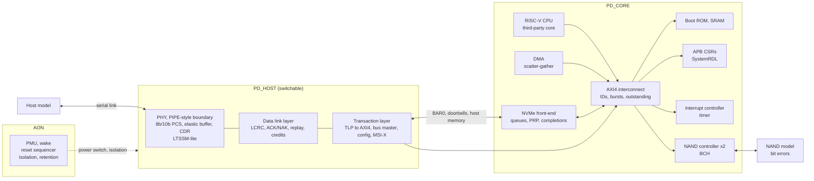

# Storage_SoC

[](https://github.com/yhkwon-git/Storage_SoC/actions/workflows/ci.yml)

A small storage-controller SoC with an NVMe-style front-end over a PCIe-like serial host link.

A RISC-V CPU, an AXI4 interconnect, DMA, SystemRDL-generated CSRs and always-on and switchable power domains form the platform. A host interface (NVMe-style queues and command front-end, a transaction layer that also masters host memory, data link layer, PHY with a PIPE-style boundary) and a NAND-flash datapath with BCH sit on it. Each IP has its own testbench, and the SoC is signed off with a UVM environment, synthesis and multi-corner STA in an open-source flow.

한국어 요약은 [아래](#한국어-요약)에 있습니다.

## At a glance

| Item | Value |
| --- | --- |
| Current phase | Phase 1, SoC platform: steps 1-1 (architecture), 1-2 (common blocks), 1-3 (AXI4 crossbar), 1-4 (CPU subsystem) and 1-5 (SystemRDL CSRs) done |
| Design | Ibex RV32IMC running firmware from a boot ROM on a 4 x 5 AXI4 crossbar, with SRAM and APB SYS, interrupt controller and timer whose registers are generated from SystemRDL; dual-clock FIFO, 2-flop synchronizer, channel register slice |
| Verification tools | Vivado simulator 2019.2 (UVM 1.2), Verilator 5.052 |
| Register generation | PeakRDL 1.5.0: register RTL, C header, UVM register model and register document from one source |
| Implementation tools | Yosys 0.52, OpenSTA 3.1.0, Sky130 HD (ss/tt/ff corners) |

Every number in this repository names the commit it was measured at, and the script that produced it is in the repository.

## Architecture (planned)



- **Platform.** A third-party RISC-V core behind an AXI4 adapter, an AXI4 interconnect with IDs, bursts and outstanding transactions, boot ROM and SRAM, an interrupt controller and timer, and a descriptor-based DMA.
- **CSRs.** One SystemRDL source generates the APB register blocks, the C header for firmware, the UVM register model and the register document.
- **Clocks, resets and power.** Four clock domains, reset synchronizers with an ordered release, clock gating, an always-on PMU that switches the host domain, and isolation and retention described in UPF and checked by a power-aware testbench.
- **Host interface.**
  - An NVMe-style front-end: controller registers and doorbells, an admin queue and four I/O queue pairs, command fetch with round-robin arbitration, PRP data transfer between host memory and SRAM, completion posting with phase tags, and MSI-X per completion queue. Firmware handles the admin commands and the I/O commands (Read, Write, Flush).
  - A transaction layer that serves host requests on AXI4 and also masters host memory (tags, completion reassembly, payload splitting), with a configuration space holding BAR0 and the MSI-X capability.
  - Below it, a data link layer with LCRC, ACK/NAK, replay and credits, a reduced link-training state machine tied to the power states, and a PHY behind a PIPE-style boundary (8b/10b PCS, comma alignment, elastic buffer for the reference-clock ppm offset, digital CDR).
- **Storage path.** Two NAND channel controllers with an ONFI-style asynchronous interface, a BCH encoder and decoder, and firmware that serves NVMe reads and writes through SRAM to NAND.

## Roadmap

| Phase | Scope | Status |
| --- | --- | --- |
| 0 | Toolchain checks, repository layout, CI, RISC-V GCC | Done |
| 1 | SoC platform: CPU, AXI4 interconnect, CSR, DMA, clock/reset/power domains, firmware | In progress: 1-1 to 1-5 done |
| 2 | Host interface: transaction layer and NVMe front-end (steps 2-1 to 2-5), then data link layer, PHY with a PIPE-style boundary and link training (steps 2-6 to 2-9) | Planned |
| 3 | Storage datapath: NAND channel controllers, NAND model, BCH, NVMe reads and writes through to NAND | Planned |
| 4 | SoC-level UVM, verification plan, coverage closure | Planned |
| 5 | Full-chip synthesis and multi-corner STA, documentation | Planned |
| 6 | Optional: DSP receiver for the PHY (FFE, DFE, Mueller-Muller CDR, real-number analog model) | Optional |

Build order: phase 1, steps 2-1 to 2-5, phase 3, steps 2-6 to 2-9, then phases 4 and 5. Steps 2-1 to 2-5 run against a host model at the transaction level, so NVMe commands reach NAND before the serial link exists. Steps 2-6 to 2-9 then move the same host model and tests behind the serial link.

## Verification flow

| Tool | Checked version | Role |
| --- | --- | --- |
| Vivado simulator (xsim) | 2019.2 | UVM 1.2 testbenches: sequences, constrained random, covergroups |
| Verilator | 5.052 | Lint, fast regressions, line/branch/toggle coverage, covergroup bins |
| GitHub Actions | `verilator/verilator:v5.052` image | The Verilator checks on every push |
| PeakRDL | 1.5.0 (`flow/rdl/requirements.txt`) | Generates the register files; `make -C dv rdl-check` confirms the committed files match the source |

Phase 0 findings (2026-11-21, commit ce2671d):

- xsim 2019.2 runs a UVM 1.2 sequence-to-driver test with `randomize()` and a covergroup: 50 items, coverage 100.0, UVM_ERROR 0.
- Verilator 5.052 writes all 14 covergroup bins, including the cross, to `coverage.dat` with their hit counts. `get_coverage()` on a single coverpoint does not compile, and the covergroup total reads 0.0 at run time, so Verilator coverage numbers are taken from `coverage.dat`.
- Under `-Wall`, Verilator warns about members it adds to every covergroup (`option`, `total_bins`, ...). The waiver covers the covergroup block only.

Block results (commit 8ce1fac, details in [docs/02_common_blocks.md](docs/02_common_blocks.md)):

- **Dual-clock FIFO.** 12 runs: six clock pairs from 4:1 to 1:4, each with random and full-rate traffic, 20,000 words per run. 0 data errors, and 97.9 to 101.0% of the throughput bound. The FIFO it replaces moved 12.5 to 24.8% of the bound at the same clock pairs, except 50 to 68% at the 4:1 pair.
- **Register slice.** 5,000 random beats in order. With VALID and READY held high, one beat per clock and one clock of latency. A k-clock downstream stall blocks the upstream for exactly k clocks, k = 1 to 6.

AXI4 crossbar (commit 76fd272, details in [docs/03_axi_crossbar.md](docs/03_axi_crossbar.md)):

- **Directed test.**
  - 72 unmapped or no-path bursts answered DECERR, none reaching a slave.
  - 32 bursts from four masters to one slave read back intact.
  - An ID switching slaves waits for its earlier transaction and is accepted 1 clock after it ends.
  - At most 4 reads and 4 writes outstanding per master.
  - Different slaves are served in the same clock.
  - Round-robin share of 50, 50, 50, 50 of 200 grants.
  - 1.000 write and read beats per clock for 16-beat bursts.
- **Random test.** 10 seeds, 80,000 bursts with 8% DECERR traffic, responses reordered across IDs, random READY and latency: 0 errors. 62 of 62 covergroup bins.
- **RTL coverage.** Line 31 of 32 (an unreachable `default`), branch 72 of 72, toggle 70.6%. The missed toggles are almost all bits fixed by the configuration.
- **Mutation check.** 7 of 7 planted bugs caught: ID rule, outstanding limit, R lock, AW grant hold, W order, path table, B routing.

CPU subsystem (commit 3e51bad, details in [docs/04_cpu_subsystem.md](docs/04_cpu_subsystem.md)):

- **Core.** Ibex v2.1.0 (RV32IMC), 43 files vendored unchanged, behind two AXI4 adapters.
- **Firmware tests.** Five tests (hello, memtest, irq, buserr, perf) pass, both alone and while M2 and M3 drive random bursts into SRAM. In the memtest run that is 158,866 background bursts, with 0 errors on either side.
  - memtest includes 12 misaligned words.
  - irq claims external interrupts lowest ID first.
  - buserr turns DECERR, SLVERR and PSLVERR into the right access faults (6 cases) and runs code copied into SRAM.
- **CPI with code in ROM.**
  - A register-only loop runs at 1.42 with or without the background traffic.
  - A CRC-32 over SRAM runs at 1.40 alone and 1.67 under SRAM contention.
- **APB bridge.** A 64-bit check from M3 covers paths the CPU never uses: two-word beats, strobed words, PSLVERR inside a beat, an empty slot, a burst.
- **Lint.** soc_top is `-Wall` clean; vendor files are waived.

CSRs (commit 888d3e5, details in [docs/05_csr.md](docs/05_csr.md)):

- **One source.** `rtl/csr/rdl/soc_apb.rdl` describes SYS, INTC and TIMER (14 registers). PeakRDL generates from it:
  - the APB register RTL;
  - the firmware header;
  - the UVM register model;
  - [docs/regs/soc_apb.md](docs/regs/soc_apb.md).

  The wrappers keep their ports and add the counting, claim and event logic.
- **Same behavior.** Same map and same APB timing as the hand-written blocks: every SoC clock count is unchanged, and the firmware images are byte-identical.
- **UVM register tests on xsim.** UVM's reset sequence (12 registers) and bit bash (10 registers) over the generated model, plus 33 behavior and decode checks: 0 failures, UVM_ERROR 0, in 1,191 APB transfers.
- **Mutation check.** 4 of 4 planted bugs caught (commit 7bbaca7): a reset value, a stuck bit, the claim order, a missing decode error.

## How to run

```bash
# Verilator side (Linux or WSL)
bash flow/tools/check_verilator.sh                                   # [TOOLS] verilator PASS
```

```powershell
# Vivado simulator side (Windows)
powershell -ExecutionPolicy Bypass -File flow\tools\check_xsim.ps1   # [TOOLS] xsim UVM PASS
```

```bash
# Block and SoC checks (Linux or WSL): lint, dual-clock FIFO, register slice, crossbar, firmware on soc_top
make -C dv                                                           # [LINT] PASS ... [XBAR] all runs PASS, [SOC] all runs PASS
make -C dv xbar-mut                                                  # [MUT] 7 of 7 mutants caught
make -C fw images                                                    # rebuild fw/images (needs riscv-none-elf-gcc on PATH)
make -C dv rdl-check                                                 # [RDL] generated files match soc_apb.rdl (needs PeakRDL)
bash flow/rdl/gen.sh                                                 # regenerate after editing rtl/csr/rdl/soc_apb.rdl
make -C dv ral                                                       # [RAL] PASS: UVM register tests on xsim (WSL calls Windows)
make -C dv ral-mut                                                   # [MUT] 4 of 4 mutants caught
```

Outputs go to `build/`, which git ignores. `check_verilator.sh` takes `BUILD_DIR` to build elsewhere, and `check_xsim.ps1` takes `-Vivado <install dir>` or `XILINX_VIVADO`.

## Repository layout

```text
.github/workflows/   CI
docs/                design documents
docs/regs/           register document generated from SystemRDL
dv/                  testbenches (dv/tb/), SVA checkers (dv/sva/), lint waivers (dv/lint/), run, mutation and coverage scripts
dv/ral/              UVM register model generated from SystemRDL
dv/uvm/              APB agent and UVM register tests (xsim)
flow/rdl/            register generation script and pinned PeakRDL versions
flow/tools/          toolchain checks: smoke_uvm.sv (xsim), smoke_cov.sv (Verilator) and their scripts
fw/                  firmware: start-up and linker script (common/), tests (tests/), committed ROM images (images/)
rtl/axi/             AXI4 crossbar, ID tracker, default slave, AXI-to-APB bridge, channel register slice
rtl/common/          dual-clock FIFO, 2-flop synchronizer, round-robin arbiter, single-clock FIFO
rtl/cpu/             Ibex wrapper, Ibex-port-to-AXI4 adapter
rtl/csr/             SystemRDL source (rdl/) and the register blocks generated from it (gen/)
rtl/mem/             AXI4 ROM and SRAM
rtl/periph/          APB SYS, interrupt controller, timer around the generated registers
rtl/top/             soc_top
rtl/vendor/ibex/     Ibex v2.1.0, unchanged (VENDOR.md)
```

Later steps add `syn/` and more of `rtl/`; the planned layout is in section 11 of the architecture document.

## Documents

| Document | Contents |
| --- | --- |
| [docs/01_soc_architecture.md](docs/01_soc_architecture.md) | Clock domains and crossings, resets, power domains with isolation, retention and sequences, AXI4 rules, address and interrupt maps, boot, timing targets, phase-1 verification plan |
| [docs/02_common_blocks.md](docs/02_common_blocks.md) | Blocks taken from AXI_PCIe_Subsystem `b64e36a`, why the dual-clock FIFO was rewritten, FIFO and register-slice measurements |
| [docs/03_axi_crossbar.md](docs/03_axi_crossbar.md) | Crossbar structure and design decisions (same-ID rule, default slaves, W routing, R lock), verification environment, directed, random, coverage and mutation results |
| [docs/04_cpu_subsystem.md](docs/04_cpu_subsystem.md) | Ibex choice and configuration, the memory-port adapter's ordering rules, memories, APB bridge and registers, firmware, SoC test results, CPI, bring-up findings |
| [docs/05_csr.md](docs/05_csr.md) | SystemRDL source and its four outputs, generator options, logic around the registers, firmware header use, UVM register tests, mutation check, findings |
| [docs/regs/soc_apb.md](docs/regs/soc_apb.md) | Generated register reference: every register and field with offset, access and reset value |

## Limitations

- Built from public material only. The PCIe, M-PHY and UniPro specifications are available to members only, so the host link follows the general structure of those serial links and claims no compliance with any of them. The NVMe front-end follows a subset of the register, queue and PRP structure in the publicly available NVMe Base Specification and claims no compliance either. The PHY-to-controller boundary follows the publicly available PIPE specification in style, not in full.
- Analog behavior (channel, CDR sampling) is modeled behaviorally. There are no transistor-level circuits.
- Third-party IP keeps its own license and is pinned to the commit it was taken from.

## Development notes

An LLM assistant (Claude) is used to draft code, tests and documents. A result goes in only after it passes the regressions and checks in this repository, and commits made with the assistant carry a co-author line.

## 한국어 요약

PCIe 계열 serial host link 위에 NVMe 방식 front-end를 갖춘 소형 스토리지 컨트롤러 SoC입니다.

- **플랫폼.** RISC-V CPU, AXI4 interconnect, DMA, SystemRDL로 생성한 CSR, AON과 switchable power domain(PD_HOST)으로 구성합니다.
- **Host interface.** NVMe 방식 front-end(controller register와 doorbell, admin queue와 I/O queue 4쌍, round-robin 명령 fetch, PRP 데이터 전송, phase tag를 쓰는 completion, MSI-X), host memory까지 직접 접근하는 transaction layer, 그 아래 data link layer(LCRC, ACK/NAK, replay), link training, PIPE 방식 경계를 가진 PHY(8b/10b PCS, elastic buffer, digital CDR)입니다.
- **Storage path.** NAND channel controller 2개와 BCH ECC, NVMe Read·Write를 SRAM을 거쳐 NAND까지 처리하는 firmware입니다.
- **진행 순서.** Phase 1 → 2-1~2-5(transaction 수준 host 모델로 NVMe) → Phase 3 → 2-6~2-9(link · PHY) → Phase 4, 5. NVMe 명령이 NAND까지 가는 경로를 serial link보다 먼저 완성합니다.
- **검증과 구현.** IP별 TB를 먼저 만들고, SoC 전체는 UVM(Vivado simulator 2019.2)으로 sign-off합니다. lint, 빠른 regression, coverage는 Verilator 5.052, 합성과 multi-corner STA는 Yosys, OpenSTA, Sky130으로 합니다.
- **현재 상태.** Phase 0(도구 확인, repo 구조, CI, RISC-V GCC)이 끝났고, Phase 1(SoC platform)을 진행 중입니다.
  - 1-1 아키텍처 사양([docs/01_soc_architecture.md](docs/01_soc_architecture.md)): clock 5개와 crossing 규칙, reset 해제 순서, PD_HOST의 isolation·retention·power sequence, AXI4 규칙, address·interrupt map, 목표 주파수를 정했습니다.
  - 1-2 공통 블록([docs/02_common_blocks.md](docs/02_common_blocks.md)): 이전 프로젝트의 2-FF synchronizer와 register slice는 로직을 그대로 가져왔습니다. dual-clock FIFO는 같은 TB로 측정한 결과 처리량이 상한의 12.5~24.8%(4:1 비율만 50~68%)에 그쳐서 새로 설계했고, 새 FIFO는 12개 run 모두 데이터 오류 0, 상한의 97.9~101.0%를 냈습니다(commit 8ce1fac).
  - 1-3 AXI4 crossbar([docs/03_axi_crossbar.md](docs/03_axi_crossbar.md)): 4×5 sparse 구조이고, 같은 ID가 outstanding인 동안 다른 slave로 넘어가지 않게 해서 reorder buffer 없이 응답 순서를 지킵니다. master마다 DECERR slave를 두고, W는 master와 slave 양쪽의 AW 순서를 따르게 했습니다(commit 76fd272).
    - **검증 환경.** class 기반 master/slave 모델과 9개 포트의 SVA checker를 붙였습니다.
    - **directed 8종.** 모두 PASS입니다.
    - **random.** 10 seed, 80,000 burst에서 오류 0이고, covergroup 62/62입니다.
    - **mutation.** 일부러 심은 버그 7종을 모두 잡았습니다.
  - 1-4 CPU subsystem([docs/04_cpu_subsystem.md](docs/04_cpu_subsystem.md)):
    - **구성.** Ibex v2.1.0(RV32IMC, 43개 파일을 원본 그대로 반입)을 AXI4 adapter 2개로 crossbar에 붙였습니다. boot ROM, SRAM, AXI→APB bridge와 SYS·INTC·TIMER, firmware를 더했습니다.
    - **firmware 테스트.** 5종이 단독으로도, 다른 master가 SRAM에 random burst를 보내는 중에도 모두 통과했습니다. memtest에는 misaligned 접근 12건이 포함되고, buserr는 결함 6종을 검사합니다.
    - **CPI.** ROM 코드 기준으로 1.40~1.42이고, SRAM 경합 중 CRC는 1.67입니다(commit 3e51bad).
  - 1-5 SystemRDL CSR([docs/05_csr.md](docs/05_csr.md)):
    - **단일 source.** SYS·INTC·TIMER 레지스터 14개를 SystemRDL 하나로 기술하고, PeakRDL로 APB register RTL, firmware header, UVM register model, register 문서를 생성합니다.
    - **동작 동일성.** map과 APB timing이 손으로 쓴 이전 블록과 같아서 SoC 테스트의 clock 수가 전부 그대로이고, firmware image도 byte 단위로 같습니다(commit 888d3e5).
    - **UVM register test(xsim).** reset 검사 12개, bit bash 10개, 동작·decode 검사 33개에서 실패 0입니다. 일부러 심은 버그 4종도 모두 잡았습니다(commit 7bbaca7).
- **범위.** 공개 자료만으로 구성하며 PCIe, NVMe, M-PHY, UniPro 규격 준수를 주장하지 않습니다. NVMe는 공개된 Base Specification의 register · queue · PRP 구조 일부만 따릅니다.
- **LLM 사용.** 코드, 테스트, 문서 초안에 LLM(Claude)을 쓰고, repo 안의 regression과 검사를 통과한 결과만 반영합니다.
