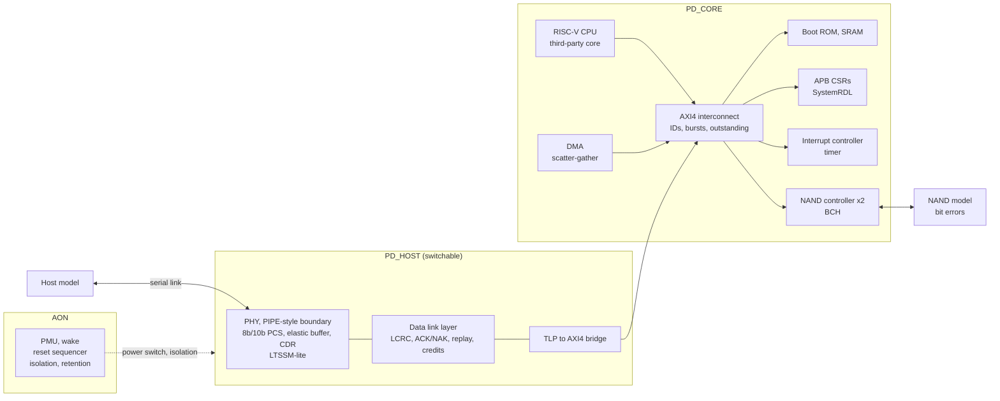

# Storage_SoC

A small storage-controller SoC with a PCIe-like serial host link.

A RISC-V CPU, an AXI4 interconnect, DMA, SystemRDL-generated CSRs and always-on and switchable power domains form the platform. A serial host interface (PHY with a PIPE-style boundary, data link layer, transaction-to-AXI bridge) and a NAND-flash datapath with BCH sit on it. Each IP has its own testbench, and the SoC is signed off with a UVM environment, synthesis and multi-corner STA in an open-source flow.

한국어 요약은 [아래](#한국어-요약)에 있습니다.

## At a glance

| Item | Value |
| --- | --- |
| Current phase | Phase 1, SoC platform: step 1-1, the architecture specification, is written |
| Design | No RTL yet |
| Verification tools | Vivado simulator 2019.2 (UVM 1.2), Verilator 5.052 |
| Implementation tools | Yosys 0.52, OpenSTA 3.1.0, Sky130 HD (ss/tt/ff corners) |

Every number in this repository names the commit it was measured at, and the script that produced it is in the repository.

## Architecture (planned)



- **Platform.** A third-party RISC-V core behind an AXI4 adapter, an AXI4 interconnect with IDs, bursts and outstanding transactions, boot ROM and SRAM, an interrupt controller and timer, and a descriptor-based DMA.
- **CSRs.** One SystemRDL source generates the APB register blocks, the C header for firmware, the UVM register model and the register document.
- **Clocks, resets and power.** Four clock domains, reset synchronizers with an ordered release, clock gating, an always-on PMU that switches the host domain, and isolation and retention described in UPF and checked by a power-aware testbench.
- **Host interface.** A PHY behind a PIPE-style boundary (8b/10b PCS, comma alignment, elastic buffer for the reference-clock ppm offset, digital CDR), a reduced link-training state machine tied to the power states, a data link layer with LCRC, ACK/NAK, replay and credits, and a transaction-to-AXI4 bridge.
- **Storage path.** Two NAND channel controllers with an ONFI-style asynchronous interface, a BCH encoder and decoder, and firmware that moves host blocks through SRAM to NAND.

## Roadmap

| Phase | Scope | Status |
| --- | --- | --- |
| 0 | Toolchain checks, repository layout, CI, RISC-V GCC | Done; the CI workflow goes live with its push |
| 1 | SoC platform: CPU, AXI4 interconnect, CSR, DMA, clock/reset/power domains, firmware | In progress: 1-1 done |
| 2 | Host interface: PHY with a PIPE-style boundary, link training, data link layer, transaction bridge | Planned |
| 3 | Storage datapath: NAND channel controllers, NAND model, BCH | Planned |
| 4 | SoC-level UVM, verification plan, coverage closure | Planned |
| 5 | Full-chip synthesis and multi-corner STA, documentation | Planned |
| 6 | Optional: DSP receiver for the PHY (FFE, DFE, Mueller-Muller CDR, real-number analog model) | Optional |

## Verification flow

| Tool | Checked version | Role |
| --- | --- | --- |
| Vivado simulator (xsim) | 2019.2 | UVM 1.2 testbenches: sequences, constrained random, covergroups |
| Verilator | 5.052 | Lint, fast regressions, line/branch/toggle coverage, covergroup bins |
| GitHub Actions | `verilator/verilator:v5.052` image | The Verilator checks on every push |

Phase 0 findings (2026-11-21, commit ce2671d):

- xsim 2019.2 runs a UVM 1.2 sequence-to-driver test with `randomize()` and a covergroup: 50 items, coverage 100.0, UVM_ERROR 0.
- Verilator 5.052 writes all 14 covergroup bins, including the cross, to `coverage.dat` with their hit counts. `get_coverage()` on a single coverpoint does not compile, and the covergroup total reads 0.0 at run time, so Verilator coverage numbers are taken from `coverage.dat`.
- Under `-Wall`, Verilator warns about members it adds to every covergroup (`option`, `total_bins`, ...). The waiver covers the covergroup block only.

## How to run

```bash
# Verilator side (Linux or WSL)
bash flow/tools/check_verilator.sh                                   # [TOOLS] verilator PASS
```

```powershell
# Vivado simulator side (Windows)
powershell -ExecutionPolicy Bypass -File flow\tools\check_xsim.ps1   # [TOOLS] xsim UVM PASS
```

Outputs go to `build/`, which git ignores. `check_verilator.sh` takes `BUILD_DIR` to build elsewhere, and `check_xsim.ps1` takes `-Vivado <install dir>` or `XILINX_VIVADO`.

## Repository layout

```text
.github/workflows/   CI
docs/                design documents
flow/tools/          toolchain checks: smoke_uvm.sv (xsim), smoke_cov.sv (Verilator) and their scripts
```

Each phase adds its own directories (`rtl/`, `fw/`, `dv/`, `syn/`, ...); the planned layout is in section 11 of the architecture document.

## Documents

| Document | Contents |
| --- | --- |
| [docs/01_soc_architecture.md](docs/01_soc_architecture.md) | Clock domains and crossings, resets, power domains with isolation, retention and sequences, AXI4 rules, address and interrupt maps, boot, timing targets, phase-1 verification plan |

## Limitations

- Built from public material only. The PCIe, M-PHY and UniPro specifications are available to members only, so the host link follows the general structure of those serial links and claims no compliance with any of them. The PHY-to-controller boundary follows the publicly available PIPE specification in style, not in full.
- Analog behavior (channel, CDR sampling) is modeled behaviorally. There are no transistor-level circuits.
- Third-party IP keeps its own license and is pinned to the commit it was taken from.

## Development notes

An LLM assistant (Claude) is used to draft code, tests and documents. A result goes in only after it passes the regressions and checks in this repository, and commits made with the assistant carry a co-author line.

## 한국어 요약

PCIe 계열 serial host link를 갖춘 소형 스토리지 컨트롤러 SoC입니다.

- **플랫폼.** RISC-V CPU, AXI4 interconnect, DMA, SystemRDL로 생성한 CSR, AON과 switchable power domain(PD_HOST)으로 구성합니다.
- **Host interface.** PIPE 방식 경계를 가진 PHY(8b/10b PCS, elastic buffer, digital CDR), link training, data link layer(LCRC, ACK/NAK, replay), TLP→AXI4 bridge입니다.
- **Storage path.** NAND channel controller 2개와 BCH ECC, host 데이터를 SRAM을 거쳐 NAND로 옮기는 firmware입니다.
- **검증과 구현.** IP별 TB를 먼저 만들고, SoC 전체는 UVM(Vivado simulator 2019.2)으로 sign-off합니다. lint, 빠른 regression, coverage는 Verilator 5.052, 합성과 multi-corner STA는 Yosys, OpenSTA, Sky130으로 합니다.
- **현재 상태.** Phase 0(도구 확인, repo 구조, CI, RISC-V GCC)이 끝났고, Phase 1(SoC platform)의 1-1 아키텍처 사양([docs/01_soc_architecture.md](docs/01_soc_architecture.md))을 작성했습니다. clock 5개와 crossing 규칙, reset 해제 순서, PD_HOST의 isolation·retention·power sequence, AXI4 규칙, address·interrupt map, 목표 주파수를 정했습니다.
- **범위.** 공개 자료만으로 구성하며 PCIe, M-PHY, UniPro 규격 준수를 주장하지 않습니다.
- **LLM 사용.** 코드, 테스트, 문서 초안에 LLM(Claude)을 쓰고, repo 안의 regression과 검사를 통과한 결과만 반영합니다.
