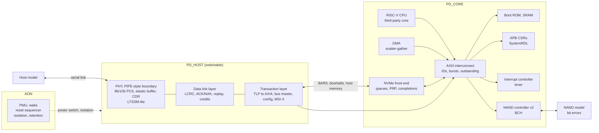

# Storage_SoC

[](https://github.com/yhkwon-git/Storage_SoC/actions/workflows/ci.yml)

A small storage-controller SoC with an NVMe-style front-end over a PCIe-like serial host link.

A RISC-V CPU, an AXI4 interconnect, DMA, SystemRDL-generated CSRs and always-on and switchable power domains form the platform. A host interface (NVMe-style queues and command front-end, a transaction layer that also masters host memory, data link layer, PHY with a PIPE-style boundary) and a NAND-flash datapath with BCH sit on it. Each IP has its own testbench, and the SoC is signed off with a UVM environment, synthesis and multi-corner STA in an open-source flow.

한국어 요약은 [아래](#한국어-요약)에 있습니다.

## At a glance

| Item | Value |
| --- | --- |
| Current phase | Phase 2, host link: steps 2-6 to 2-9 (data link layer, PHY, link training, the full stack) are next. Phase 1, steps 2-1 to 2-5 and phase 3 (NAND channels, NAND model, BCH, NVMe reads and writes through to NAND) are done. Setup at the ss corner is not met (docs/09 to docs/17) |
| Design | Ibex RV32IMC running firmware from a boot ROM on a 4 x 6 AXI4 crossbar, with SRAM, a descriptor-based DMA, and APB SYS, interrupt controller and timer whose registers are generated from SystemRDL; an always-on PMU that orders the resets and switches the PD_HOST domain with isolation and retention (UPF); a CPU clock gate; a PCIe-style transaction layer on the host link (inbound BARs, bus master, configuration space, MSI-X); an NVMe-style controller (registers, doorbells, round-robin command fetch into SRAM, PRP data transfers with lists, completion queue entries with phase tags and MSI-X per queue, epochs that make a controller reset safe while firmware holds commands) driven by firmware that serves admin, Read, Write and Flush commands, on SRAM or through a flash translation layer on NAND; two NAND channels with an ONFI-style asynchronous interface, each a bus sequencer on clk_nand with command and completion queues, an 8 KiB page buffer and a BCH encoder and decoder correcting 8 bits per 512 bytes; dual-clock FIFO, 2-flop synchronizer, channel register slice |
| Verification tools | Vivado simulator 2019.2 (UVM 1.2), Verilator 5.052 |
| Register generation | PeakRDL 1.5.0: register RTL, C header, UVM register model and register document from one source |
| Implementation tools | sv2v 0.0.13, Yosys 0.52, OpenSTA 3.1.0, Sky130 HD from lambdapdk v0.2.9 (ss/tt/ff corners) |

Every number in this repository names the commit it was measured at, and the script that produced it is in the repository.

## Architecture (planned)



- **Platform.** A third-party RISC-V core behind an AXI4 adapter, an AXI4 interconnect with IDs, bursts and outstanding transactions, boot ROM and SRAM, an interrupt controller and timer, and a descriptor-based DMA.
- **CSRs.** One SystemRDL source generates the APB register blocks, the C header for firmware, the UVM register model and the register document.
- **Clocks, resets and power.** Four clock domains, reset synchronizers with an ordered release, clock gating, an always-on PMU that switches the host domain, and isolation and retention described in UPF and checked by a power-aware testbench.
- **Host interface.**
  - An NVMe-style front-end: controller registers and doorbells, an admin queue and four I/O queue pairs, command fetch with round-robin arbitration, PRP data transfer between host memory and SRAM, completion posting with phase tags, and MSI-X per completion queue. Firmware handles the admin commands and the I/O commands (Read, Write, Flush).
  - A transaction layer that serves host requests on AXI4 and also masters host memory (tags, completion reassembly, payload splitting), with a configuration space holding BAR0 and the MSI-X capability.
  - Below it, a data link layer with LCRC, ACK/NAK, replay and credits, a reduced link-training state machine tied to the power states, and a PHY behind a PIPE-style boundary (8b/10b PCS, comma alignment, elastic buffer for the reference-clock ppm offset, digital CDR).
- **Storage path.** Two NAND channel controllers with an ONFI-style asynchronous interface, a BCH encoder and decoder, and firmware that serves NVMe reads and writes through SRAM to NAND.

## Roadmap

| Phase | Scope | Status |
| --- | --- | --- |
| 0 | Toolchain checks, repository layout, CI, RISC-V GCC | Done |
| 1 | SoC platform: CPU, AXI4 interconnect, CSR, DMA, clock/reset/power domains, firmware | Done: 1-1 to 1-9; setup at ss not met (docs/09) |
| 2 | Host interface: transaction layer and NVMe front-end (steps 2-1 to 2-5), then data link layer, PHY with a PIPE-style boundary and link training (steps 2-6 to 2-9) | In progress: 2-1 to 2-5 done; 2-6 to 2-9 after phase 3 |
| 3 | Storage datapath: NAND channel controllers, NAND model, BCH, NVMe reads and writes through to NAND | Done: 3-1 to 3-4 |
| 4 | SoC-level UVM, verification plan, coverage closure | Planned |
| 5 | Full-chip synthesis and multi-corner STA, documentation | Planned |
| 6 | Optional: DSP receiver for the PHY (FFE, DFE, Mueller-Muller CDR, real-number analog model) | Optional |

Build order: phase 1, steps 2-1 to 2-5, phase 3, steps 2-6 to 2-9, then phases 4 and 5. Steps 2-1 to 2-5 run against a host model at the transaction level, so NVMe commands reach NAND before the serial link exists. Steps 2-6 to 2-9 then move the same host model and tests behind the serial link.

## Verification flow

| Tool | Checked version | Role |
| --- | --- | --- |
| Vivado simulator (xsim) | 2019.2 | UVM 1.2 testbenches: sequences, constrained random, covergroups |
| Verilator | 5.052 | Lint, fast regressions, line/branch/toggle coverage, covergroup bins |
| GitHub Actions | `verilator/verilator:v5.052` image | The Verilator checks on every push |
| PeakRDL | 1.5.0 (`flow/rdl/requirements.txt`) | Generates the register files; `make -C dv rdl-check` confirms the committed files match the source |

Phase 0 findings (2026-11-21, commit ce2671d):

- xsim 2019.2 runs a UVM 1.2 sequence-to-driver test with `randomize()` and a covergroup: 50 items, coverage 100.0, UVM_ERROR 0.
- Verilator 5.052 writes all 14 covergroup bins, including the cross, to `coverage.dat` with their hit counts. `get_coverage()` on a single coverpoint does not compile, and the covergroup total reads 0.0 at run time, so Verilator coverage numbers are taken from `coverage.dat`.
- Under `-Wall`, Verilator warns about members it adds to every covergroup (`option`, `total_bins`, ...). The waiver covers the covergroup block only.

Block results (commit 8ce1fac, details in [docs/02_common_blocks.md](docs/02_common_blocks.md)):

- **Dual-clock FIFO.** 12 runs: six clock pairs from 4:1 to 1:4, each with random and full-rate traffic, 20,000 words per run. 0 data errors, and 97.9 to 101.0% of the throughput bound. The FIFO it replaces moved 12.5 to 24.8% of the bound at the same clock pairs, except 50 to 68% at the 4:1 pair.
- **Register slice.** 5,000 random beats in order. With VALID and READY held high, one beat per clock and one clock of latency. A k-clock downstream stall blocks the upstream for exactly k clocks, k = 1 to 6.

AXI4 crossbar (commit 76fd272, details in [docs/03_axi_crossbar.md](docs/03_axi_crossbar.md)):

- **Directed test.**
  - 72 unmapped or no-path bursts answered DECERR, none reaching a slave.
  - 32 bursts from four masters to one slave read back intact.
  - An ID switching slaves waits for its earlier transaction and is accepted 1 clock after it ends.
  - At most 4 reads and 4 writes outstanding per master.
  - Different slaves are served in the same clock.
  - Round-robin share of 50, 50, 50, 50 of 200 grants.
  - 1.000 write and read beats per clock for 16-beat bursts.
- **Random test.** 10 seeds, 80,000 bursts with 8% DECERR traffic, responses reordered across IDs, random READY and latency: 0 errors. 62 of 62 covergroup bins.
- **RTL coverage.** Line 31 of 32 (an unreachable `default`), branch 72 of 72, toggle 70.6%. The missed toggles are almost all bits fixed by the configuration.
- **Mutation check.** 7 of 7 planted bugs caught: ID rule, outstanding limit, R lock, AW grant hold, W order, path table, B routing.

CPU subsystem (commit 3e51bad, details in [docs/04_cpu_subsystem.md](docs/04_cpu_subsystem.md)):

- **Core.** Ibex v2.1.0 (RV32IMC), 43 files vendored unchanged, behind two AXI4 adapters.
- **Firmware tests.** Five tests (hello, memtest, irq, buserr, perf) pass, both alone and while M2 and M3 drive random bursts into SRAM. In the memtest run that is 158,866 background bursts, with 0 errors on either side.
  - memtest includes 12 misaligned words.
  - irq claims external interrupts lowest ID first.
  - buserr turns DECERR, SLVERR and PSLVERR into the right access faults (6 cases) and runs code copied into SRAM.
- **CPI with code in ROM.**
  - A register-only loop runs at 1.42 with or without the background traffic.
  - A CRC-32 over SRAM runs at 1.40 alone and 1.67 under SRAM contention.
- **APB bridge.** A 64-bit check from M3 covers paths the CPU never uses: two-word beats, strobed words, PSLVERR inside a beat, an empty slot, a burst.
- **Lint.** soc_top is `-Wall` clean; vendor files are waived.

CSRs (commit 888d3e5, details in [docs/05_csr.md](docs/05_csr.md)):

- **One source.** `rtl/csr/rdl/soc_apb.rdl` describes SYS, INTC and TIMER (14 registers). PeakRDL generates from it:
  - the APB register RTL;
  - the firmware header;
  - the UVM register model;
  - [docs/regs/soc_apb.md](docs/regs/soc_apb.md).

  The wrappers keep their ports and add the counting, claim and event logic.
- **Same behavior.** Same map and same APB timing as the hand-written blocks: every SoC clock count is unchanged, and the firmware images are byte-identical.
- **UVM register tests on xsim.** UVM's reset sequence (12 registers) and bit bash (10 registers) over the generated model, plus 33 behavior and decode checks: 0 failures, UVM_ERROR 0, in 1,191 APB transfers.
- **Mutation check.** 4 of 4 planted bugs caught (commit 7bbaca7): a reset value, a stuck bit, the claim order, a missing decode error.

DMA (commit 2c90ba1, details in [docs/06_dma.md](docs/06_dma.md)):

- **Design.** Chains of 16-byte descriptors copied over M2:
  - descriptor prefetch on its own read ID;
  - 16-beat bursts split at 4 KB;
  - an aligner for any source and destination byte offset;
  - FENCE for a descriptor that reads an earlier one's destination.

  Two rules keep it from blocking other masters at the crossbar:
  - reads are issued only with room for their data, so RREADY is always high;
  - an AW goes out only when its whole burst is buffered, so W never stalls mid-burst.
- **Errors.** The first cause and address are recorded, everything already issued drains, then ERR is set. Five causes, each checked.
- **Block testbench.**
  - Every byte is compared with a reference, with guard bytes around each destination.
  - The directed test covers all 64 source/destination offset pairs, page splits, FENCE, each error cause, abort and restart.
  - Random chains run on a random-latency memory with error ranges: 10 seeds, 2,000 chains, 17.2 MB copied, 163 error runs and 84 aborts, 0 errors, covergroup bins 155 of 155.
  - Mutation check: 10 of 10 planted bugs caught.
- **Throughput.** 7.97 bytes per clock on a 64 KiB copy with a memory that never stalls (99.6% of the bus). 4096 B SRAM to SRAM takes 571 clocks in the SoC (`dma` firmware test).
- **SoC.** The `dma` firmware test copies through SRAM and both NAND page buffers, scatters unaligned pieces under the DONE interrupt, and gets the ERR interrupt with DECERR for paths M2 does not have. Alone, the earlier tests keep their clock counts.

Clocks, resets and power (commit ca320d4, details in [docs/07_clock_reset_power.md](docs/07_clock_reset_power.md)):

- **Structure.** Four clock inputs and a power-on reset feed:
  - a PMU in the always-on domain, reached through an APB request/acknowledge crossing;
  - reset synchronizers that release AON, core, NAND, then host;
  - a chip reset that keeps the always-on registers;
  - a PD_HOST sequencer: isolation, save, PLL, reset, switch, each wait with a timeout, a wake pin, and a refusal while the host path is busy.
- **PD_HOST.** A placeholder for the phase-2 logic with retention registers, behind four isolation cells. `syn/upf/storage_soc.upf` describes the domains, and a script checks it against the RTL's isolation and retention cells.
- **Power testbench.** It runs on Verilator, with random values while PD_HOST is off, and on xsim, with X. Sequencing is checked every cycle.
  - Retention holds across power cycles, and non-retained state comes back at reset.
  - Refusal, wake, switch and PLL timeouts and the chip reset all behave as specified.
  - Mutation check: 11 of 11 planted bugs caught.
- **CPU clock gate.** It gates Ibex in WFI, as `ibex_top` does. With it on, every earlier firmware test exits after the same number of clocks; a 2000-tick WFI removes 1,967 clocks.
- **Firmware.** `power` power-cycles PD_HOST under interrupts with retained state checked; `reset` covers the DMA soft reset, the clock gate and a chip reset across two boots.

Firmware (commit fbe4b8a, details in [docs/08_firmware.md](docs/08_firmware.md)):

- **Drivers.** One trap handler dispatches the timer and each INTC source to its driver. A sleep tests its flag with interrupts masked, so an interrupt between the test and WFI cannot be lost. Drivers cover the timer, the DMA, the PMU, the PD_HOST placeholder and CRC-32.
- **soc_app.** The phase-1 flow in 3.5 KiB of code: boot, a 16 KiB memory check, a DMA copy through the NAND0 page buffer checked by CRC, the CPU and the DMA together, and a PD_HOST power cycle with retained state. It passes alone and with background traffic.
- **CPU and DMA together.** An 8 KiB copy runs entirely inside a 4 KiB CRC and costs the CRC 1.5% more clocks.

Synthesis, timing and CDC (commit 7a0d727, details in [docs/09_timing.md](docs/09_timing.md)):

- **Synthesis.** sv2v and Yosys map the whole SoC, Ibex included, onto Sky130 HD: 40,432 cells and 0.47 mm² of standard cells, SRAM macros not counted. The DMA is the largest block (42%, mostly its two 32-beat FIFOs in flops), then the CPU (26%).
- **STA.** OpenSTA with multi-clock constraints:
  - at tt, `clk_sys` meets 50 MHz and `pclk` 62.5 MHz, with +3.99 ns register to register;
  - at ff, setup meets and hold misses by 23 ps into the SRAM macros, left to layout;
  - at ss_n40C_1v40, setup misses by 49 ns, so `clk_sys` would run at about 14.5 MHz there. The worst path runs from the CPU through the crossbar's arbitration into the DMA; register slices at the masters would cut it.
- **CDC check.** A script traces every crossing in the netlist. All are synchronizers (26 bits), handshake registers (80), FIFO words (400) or PMU controls (560). It found one real bug: an idle flag decoded from a counter fed a synchronizer and could glitch. It is now a flop.

Transaction layer (commit 4a8e515, details in [docs/10_transaction_layer.md](docs/10_transaction_layer.md)):

- **Design.** The host reads and writes SoC memory through BAR0 (register window, MSI-X table and PBA) and BAR2 (SRAM window), with several reads outstanding and completions split at 128-byte boundaries. As a bus master the SoC moves data to and from host memory: reads with 16 tags and reassembly, writes from buffered local data, both cut at MPS or MRRS and at 4 KiB. Type 0 configuration space with PCI Express and MSI-X capabilities. Malformed TLPs are removed whole by a store-and-forward receive buffer, and unsupported requests get UR.
- **SoC integration.** M3 is the transaction layer's AXI port. A PD_HOST power-down now needs the link held and drained (HOST LINK_CTRL.HOLD), and the host's configuration survives the power cycle.
- **Block testbench.** A TLP-level host model (root complex with host memory, split and reordered completions, fault injection) against six directed tests and a random test. Over 10 seeds: 30,000 inbound operations, 1,040 bus-master transfers and 237 MSI-X messages, 0 errors, 172 of 172 covergroup bins. Mutation check: 13 of 13 planted bugs caught.
- **Throughput** with nothing in the way: 7.05 bytes per clock for inbound 256-byte writes, 6.70 for 4 KiB reads outstanding, 7.07 and 7.28 for 64 KiB bus-master transfers each way; a 1-DW read takes 13 clocks.
- **SoC.** The host model enumerates the device in every firmware test, background traffic and the APB check go through BAR2 and BAR0, and a new firmware test copies 8 KiB from host memory in 1,444 clocks and back in 1,188. Every earlier firmware test that does not touch the host link exits after the same number of clocks.
- **Synthesis and timing.** tt meets every clock; the transaction layer is 61% of the 1.32 mm² of standard cells, mostly three 64-beat buffers in flops. CDC check PASS.
- **Found on the way.** A zero-length read's Lower Address; an arbiter choice that changed under VALID; the first TLP after a power-up lost while the FIFO was still in reset; logic in front of a synchronizer; and an imported register slice whose data registers turned the reset net into a data input (−131 ns at tt until fixed).

NVMe registers and queues (commits 883242d and d3a786e, details in [docs/11_nvme_queues.md](docs/11_nvme_queues.md)):

- **Design.** CAP, VS, CC, CSTS, AQA, ASQ, ACQ and the doorbells of the admin queue and four I/O queue pairs sit on a register port inside the transaction layer (BAR0), with no AXI on the way. CC.EN enables and resets the controller, CC.SHN shuts it down, and bad doorbells are reported to firmware. The controller fetches commands round robin through the transaction layer's bus master into 16 command slots in SRAM and hands {queue, slot} to firmware through a FIFO. Firmware creates the I/O queues from the admin commands.
- **Block testbench.** The host model as an NVMe host against eight directed tests and a random test with controller resets and shutdowns; every command checked for queue, order and content. Over 10 seeds: 20,008 commands submitted, 15,395 fetched and checked through 50 controller resets, 0 errors, 49 of 49 covergroup bins. Mutation check: 14 of 14.
- **Fetch rate.** 40 clocks per command with a fast host, one fetch at a time: 1.25 million commands per second at 50 MHz.
- **SoC.** A new firmware test takes Create I/O Completion Queue and Create I/O Submission Queue from the host, sets up the queue pair, and receives 12 Read commands on it, alone and with host traffic in the background. The APB bridge now has 16 slots.
- **Synthesis and timing.** The controller is 3.6% of the standard-cell area; tt meets every clock; CDC check PASS with no new crossings.
- **Found on the way.** A 16-slot APB bridge whose range check truncated 16 to 0, caught by lint; and the power mutation check, which had been counting build failures as catches since step 2-1.

NVMe data transfers and completions (commit 569ad05, details in [docs/12_nvme_data.md](docs/12_nvme_data.md)):

- **Design.** A PRP engine moves a command's data between host memory and SRAM for firmware: PRP1 with an offset, PRP2 as the second page or a list pointer, list entries fetched 8 at a time and followed across list pages. A completion poster takes entries from firmware, waits for room in the queue, fills in the SQ head and the phase tag, writes the entry and then raises the queue's MSI-X vector. List entries and entries being posted pass through a 128-byte controller buffer on a new crossbar slave port.
- **Block testbench.** The host model builds PRP layouts in host memory and takes completion entries by phase, checking every field and every byte read; the testbench as firmware moves the data and posts the entries. Three new directed tests and a random I/O test: over 10 seeds, 2,281 completions checked and 25 MB moved, 0 errors, 95 of 95 covergroup bins (all hit by the directed tests alone). Mutation check: 27 of 27.
- **Throughput.** 6.6 bytes per clock from SRAM to the host and 5.6 the other way, one bus-master transfer per page; a completion entry is in host memory 17 clocks after firmware posts it.
- **SoC.** The firmware test now completes every command: two admin commands, then Writes and Reads with PRP lists against a 16-block namespace in SRAM, read back and checked by the host, and error statuses where due.
- **Found on the way.** A tail update a clock late that would have let the next entry overwrite an unread one (caught in review); a testbench check that could not tell queue laps apart; and a testbench build that grew to 15 minutes because Verilator copies module tasks into every caller (now 4).

NVMe firmware (commit 491d727, details in [docs/13_nvme_firmware.md](docs/13_nvme_firmware.md)):

- **Firmware.** `nvme_app` serves the front-end from the NVMe interrupt:
  - admin: Identify (controller, namespace, active namespace list), Create and Delete I/O queues, Set and Get Features (Number of Queues, and a vendor-specific transfer overlap);
  - I/O: Read, Write and Flush on a 24-block namespace in SRAM;
  - the specification's status for anything else.

  With overlap on, the next command's transfer is loaded while the current one runs and started the moment it ends.
- **SoC test.** The host in `tb_soc` brings the controller up as a host driver does and creates four I/O queue pairs. It runs reads at queue depths 1 to 16 in both modes, then a Flush, error commands, queue deletion, a controller reset and a shutdown. Every completion and every byte read is checked. It passes alone and with background traffic.
- **Measured** at 50 MHz:
  - a 4 KiB read at QD1 takes 1,400 clocks from doorbell to completion entry;
  - 4 KiB reads reach 48,045 IOPS at QD16, and 62,274 with overlap;
  - 512-byte reads reach 105,297 IOPS with overlap;
  - an APB register access costs the CPU 8 clocks to read and 9 to write.
- **What limits it.**
  - 512-byte reads are firmware-bound at about 475 clocks per command; about 155 of those go to some 18 register accesses.
  - 4 KiB reads are bound by the transaction layer's single bus master, which carries each command's fetch, data and completion entry in turn (about 800 clocks).
- **Found on the way.** A controller reset that went uncounted because the shutdown was looked at first, and a driver linked into every application.

NVMe host driver model and verification (commit c5e2b96, details in [docs/14_nvme_host_verification.md](docs/14_nvme_host_verification.md)):

- **Epochs.** A controller reset while firmware held a command let that command move data, post an entry, return its slot or create a queue after the host had enabled the controller again. Firmware alone cannot close that window. The controller now counts resets in an epoch, which firmware gets with each command and writes back with everything it does for it; whatever carries another epoch does nothing.
- **Host driver model.** A class-based NVMe host on the transaction-level host model:
  - queues created and deleted with admin commands, any SQ on any CQ, shared CQs and vectors;
  - PRP1, PRP2 and PRP lists, completions by phase tag, every CID, SQID, status, SQ head and byte read checked against a copy of the namespace;
  - controller resets with commands outstanding, after which no abandoned command may complete or write its buffer.
- **SoC test.** `nvme_rand` runs it against the step 2-4 firmware: 4 runs, 5,358 commands, 20 controller resets abandoning 330 of them, 6.6 MB read and compared, 0 errors, and 81 of 81 covergroup bins. In these runs the hardware refused 8 transfer starts and discarded 9 completion posts that the firmware made for stale commands.
- **Assertions.** 13 assertions on the controller's queue state, bound into both NVMe testbenches. `tb_nvme` has a new epoch test: 101 of 101 bins, and 33 of 33 mutants caught, 6 of them new for the epochs.
- **Found on the way.**
  - Firmware posted every I/O completion to the CQ with its SQ's number.
  - The slot assertion found the command FIFO emptying a clock after a reset had freed the slots: for that clock, CMD offered a stale command with the new epoch.
- **Synthesis and timing.** The NVMe controller is 10.3% of the standard cells; tt meets every clock; CDC check PASS with no new crossings.

NAND channel controllers (commit f67f5d6, details in [docs/15_nand_channel.md](docs/15_nand_channel.md)):

- **Design.** Two channels replace the plain memories at S3 and S4, at the same addresses.
  - **Bus side:** a sequencer on `clk_nand` drives an 8-bit ONFI-style asynchronous interface. It runs reset, read ID, page read, change read column, page program, block erase and read status, with timing firmware sets per command. It waits for R/B# with a timeout and turns the status byte into a code.
  - **`clk_sys` side:** a command queue of 4, a completion queue of 8 (a command goes out only with room for its completion), a data mover, and an 8 KiB page buffer in one SRAM macro. The page buffer serves the bus first, so every earlier firmware test exits after the same number of clocks.
  - **Crossings:** commands, data and completions cross in four dual-clock FIFOs.
- **NAND model.** An ONFI-style target answers the commands and checks every interface rule the controller must keep, in nanoseconds: pulse widths, setups and holds, tWHR, tADL, tRR, bus contention.
- **Block testbench.** 12 directed tests and 10 random seeds at three `clk_nand` periods: 486,922 bytes programmed and 616,328 read under 2,244,656 interface checks, with bus assertions bound; 0 errors, 32 of 32 covergroup bins. Mutation check: 18 of 18.
- **Throughput.** One byte every two `clk_nand` clocks at the fastest setting, 25 MB/s. A 4,320-byte page programs in 9,689 clocks and reads in 8,924, including the model's busy times.
- **SoC.** A new firmware test runs both channels: identify, program, read back, the spare area, both at once with their interrupts, and write protect. It passes alone and with background traffic. The UVM register test now covers NAND0 and NAND1: 74 checks, 0 failures.
- **Synthesis and timing.** The channels are 10.3% of the standard cells. `clk_nand` meets 50 MHz at every corner, ss included. CDC check PASS.
- **Found on the way.** An inverter in front of a synchronizer, found by the CDC check. Two blind spots of the testbench, found by the mutation check: an address byte stuck at 0 that went unseen because program and read went to the same wrong page, and an R/B# look that came too early. The testbench now checks the model's array, and the model's R/B# falls after 100 ns.

NAND model (commit 6b4fc0a, details in [docs/16_nand_model.md](docs/16_nand_model.md)):

- **Device behavior.** The NAND model of the testbenches now behaves as a device. No RTL changes, and its defaults keep step 3-1's behavior: the 29 earlier firmware runs exit after the same number of clocks as before.
  - **Busy times** drawn per operation, from program-and-verify loops and erase pulses.
  - **Wear:** P/E cycles shorten programs, lengthen erases and raise the bit error rate tenfold at the rated endurance; past it, erases start to fail and wear the block out.
  - **Raw bit errors** on reads, at a rate, in exact counts per region or as stuck bits, with a log of every bit flipped.
  - **Factory bad blocks** with their markers, the **program rules** checked (page order, partial-program limit, bad and half-erased blocks), and what a reset leaves when it stops a program, an erase or a read.
- **Block testbench.** Five new directed tests check the model through the controller, as firmware would use it.
  - The even random seeds run with busy times drawn and 200 bit errors per million: every byte read matched the expected data with exactly the logged bits flipped.
  - BUSY_TIME equals each operation's time less tWB less one clock, for all 162 operations of the busy test.
  - 66 of 66 covergroup bins. Mutation check of the model: 21 of 21; of the RTL, still 18 of 18.
- **SoC.** A NAND characterization firmware test:
  - scans both channels for factory bad blocks and finds exactly the three planted, despite raw bit errors on the markers;
  - measures busy times on a fresh and a worn block: erases of 50 and 150 µs, and faster programs on the worn one;
  - counts raw bit errors: 20 in four fresh pages, 254 in four worn ones, and the 274 match the bits the model flipped.

BCH error correction (commit 2c9bc8b, details in [docs/17_bch.md](docs/17_bch.md)):

- **Code.** Binary BCH over GF(2^13) correcting 8 bit errors in each codeword of 512 data bytes, 4 metadata bytes and 13 parity bytes. A Python reference model defines it, generates the RTL's constants and the test vectors, and holds the decoder in both its textbook and its hardware form.
- **Design.** Each NAND channel has an encoder on the program path and a decoder on the read path, in `clk_sys` between the page buffer and the bus.
  - **Decoder:** syndromes 8 bits a clock; inversionless binary Berlekamp-Massey, 144 clocks on two multipliers; a Chien search 8 bits a clock, 529 clocks.
  - **Page layout:** the 8 codewords of a page lie one after the other, the bad-block marker column left out. Each is decoded while the next one arrives, so a read takes 682 clocks more with ECC, the decode of the last codeword.
  - **Corrections** are written into the page buffer a byte at a time, only once a codeword is known correctable. A parity mask makes erased pages read as valid codewords of FFh.
- **Block tests.** 1,800 vectors of the model with 0 to 11 errors, the codec checked bit for bit: 1,191 codewords corrected (5,404 bits) and 443 past correcting, each as the model decodes it. Mutation check of the codec: 17 of 17, after two blind spots it found were closed.
- **Channel tests.** Three ECC tests in `tb_nand` check the page layout and parity in the model's array, and every codeword of every read against the model's flip log; 85 of 85 covergroup bins. Mutation check: 28 of 28, 10 of them in the ECC path.
- **SoC.** A firmware test programs and reads pages with ECC under raw bit errors:
  - its 76 corrected bits are the ones the model flipped;
  - an erased page reads as FFh;
  - a worn block is past correcting in every codeword.

  Every earlier firmware run exits after the same number of clocks as before.
- **Synthesis and timing.** BCH is 9.9% of the standard cells, both channels. It meets 50 MHz at tt and ff with 12 ns or more to spare. At ss, `clk_nand` now misses by 0.311 ns in the sequencer, which this step did not change; it is left to step 5-1 with the rest of that corner. CDC check PASS with no new crossings.

NVMe on NAND (commit a4d455b, details in [docs/18_nvme_nand.md](docs/18_nvme_nand.md)):

- **Firmware.** `ssd_app` is the NVMe firmware of step 2-4 with its namespace on NAND. No RTL changes.
  - **Data path:** host memory, PRP transfers to an SRAM staging area, DMA to a channel's page buffer, BCH, NAND, and back for a read.
  - **Flash translation layer:** logical pages of 4 KiB on both channels; out-of-place writes into erased blocks in page order; factory bad blocks skipped; failed erases and programs retired. Writes of less than a page are read-modify-write.
- **Test.** The NVMe host driver model of step 2-5 runs against it, with controller resets in planned states, and compares every byte it reads. The NAND devices have raw bit errors, varying busy times, a factory bad block, an erase failure and a program failure.
  - The 863-command run read back 733,696 bytes with 0 errors.
  - The firmware corrected 4,643 bit errors and retired 3 bad blocks on the way.
- **Pace.** One command at a time, a 4 KiB read takes 11,637 clocks and a 4 KiB write 12,215; a 512-byte write, which is read-modify-write, takes 21,669. Four outstanding reads give 4,515 IOPS, the same as one at a time: the firmware runs one NAND operation at a time.

## How to run

```bash
# Verilator side (Linux or WSL)
bash flow/tools/check_verilator.sh                                   # [TOOLS] verilator PASS
```

```powershell
# Vivado simulator side (Windows)
powershell -ExecutionPolicy Bypass -File flow\tools\check_xsim.ps1   # [TOOLS] xsim UVM PASS
```

```bash
# Block and SoC checks (Linux or WSL): lint, UPF check, dual-clock FIFO, register slice, crossbar, DMA, transaction layer, NVMe queues, BCH against its Python model (needs python3), NAND channel and model, power, firmware on soc_top
make -C dv                                                           # [LINT] [ISO] PASS ... [XBAR] [DMA] [TL] [NVME] [BCH] [NAND] [PWR] [SOC] all runs PASS
make -C dv xbar-mut                                                  # [MUT] 7 of 7 mutants caught
make -C dv dma-mut                                                   # [MUT] 10 of 10 mutants caught
make -C dv tl-mut                                                    # [MUT] 16 of 16 mutants caught
make -C dv nvme-mut                                                  # [MUT] 33 of 33 mutants caught
make -C dv bch-mut                                                   # [MUT] 17 of 17 mutants in the BCH codec caught
make -C dv nand-mut                                                  # [MUT] 28 of 28 mutants caught
make -C dv nand-model-mut                                            # [MUT] 21 of 21 mutants in the NAND model caught
make -C dv power-mut                                                 # [MUT] 11 of 11 mutants caught
make -C dv power-x                                                   # [PWR] X run PASS: power testbench on xsim (WSL calls Windows)
make -C fw images                                                    # rebuild fw/images (needs riscv-none-elf-gcc on PATH)
make -C dv rdl-check                                                 # [RDL] generated files match soc_apb.rdl (needs PeakRDL)
bash flow/rdl/gen.sh                                                 # regenerate after editing rtl/csr/rdl/soc_apb.rdl
make -C dv ral                                                       # [RAL] PASS: UVM register tests on xsim (WSL calls Windows)
make -C dv ral-mut                                                   # [MUT] 4 of 4 mutants caught
```

Outputs go to `build/`, which git ignores. `check_verilator.sh` takes `BUILD_DIR` to build elsewhere, and `check_xsim.ps1` takes `-Vivado <install dir>` or `XILINX_VIVADO`.

## Repository layout

```text
.github/workflows/   CI
docs/                design documents
docs/regs/           register document generated from SystemRDL
dv/                  testbenches (dv/tb/), SVA checkers (dv/sva/), lint waivers (dv/lint/), run, mutation and coverage scripts
dv/ral/              UVM register model generated from SystemRDL
dv/uvm/              APB agent and UVM register tests (xsim)
flow/rdl/            register generation script and pinned PeakRDL versions
flow/bch/            Python reference model of the BCH code: RTL constants, test vectors
flow/cdc/            structural clock-domain-crossing check of the netlist
flow/power/          check that the UPF and the RTL agree on isolation and retention
flow/sta/            OpenSTA at three corners
flow/syn/            Sky130 library fetch, sv2v and Yosys synthesis, fanout buffering, area by block
flow/tools/          toolchain checks: smoke_uvm.sv (xsim), smoke_cov.sv (Verilator) and their scripts
fw/                  firmware: start-up and linker script (common/), tests (tests/), drivers including NVMe command handling and the flash translation layer (drv/), soc_app, nvme_app and ssd_app (app/), committed ROM images (images/)
rtl/axi/             AXI4 crossbar, ID tracker, default slave, AXI-to-APB bridge, channel register slice
rtl/common/          dual-clock FIFO, 2-flop synchronizer, round-robin arbiter, single-clock FIFO
rtl/cpu/             Ibex wrapper, Ibex-port-to-AXI4 adapter
rtl/csr/             SystemRDL source (rdl/) and the register blocks generated from it (gen/)
rtl/dma/             descriptor-based DMA
rtl/nand/            NAND channel controllers: bus sequencer (clk_nand), command and completion queues, data mover, page buffer
rtl/ecc/             BCH encoder and decoder (syndromes, Berlekamp-Massey, Chien search) and its generated constants
rtl/host/            PD_HOST boundary, its placeholder logic, core side (HOST registers, FIFOs), PLL model
rtl/host/tl/         transaction layer: receive buffer, pack and unpack, dispatcher, configuration space, MSI-X, completer, bus master, link-side port
rtl/host/nvme/       NVMe controller: host registers and doorbells, queue pointers, round-robin fetch, command slots and FIFO, PRP engine, completion poster, controller buffer
rtl/mem/             AXI4 ROM and SRAM
rtl/periph/          APB SYS, interrupt controller, timer around the generated registers
rtl/pmu/             PMU, APB clock-domain crossing, isolation cell, retention register
rtl/top/             soc_top
rtl/vendor/ibex/     Ibex v2.1.0, unchanged (VENDOR.md)
```

`syn/upf/` holds the power intent; later steps add the rest of `syn/` and more of `rtl/`, and the planned layout is in section 11 of the architecture document.

## Documents

| Document | Contents |
| --- | --- |
| [docs/01_soc_architecture.md](docs/01_soc_architecture.md) | Clock domains and crossings, resets, power domains with isolation, retention and sequences, AXI4 rules, address and interrupt maps, boot, timing targets, phase-1 verification plan |
| [docs/02_common_blocks.md](docs/02_common_blocks.md) | Blocks taken from AXI_PCIe_Subsystem `b64e36a`, why the dual-clock FIFO was rewritten, FIFO and register-slice measurements |
| [docs/03_axi_crossbar.md](docs/03_axi_crossbar.md) | Crossbar structure and design decisions (same-ID rule, default slaves, W routing, R lock), verification environment, directed, random, coverage and mutation results |
| [docs/04_cpu_subsystem.md](docs/04_cpu_subsystem.md) | Ibex choice and configuration, the memory-port adapter's ordering rules, memories, APB bridge and registers, firmware, SoC test results, CPI, bring-up findings |
| [docs/05_csr.md](docs/05_csr.md) | SystemRDL source and its four outputs, generator options, logic around the registers, firmware header use, UVM register tests, mutation check, findings |
| [docs/06_dma.md](docs/06_dma.md) | DMA programming model, design decisions (read IDs, read credits, full-burst AW, aligner), block testbench, throughput, mutation check, SoC firmware test, findings |
| [docs/07_clock_reset_power.md](docs/07_clock_reset_power.md) | Clocks and crossings, reset order and chip reset, PD_HOST power sequence, isolation, retention and UPF, CPU clock gate, power testbench (random and X off-state values), mutation check, SoC power and reset tests, findings |
| [docs/08_firmware.md](docs/08_firmware.md) | Driver layer, interrupt dispatch and race-free sleep, soc_app's phases and results, CPU and DMA together, clock counts of every program |
| [docs/09_timing.md](docs/09_timing.md) | Synthesis flow, SRAM macro models, constraints, area by block, timing at three corners and the critical paths, the CDC check and what it found |
| [docs/10_transaction_layer.md](docs/10_transaction_layer.md) | Transaction layer: what the host and the SoC see (configuration space, BARs, request handling, HOST registers, link hold), design decisions, host model and tests, throughput, mutation check, SoC tests, area, timing and CDC, findings |
| [docs/11_nvme_queues.md](docs/11_nvme_queues.md) | NVMe registers and queues: what the host and the firmware see, enable, reset and shutdown, doorbells, round-robin fetch, design decisions, block tests, throughput, mutation check, SoC firmware test, area, timing and CDC, findings |
| [docs/12_nvme_data.md](docs/12_nvme_data.md) | NVMe data and completions: PRP transfers and lists, completion queue entries, phase and MSI-X order, the controller buffer on the crossbar, design decisions, block tests, throughput, mutation check, SoC test, area, timing and CDC, findings |
| [docs/13_nvme_firmware.md](docs/13_nvme_firmware.md) | NVMe firmware: command loop, admin and I/O commands, statuses, transfer overlap, controller reset, the host's run, latency and IOPS by queue depth, firmware cost per command, what limits it, findings |
| [docs/14_nvme_host_verification.md](docs/14_nvme_host_verification.md) | NVMe host driver model and verification: why the controller needed epochs and how they work, the host model's checks, the nvme_rand epochs and reset plan, queue assertions, coverage, results, findings |
| [docs/15_nand_channel.md](docs/15_nand_channel.md) | NAND channel controllers: what firmware sees, the bus operations and timing, design decisions, the NAND model and its checks, tests, assertions, coverage, mutation check, throughput, SoC tests, area, timing and CDC, findings |
| [docs/16_nand_model.md](docs/16_nand_model.md) | NAND model: busy times from program loops and erase pulses, wear and endurance, raw bit errors and their log, factory bad blocks, program rules, stopped operations, its knobs, tests, mutation check of the model, the SoC characterization test, findings |
| [docs/17_bch.md](docs/17_bch.md) | BCH error correction: the code, what firmware sees (page layout, the marker column, erased pages), encoder and decoder, design decisions, the Python reference model, codec and channel tests, mutation checks, the SoC test, area, timing and CDC, findings |
| [docs/18_nvme_nand.md](docs/18_nvme_nand.md) | NVMe on NAND: the data path through SRAM, what the host sees, the flash translation layer (map, out-of-place writes, bad blocks, metadata), design decisions, the host driver model's run on NAND, pace, limits |
| [docs/regs/soc_apb.md](docs/regs/soc_apb.md) | Generated register reference: every register and field with offset, access and reset value |

## Limitations

- Built from public material only. The PCIe, M-PHY and UniPro specifications are available to members only, so the host link follows the general structure of those serial links and claims no compliance with any of them. The NVMe front-end follows a subset of the register, queue and PRP structure in the publicly available NVMe Base Specification and claims no compliance either, and the NAND channels follow the general structure of the publicly available ONFI specification in the same way. The PHY-to-controller boundary follows the publicly available PIPE specification in style, not in full.
- Analog behavior (channel, CDR sampling) is modeled behaviorally. There are no transistor-level circuits.
- Third-party IP keeps its own license and is pinned to the commit it was taken from.

## Development notes

An LLM assistant (Claude) is used to draft code, tests and documents. A result goes in only after it passes the regressions and checks in this repository, and commits made with the assistant carry a co-author line.

## 한국어 요약

PCIe 계열 serial host link 위에 NVMe 방식 front-end를 갖춘 소형 스토리지 컨트롤러 SoC입니다.

- **플랫폼.** RISC-V CPU, AXI4 interconnect, DMA, SystemRDL로 생성한 CSR, AON과 switchable power domain(PD_HOST)으로 구성합니다.
- **Host interface.** NVMe 방식 front-end(controller register와 doorbell, admin queue와 I/O queue 4쌍, round-robin 명령 fetch, PRP 데이터 전송, phase tag를 쓰는 completion, MSI-X), host memory까지 직접 접근하는 transaction layer, 그 아래 data link layer(LCRC, ACK/NAK, replay), link training, PIPE 방식 경계를 가진 PHY(8b/10b PCS, elastic buffer, digital CDR)입니다.
- **Storage path.** NAND channel controller 2개와 BCH ECC, NVMe Read·Write를 SRAM을 거쳐 NAND까지 처리하는 firmware입니다.
- **진행 순서.** Phase 1 → 2-1~2-5(transaction 수준 host 모델로 NVMe) → Phase 3 → 2-6~2-9(link · PHY) → Phase 4, 5. NVMe 명령이 NAND까지 가는 경로를 serial link보다 먼저 완성합니다.
- **검증과 구현.** IP별 TB를 먼저 만들고, SoC 전체는 UVM(Vivado simulator 2019.2)으로 sign-off합니다. lint, 빠른 regression, coverage는 Verilator 5.052, 합성과 multi-corner STA는 Yosys, OpenSTA, Sky130으로 합니다.
- **현재 상태.** Phase 0(도구 확인, repo 구조, CI, RISC-V GCC)과 Phase 1(SoC platform, 1-1~1-9)이 끝났고, ss corner의 setup 미충족은 docs/09에 기록했습니다. Phase 2는 2-1(transaction layer), 2-2(NVMe register와 queue), 2-3(PRP 데이터와 completion), 2-4(SRAM namespace에서 firmware 명령 처리), 2-5(NVMe host driver 모델과 검증)를 마쳤습니다. Phase 3(storage datapath)는 3-1(NAND channel controller), 3-2(busy 시간, 마모, bit error를 넣은 NAND 모델), 3-3(BCH 오류 정정), 3-4(NVMe Read·Write를 NAND까지)를 모두 마쳤습니다. 다음은 Phase 2 뒷부분 2-6~2-9(data link layer, PHY, link training, 전체 stack)입니다.
  - 1-1 아키텍처 사양([docs/01_soc_architecture.md](docs/01_soc_architecture.md)): clock 5개와 crossing 규칙, reset 해제 순서, PD_HOST의 isolation·retention·power sequence, AXI4 규칙, address·interrupt map, 목표 주파수를 정했습니다.
  - 1-2 공통 블록([docs/02_common_blocks.md](docs/02_common_blocks.md)): 이전 프로젝트의 2-FF synchronizer와 register slice는 로직을 그대로 가져왔습니다. dual-clock FIFO는 같은 TB로 측정한 결과 처리량이 상한의 12.5~24.8%(4:1 비율만 50~68%)에 그쳐서 새로 설계했고, 새 FIFO는 12개 run 모두 데이터 오류 0, 상한의 97.9~101.0%를 냈습니다(commit 8ce1fac).
  - 1-3 AXI4 crossbar([docs/03_axi_crossbar.md](docs/03_axi_crossbar.md)): 4×5 sparse 구조이고, 같은 ID가 outstanding인 동안 다른 slave로 넘어가지 않게 해서 reorder buffer 없이 응답 순서를 지킵니다. master마다 DECERR slave를 두고, W는 master와 slave 양쪽의 AW 순서를 따르게 했습니다(commit 76fd272).
    - **검증 환경.** class 기반 master/slave 모델과 9개 포트의 SVA checker를 붙였습니다.
    - **directed 8종.** 모두 PASS입니다.
    - **random.** 10 seed, 80,000 burst에서 오류 0이고, covergroup 62/62입니다.
    - **mutation.** 일부러 심은 버그 7종을 모두 잡았습니다.
  - 1-4 CPU subsystem([docs/04_cpu_subsystem.md](docs/04_cpu_subsystem.md)):
    - **구성.** Ibex v2.1.0(RV32IMC, 43개 파일을 원본 그대로 반입)을 AXI4 adapter 2개로 crossbar에 붙였습니다. boot ROM, SRAM, AXI→APB bridge와 SYS·INTC·TIMER, firmware를 더했습니다.
    - **firmware 테스트.** 5종이 단독으로도, 다른 master가 SRAM에 random burst를 보내는 중에도 모두 통과했습니다. memtest에는 misaligned 접근 12건이 포함되고, buserr는 결함 6종을 검사합니다.
    - **CPI.** ROM 코드 기준으로 1.40~1.42이고, SRAM 경합 중 CRC는 1.67입니다(commit 3e51bad).
  - 1-5 SystemRDL CSR([docs/05_csr.md](docs/05_csr.md)):
    - **단일 source.** SYS·INTC·TIMER 레지스터 14개를 SystemRDL 하나로 기술하고, PeakRDL로 APB register RTL, firmware header, UVM register model, register 문서를 생성합니다.
    - **동작 동일성.** map과 APB timing이 손으로 쓴 이전 블록과 같아서 SoC 테스트의 clock 수가 전부 그대로이고, firmware image도 byte 단위로 같습니다(commit 888d3e5).
    - **UVM register test(xsim).** reset 검사 12개, bit bash 10개, 동작·decode 검사 33개에서 실패 0입니다. 일부러 심은 버그 4종도 모두 잡았습니다(commit 7bbaca7).
  - 1-6 DMA([docs/06_dma.md](docs/06_dma.md)):
    - **구조.** 16 byte descriptor chain을 M2로 복사합니다.
      - 다음 descriptor는 별도 read ID로 미리 읽습니다.
      - 16-beat burst를 4KB 경계에서 나누고, 임의의 source·destination byte offset을 정렬기로 맞춥니다.
      - 앞 descriptor의 destination을 읽는 descriptor에는 FENCE를 씁니다.
    - **crossbar를 막지 않는 규칙.** read는 데이터가 들어갈 자리가 있을 때만 내보내 RREADY가 항상 1이고, AW는 burst 전체가 buffer에 있을 때만 내보내 W가 burst 중간에 멈추지 않습니다.
    - **오류 처리.** 첫 오류의 원인과 주소를 기록하고, 이미 낸 transaction을 모두 마친 뒤 ERR를 올립니다.
    - **검증.**
      - 모든 byte를 기준 모델과 비교하고, destination 앞뒤에 guard byte를 둡니다.
      - directed test는 offset 조합 64종, 4KB 분할, FENCE, 오류 원인 5종, abort와 재시작을 다룹니다.
      - random chain과 mutation 10/10도 통과했습니다.
    - **성능.** stall 없는 메모리에서 7.97 B/clock(bus 폭의 99.6%)이고, SoC의 SRAM→SRAM 4096 B는 571 clock입니다(commit 2c90ba1).
  - 1-7 clock·reset·power([docs/07_clock_reset_power.md](docs/07_clock_reset_power.md)):
    - **구조.** clock 4개와 power-on reset을 받습니다.
      - always-on domain의 PMU는 APB request/acknowledge crossing 너머에 있습니다.
      - PMU가 AON → core → NAND → host 순서로 reset을 풀고, always-on register를 보존하는 chip reset도 제공합니다.
      - PD_HOST는 isolation → save → PLL → reset → switch 순서로 켜고 끄며, 모든 대기에 timeout이 있고, wake pin과 host 경로가 바쁠 때의 거부를 지원합니다.
    - **PD_HOST.** phase 2 logic 자리에 retention register를 가진 placeholder를 두고 출력 4개에 isolation cell을 달았습니다. UPF로 기술하고, 스크립트로 RTL과 대조합니다.
    - **power-aware TB.** 꺼진 PD_HOST 출력을 Verilator에서는 random 값으로, xsim에서는 X로 만들고, sequencing 규칙을 매 cycle 검사합니다.
      - 전원 cycle 뒤 retention 값은 복원되고 비보존 값은 reset 값으로 돌아옵니다.
      - 일부러 심은 버그 11종을 모두 잡았습니다.
    - **CPU clock gate.** ibex_top과 같은 방식으로 WFI 중 Ibex clock을 끕니다. 켜진 상태에서도 기존 firmware test의 clock 수가 모두 같고, 2000-tick WFI에서 1,967 clock을 줄였습니다(commit ca320d4).
  - 1-8 firmware([docs/08_firmware.md](docs/08_firmware.md)):
    - **driver.** trap handler 하나가 timer와 INTC source별 driver를 호출하고, interrupt를 끈 상태에서 flag를 확인하는 sleep으로 WFI 직전 interrupt 유실을 막습니다.
    - **soc_app.** 3.5 KiB 코드로 phase 1 흐름 전체를 실행합니다. boot, 16 KiB memory check, NAND0 page buffer를 거치는 DMA 복사의 CRC 검증, CPU·DMA 동시 실행, retention을 확인하는 PD_HOST 전원 cycle 순서입니다.
    - **CPU·DMA 동시 실행.** 8 KiB DMA 복사는 4 KiB CRC 계산 중에 끝나고, CRC는 1.5% 느려집니다(commit fbe4b8a).
  - 1-9 합성·STA·CDC([docs/09_timing.md](docs/09_timing.md)):
    - **합성.** sv2v와 Yosys로 Ibex를 포함한 SoC 전체를 Sky130 HD에 mapping했습니다. 40,432 cell, 표준 cell 면적 0.47 mm²이며 SRAM macro는 제외한 값입니다.
    - **STA.**
      - tt에서 50 MHz(clk_sys)와 62.5 MHz(pclk)를 만족합니다.
      - ff에서 setup은 만족하고, SRAM 입력의 hold는 23 ps 부족해 layout 단계로 넘깁니다.
      - ss_n40C_1v40에서는 setup이 49 ns 부족해 약 14.5 MHz에 해당합니다. 최악 경로는 CPU → crossbar arbitration → DMA이고, master 쪽에 register slice를 넣으면 끊을 수 있습니다.
    - **CDC 검사.** netlist의 모든 crossing이 synchronizer, handshake register, FIFO word, PMU control 중 하나인지 스크립트로 확인합니다. counter를 decode한 idle 신호가 synchronizer로 바로 들어가 glitch가 날 수 있는 실제 버그를 찾아 flop으로 고쳤습니다(commit 7a0d727).
  - 2-1 transaction layer([docs/10_transaction_layer.md](docs/10_transaction_layer.md)):
    - **구조.** host가 BAR0(register window, MSI-X table·PBA)와 BAR2(SRAM window)로 SoC memory를 읽고 쓰며, read는 여러 개를 동시에 받고 completion은 128 byte 경계에서 나눕니다. bus master로는 SoC가 host memory를 읽고 씁니다. read는 tag 16개와 재조립, write는 local data를 다 모은 뒤 보내며, 둘 다 MPS·MRRS와 양쪽 4 KiB 경계에서 나눕니다. PCI Express·MSI-X capability를 가진 type 0 configuration space, 잘못된 TLP를 통째로 버리는 store-and-forward 수신 buffer, 처리하지 않는 요청에 대한 UR도 갖췄습니다.
    - **SoC 통합.** M3가 transaction layer의 AXI port가 되었습니다. PD_HOST 전원 차단에는 link hold(HOST LINK_CTRL.HOLD)와 경로 비움이 필요하고, host가 설정한 configuration은 전원 cycle 뒤에도 유지됩니다.
    - **검증.** TLP 수준 host 모델(host memory, completion 분할·순서 섞기, 결함 주입)로 directed 6종과 random을 돌렸습니다. 10 seed에서 inbound 30,000건, bus master 1,040건, MSI-X 237건을 오류 0으로 처리했고, covergroup 172/172, mutation 13/13입니다.
    - **성능.** 막힘이 없을 때 inbound 256 byte write 7.05 B/clock, 4 KiB read 동시 처리 6.70, 64 KiB bus master 7.07(host→SoC)·7.28(SoC→host)이고, 1 DW read는 13 clock입니다.
    - **SoC 테스트.** host 모델이 모든 firmware test에서 enumeration을 하고, 배경 트래픽과 APB 검사가 BAR2·BAR0를 거칩니다. 새 firmware test는 host memory에서 8 KiB를 1,444 clock에 가져오고 1,188 clock에 돌려보냅니다. host link를 쓰지 않는 기존 test의 clock 수는 모두 그대로입니다.
    - **찾은 문제.** zero-length read의 Lower Address, VALID 중에 바뀌던 arbiter 선택, 전원 복귀 직후 FIFO reset 해제 전에 받아 잃어버린 첫 TLP, synchronizer 앞의 logic, 그리고 data register 때문에 reset net이 data 입력이 되어 tt에서 −131 ns가 났던 register slice를 찾아 고쳤습니다(commit 4a8e515).
  - 2-2 NVMe register와 queue([docs/11_nvme_queues.md](docs/11_nvme_queues.md)):
    - **구조.** CAP, VS, CC, CSTS, AQA, ASQ, ACQ와 admin queue·I/O queue 4쌍의 doorbell을 transaction layer 안의 register port(BAR0)에 두어 AXI를 거치지 않습니다. CC.EN으로 enable·reset, CC.SHN으로 shutdown을 처리하고, 잘못된 doorbell은 firmware에 알립니다. 명령은 transaction layer의 bus master로 round robin fetch해 SRAM의 command slot 16개에 넣고, {queue, slot}을 FIFO로 firmware에 넘깁니다. I/O queue는 firmware가 admin 명령을 보고 만듭니다.
    - **검증.** host 모델이 NVMe host 역할을 하며 directed 8종과 controller reset·shutdown이 섞인 random을 돌렸고, 모든 명령의 queue·순서·내용을 확인합니다. 10 seed에서 명령 20,008개를 제출해 15,395개를 fetch·확인했고(controller reset 50회), 오류 0, covergroup 49/49입니다. mutation 14/14입니다.
    - **성능.** 빠른 host에서 명령 하나 fetch에 40 clock이고 한 번에 하나씩 처리하므로, 50 MHz에서 초당 125만 개입니다.
    - **SoC 테스트.** 새 firmware test가 host의 Create I/O Completion Queue·Create I/O Submission Queue를 받아 queue 쌍을 만들고, 그 queue로 Read 명령 12개를 받습니다. 배경 host 트래픽이 있을 때도 통과합니다. APB bridge는 slot 16개가 되었습니다.
    - **찾은 문제.** slot 수 16을 4 bit로 잘라 0과 비교하던 APB bridge의 범위 검사를 lint가 잡았고, 2-1부터 build 실패를 검출로 세던 power mutation 검사를 고쳤습니다(commit 883242d, d3a786e).
  - 2-3 NVMe 데이터 전송과 completion([docs/12_nvme_data.md](docs/12_nvme_data.md)):
    - **구조.** PRP engine이 firmware 대신 명령 데이터를 host memory와 SRAM 사이로 옮깁니다. PRP1의 offset, 두 번째 page 또는 list pointer인 PRP2, 8개씩 가져오는 list entry와 list page 사이의 연결을 처리합니다. completion poster는 firmware가 넘긴 entry를 queue에 자리가 날 때까지 기다렸다가 SQ head와 phase tag를 채워 쓰고, 그 뒤에 queue의 MSI-X vector를 올립니다. list entry와 보낼 entry는 crossbar의 새 slave port에 붙은 128 byte controller buffer를 거칩니다.
    - **검증.** host 모델이 host memory에 PRP layout을 만들고 completion entry를 phase로 받아 모든 field와 읽은 byte를 확인하며, TB가 firmware 역할로 데이터를 옮기고 entry를 보냅니다. directed 3종과 random I/O 10 seed에서 completion 2,281개를 확인하고 25 MB를 옮겨 오류 0, covergroup 95/95(directed만으로 모두 hit), mutation 27 of 27입니다.
    - **성능.** SRAM → host 6.6 B/clock, host → SRAM 5.6 B/clock(page마다 bus master 전송 하나)이고, firmware가 보낸 completion entry는 17 clock 뒤 host memory에 있습니다.
    - **SoC 테스트.** firmware test가 이제 모든 명령을 completion까지 처리합니다. admin 명령 2개 뒤 PRP list를 쓰는 Write·Read를 SRAM의 16 block namespace로 처리하고, host가 읽은 데이터와 오류 status를 확인합니다.
    - **찾은 문제.** 한 clock 늦은 tail 갱신으로 다음 entry가 읽지 않은 entry를 덮어쓸 수 있던 문제(설계 검토에서 발견), queue 바퀴를 구분하지 못하던 TB 검사, Verilator가 module task를 호출한 곳마다 복사해 15분까지 늘어난 TB build(지금 4분)를 고쳤습니다(commit 569ad05).
  - 2-4 NVMe firmware([docs/13_nvme_firmware.md](docs/13_nvme_firmware.md)):
    - **구조.** nvme_app이 NVMe interrupt를 받아 명령을 처리합니다.
      - admin: Identify(controller·namespace·active namespace list), I/O queue 생성·삭제, Set·Get Features(Number of Queues, vendor 전용 transfer overlap)
      - I/O: SRAM의 24 block namespace에 대한 Read·Write·Flush
      - 나머지 명령에는 규격의 status를 돌려줍니다.

      overlap을 켜면 현재 전송 중에 다음 명령의 PRP 전송을 미리 설정하고, 앞 전송이 끝나는 즉시 시작합니다.
    - **SoC 테스트.** tb_soc의 host가 host driver처럼 controller를 올리고 I/O queue 4쌍을 만듭니다. 두 mode에서 QD1~QD16 read를 돌린 뒤 Flush, 오류 명령, queue 삭제, controller reset, shutdown을 보냅니다. 모든 completion과 읽은 byte를 확인하며, 배경 트래픽이 있을 때도 통과합니다.
    - **성능.** 50 MHz 기준입니다.
      - QD1 4 KiB read는 doorbell부터 completion entry까지 1,400 clock입니다.
      - 4 KiB read는 QD16에서 48,045 IOPS, overlap을 켜면 62,274 IOPS입니다.
      - 512 B read는 overlap에서 105,297 IOPS입니다.
      - CPU의 APB register 접근은 read 8 clock, write 9 clock입니다.
    - **병목.**
      - 512 B는 firmware가 한계입니다. 명령당 약 475 clock이고, 그중 약 155 clock이 register 접근 약 18회입니다.
      - 4 KiB는 명령마다 fetch, 데이터, completion entry를 차례로 나르는 transaction layer의 bus master 하나가 한계입니다(명령당 약 800 clock).
    - **찾은 문제.** shutdown을 먼저 확인해서 controller reset을 세지 못하던 순서와, 모든 application에 link되던 driver를 고쳤습니다(commit 491d727).
  - 2-5 NVMe host driver 모델과 검증([docs/14_nvme_host_verification.md](docs/14_nvme_host_verification.md)):
    - **설계 변경(epoch).** firmware가 명령을 들고 있는 동안 host가 controller를 reset하면, 그 명령이 host가 controller를 다시 켠 뒤에도 데이터를 옮기거나 entry를 쓰고, slot을 돌려주거나 queue를 만들 수 있었습니다. firmware만으로는 이 틈을 막을 수 없어서, controller가 reset 횟수를 epoch로 세고 firmware가 명령마다 받은 epoch를 모든 동작에 함께 돌려주게 했습니다. epoch가 다르면 하드웨어가 아무것도 하지 않습니다.
    - **host driver 모델.** transaction 수준 host 모델 위의 class 기반 NVMe host입니다.
      - admin 명령으로 queue를 만들고 지우며, SQ와 CQ의 연결은 자유롭고 CQ와 vector를 공유할 수 있습니다.
      - PRP1·PRP2·PRP list를 쓰고, phase tag로 completion을 받아 CID, SQID, status, SQ head, 읽은 모든 byte를 namespace 사본과 대조합니다.
      - 명령이 남은 채 controller를 reset하고, 버려진 명령이 그 뒤에 완료되거나 버퍼에 쓰지 않는지 확인합니다.
    - **SoC 테스트.** nvme_rand가 이 모델을 2-4 firmware에 돌립니다. 4번 실행에서 명령 5,358개, controller reset 20회(버린 명령 330개), 6.6 MB를 읽어 비교했고 오류 0, covergroup 81/81입니다. 그동안 하드웨어가 stale 명령에 대한 firmware의 전송 시작 8회와 completion post 9회를 거부했습니다.
    - **SVA.** controller queue 상태 assertion 13개를 두 NVMe TB에 bind했습니다. tb_nvme는 epoch test를 더해 bin 101/101, mutation 33/33(epoch용 6개 추가)입니다.
    - **찾은 문제.** I/O completion을 SQ 번호와 같은 CQ에 쓰던 firmware, 그리고 reset이 slot을 비운 뒤 한 clock 늦게 비던 명령 FIFO(그 clock에 CMD가 stale 명령을 새 epoch로 내보냄, slot SVA가 발견)를 고쳤습니다(commit c5e2b96).
  - 3-1 NAND channel controller([docs/15_nand_channel.md](docs/15_nand_channel.md)):
    - **구조.** S3·S4의 단순 메모리를 같은 주소의 NAND channel 두 개로 바꿨습니다.
      - clk_nand의 bus sequencer가 ONFI 방식 8-bit 비동기 interface로 reset, read ID, page read, change read column, page program, block erase, read status를 실행합니다. 타이밍은 firmware가 명령마다 정하고, R/B#를 timeout과 함께 기다린 뒤 status byte로 결과 code를 만듭니다.
      - clk_sys 쪽에는 command queue 4개, completion queue 8개(자리가 있을 때만 명령을 내보냄), data mover, SRAM macro 하나로 된 8 KiB page buffer가 있습니다. page buffer는 bus를 먼저 처리하므로 기존 firmware test의 clock 수가 모두 그대로입니다.
      - 명령, 데이터, completion은 dual-clock FIFO 4개로 clock domain을 건넙니다.
    - **NAND 모델.** ONFI 방식 target이 명령에 답하고, 컨트롤러가 지켜야 할 interface 규칙(pulse 폭, setup·hold, tWHR, tADL, tRR, bus 충돌)을 ns 단위로 모두 검사합니다.
    - **검증.** directed 12종과 random 10 seed를 clk_nand 주기 세 가지에서 돌려 486,922 B를 program하고 616,328 B를 읽었습니다. interface 검사 2,244,656건과 bus SVA에서 오류 0, covergroup 32/32, mutation 18/18입니다.
    - **성능.** 가장 빠른 설정에서 clk_nand 2 clock마다 1 byte(25 MB/s)입니다. 4,320 B page는 모델의 busy 시간을 포함해 9,689 clock에 program되고 8,924 clock에 읽힙니다.
    - **SoC 테스트.** 새 firmware test가 두 채널에서 ID, program, read-back, spare area, 두 채널 동시 동작과 interrupt, write protect를 확인하며, 배경 트래픽이 있을 때도 통과합니다. UVM register test에 NAND0·NAND1을 더해 74건을 확인했고 실패 0입니다.
    - **합성과 타이밍.** NAND channel은 표준 cell 면적의 10.3%이고, clk_nand는 ss를 포함한 모든 corner에서 50 MHz를 만족합니다. CDC 검사는 PASS입니다.
    - **찾은 문제.** 동기화기 앞의 inverter(CDC 검사)를 고쳤습니다. mutation 검사가 찾은 TB 사각지대 두 곳도 고쳤습니다.
      - 주소 byte가 0으로 고정돼도 program과 read가 같은 잘못된 page로 가서 맞아떨어지던 문제: 이제 TB가 모델 array를 직접 확인합니다.
      - R/B#를 너무 일찍 보던 문제: 모델의 R/B#가 이제 100 ns 뒤에 내려갑니다(commit f67f5d6).
  - 3-2 NAND 모델([docs/16_nand_model.md](docs/16_nand_model.md)):
    - **동작.** testbench의 NAND 모델이 실제 소자처럼 동작합니다. RTL 변경은 없고, 기본값이 3-1 동작 그대로라 기존 firmware 실행 29개의 clock 수가 모두 전과 같습니다.
      - busy 시간: 명령마다 program은 program-verify loop 수, erase는 erase pulse 수로 정합니다.
      - 마모: P/E cycle이 쌓이면 program은 빨라지고 erase는 느려지며, 정격 수명에서 bit error rate가 10배가 됩니다. 수명을 넘기면 erase가 실패하기 시작하고 실패한 block은 더 쓸 수 없습니다.
      - read의 raw bit error: 비율, 영역별 정확한 개수, stuck bit로 넣고, 뒤집은 bit를 모두 기록합니다.
      - factory bad block과 marker, program 규칙 검사(page 순서, partial program 한도, bad block과 erase가 중단된 block), 동작 중 reset이 program·erase·read를 멈췄을 때 남는 상태도 모델링합니다.
    - **검증.** 새 directed test 5종이 컨트롤러를 통해, firmware가 쓰는 방식 그대로 모델 동작을 확인합니다.
      - 짝수 random seed는 busy 시간 변동과 bit error(100만 bit당 200개)를 켜고 돌렸고, 읽은 모든 byte가 기록된 bit만 뒤집힌 기대값과 일치했습니다.
      - BUSY_TIME은 busy test의 동작 162개 모두에서 동작 시간 − tWB − 1 clock과 같습니다.
      - covergroup 66/66, 모델 mutation 21/21, RTL mutation은 그대로 18/18입니다.
    - **SoC 테스트.** NAND characterization firmware test를 추가했습니다.
      - 두 채널의 factory bad block을 scan해, marker에 bit error가 있어도 심어 둔 3개만 정확히 찾습니다.
      - 신품 block과 마모된 block의 busy 시간을 잽니다. erase는 50 µs와 150 µs이고, program은 마모된 쪽이 더 빠릅니다.
      - raw bit error는 신품 4 page에서 20개, 마모된 4 page에서 254개이며, 합계 274개가 모델이 뒤집은 bit 수와 같습니다(commit 6b4fc0a).
  - 3-3 BCH 오류 정정([docs/17_bch.md](docs/17_bch.md)):
    - **부호.** GF(2^13) binary BCH로, data 512 B, metadata 4 B, parity 13 B로 된 codeword마다 8 bit를 정정합니다. Python 기준 모델이 부호를 정의하고 RTL 상수와 test vector를 만들며, decoder를 교과서 형태와 하드웨어 형태 둘 다 갖고 있습니다.
    - **구조.** NAND channel마다 page buffer와 bus 사이 clk_sys에 encoder(program 경로)와 decoder(read 경로)를 넣었습니다.
      - decoder: syndrome은 clock마다 8 bit, Berlekamp-Massey는 역원 없는 binary 형태로 multiplier 2개에서 144 clock, Chien search는 clock마다 8 bit로 529 clock입니다.
      - page layout: page의 codeword 8개를 차례로 놓고 bad-block marker column은 뺐습니다. 각 codeword를 다음 codeword가 들어오는 동안 decode하므로, ECC read는 마지막 codeword의 decode만큼인 682 clock만 늘어납니다.
      - 정정은 codeword가 정정 가능하다고 판정된 뒤에만 page buffer에 byte 단위로 씁니다. parity mask로 erased page가 FFh의 유효한 codeword로 읽힙니다.
    - **Block 검증.** 오류 0~11개를 넣은 모델 벡터 1,800개로 codec을 bit 단위로 대조했습니다. 1,191개 codeword를 정정했고(5,404 bit), 443개를 정정 불가로 판정했으며 모두 모델과 같습니다. codec mutation은 17/17이고, mutation이 찾은 TB 사각지대 두 곳을 막은 결과입니다.
    - **Channel 검증.** tb_nand의 ECC test 3종이 모델 array에서 page layout과 parity를 확인하고, 모든 read의 codeword를 모델 flip log와 대조합니다. covergroup 85/85, mutation 28/28(ECC 경로 10개 포함)입니다.
    - **SoC 테스트.** firmware가 raw bit error 속에서 ECC로 page를 program하고 읽습니다.
      - 정정한 76 bit가 모델이 뒤집은 bit와 같습니다.
      - erased page는 FFh로 읽힙니다.
      - 마모된 block은 모든 codeword가 정정 불가입니다.
      - 기존 firmware 실행은 모두 clock 수가 그대로입니다.
    - **합성과 타이밍.** BCH는 두 channel 합쳐 표준 cell 면적의 9.9%이고, tt와 ff에서 12 ns 이상 여유로 50 MHz를 만족합니다. ss에서는 이번 step에서 바꾸지 않은 sequencer의 clk_nand 경로가 0.311 ns 부족해졌고, 이 corner의 나머지 문제와 함께 5-1로 넘깁니다. CDC 검사는 새 crossing 없이 PASS입니다(commit 2c9bc8b).
  - 3-4 NVMe on NAND([docs/18_nvme_nand.md](docs/18_nvme_nand.md)):
    - **Firmware.** ssd_app은 2-4의 NVMe firmware에 NAND namespace를 붙인 것이고, RTL 변경은 없습니다.
      - 데이터 경로: host memory → PRP 전송 → SRAM staging → DMA → channel page buffer → BCH → NAND이고, read는 그 반대입니다.
      - flash translation layer: 4 KiB 논리 page를 두 channel에 나눠 두고, 지운 block에 page 순서대로 새 자리에 씁니다. factory bad block은 건너뛰고, erase·program이 실패한 block은 퇴출합니다. page보다 작은 write는 read-modify-write입니다.
    - **검증.** 2-5의 NVMe host driver 모델이 계획된 상태에서 controller reset을 섞어 가며 ssd_app에 명령을 보내고, 읽은 모든 byte를 대조합니다. NAND에는 raw bit error, 변하는 busy 시간, factory bad block, erase 실패와 program 실패를 넣었습니다.
      - 명령 863개 실행에서 733,696 byte를 읽어 오류 0입니다.
      - firmware가 bit error 4,643개를 정정하고, bad block 3개를 퇴출했습니다.
    - **성능.** 한 번에 한 명령씩 4 KiB read는 11,637 clock, 4 KiB write는 12,215 clock이고, read-modify-write인 512 B write는 21,669 clock입니다. read 4개를 동시에 걸어도 4,515 IOPS로 한 번에 하나일 때와 같은데, firmware가 NAND 동작을 하나씩 하기 때문입니다(commit a4d455b).
- **범위.** 공개 자료만으로 구성하며 PCIe, NVMe, ONFI, M-PHY, UniPro 규격 준수를 주장하지 않습니다. NVMe는 공개된 Base Specification의 register · queue · PRP 구조 일부만, NAND channel은 공개된 ONFI 규격의 일반 구조만 따릅니다.
- **LLM 사용.** 코드, 테스트, 문서 초안에 LLM(Claude)을 쓰고, repo 안의 regression과 검사를 통과한 결과만 반영합니다.
