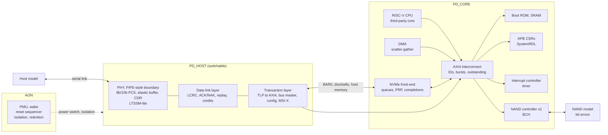

# Storage_SoC

[](https://github.com/yhkwon-git/Storage_SoC/actions/workflows/ci.yml)

PCIe 계열 Serial Host Link 위에 NVMe 방식 Front-end를 갖춘 소형 스토리지 컨트롤러 SoC이다.

플랫폼은 RISC-V CPU, AXI4 Interconnect, DMA, SystemRDL로 생성한 CSR, Always-on 및 Switchable Power Domain으로 구성된다. 그 위에 Host Interface(NVMe 방식 Queue와 Command Front-end, Host Memory에도 Master로 접근하는 Transaction Layer, Data Link Layer, PIPE 방식 경계를 갖는 PHY)와 BCH를 포함한 NAND Flash Datapath가 올라간다. IP마다 전용 Testbench를 두고, SoC 전체는 UVM 환경, 합성, Multi-corner STA로 이루어진 오픈소스 플로우에서 Sign-off한다.

## 한눈에 보기

| 항목 | 내용 |
| --- | --- |
| 현재 단계 | Phase 2 Host Link: 2-6~2-9(Data Link Layer, PHY, Link Training, 전체 Stack) 진행 예정. Phase 1, 2-1~2-5, Phase 3(NAND Channel, NAND 모델, BCH, NAND까지의 NVMe Read · Write) 완료. ss corner Setup 미충족(docs/09~docs/17) |
| 설계 | Boot ROM의 Firmware를 실행하는 Ibex RV32IMC와 4 x 6 AXI4 Crossbar, SRAM, Descriptor 기반 DMA, SystemRDL로 레지스터를 생성한 APB SYS · Interrupt Controller · Timer. Reset 순서를 제어하고 Isolation · Retention(UPF)과 함께 PD_HOST Domain을 전환하는 Always-on PMU. CPU Clock Gate. Host Link의 PCIe 방식 Transaction Layer(Inbound BAR, Bus Master, Configuration Space, MSI-X). NVMe 방식 Controller(Register, Doorbell, SRAM으로의 Round-Robin Command Fetch, List를 포함한 PRP 데이터 전송, Phase Tag와 Queue별 MSI-X를 사용하는 Completion Queue Entry, Firmware가 명령을 보유한 상태에서도 Controller Reset을 안전하게 만드는 Epoch)와, 이를 구동하여 Admin · Read · Write · Flush 명령을 SRAM 또는 NAND 위 Flash Translation Layer에서 처리하는 Firmware. ONFI 방식 비동기 Interface를 갖는 NAND Channel 2개(채널마다 clk_nand의 Bus Sequencer, Command · Completion Queue, 8 KiB Page Buffer, 512 byte당 8 bit를 정정하는 BCH Encoder · Decoder). Dual-clock FIFO, 2-flop Synchronizer, Channel Register Slice |
| 검증 도구 | Vivado Simulator 2019.2(UVM 1.2), Verilator 5.052 |
| 레지스터 생성 | PeakRDL 1.5.0: 단일 소스에서 Register RTL, C Header, UVM Register Model, 레지스터 문서 생성 |
| 구현 도구 | sv2v 0.0.13, Yosys 0.52, OpenSTA 3.1.0, lambdapdk v0.2.9의 Sky130 HD(ss/tt/ff corner) |

이 저장소의 모든 수치에는 측정 시점의 commit을 함께 표기하며, 해당 수치를 산출한 스크립트도 저장소에 포함되어 있다.

## 아키텍처: 목표 구성



- **Platform.** AXI4 Adapter를 거쳐 연결한 Third-party RISC-V Core, ID · Burst · Outstanding 트랜잭션을 처리하는 AXI4 Interconnect, Boot ROM과 SRAM, Interrupt Controller와 Timer, Descriptor 기반 DMA로 구성된다.
- **CSR.** 하나의 SystemRDL 소스에서 APB Register Block, Firmware용 C Header, UVM Register Model, 레지스터 문서를 생성한다.
- **Clock · Reset · Power.** 4개의 Clock Domain, 순서대로 해제되는 Reset Synchronizer, Clock Gating, Host Domain을 전환하는 Always-on PMU, 그리고 UPF로 기술하고 Power-aware Testbench로 검증한 Isolation · Retention으로 구성된다.
- **Host Interface.**
  - NVMe 방식 Front-end: Controller Register와 Doorbell, Admin Queue와 I/O Queue Pair 4개, Round-Robin 중재 기반 Command Fetch, Host Memory와 SRAM 간 PRP 데이터 전송, Phase Tag를 사용하는 Completion Posting, Completion Queue별 MSI-X로 구성된다. Admin 명령과 I/O 명령(Read, Write, Flush)은 Firmware가 처리한다.
  - Transaction Layer는 AXI4에서 Host 요청을 처리하는 동시에 Host Memory에 Master로 접근하며(Tag, Completion 재조립, Payload 분할), BAR0와 MSI-X Capability를 갖는 Configuration Space를 포함한다.
  - 하위 계층으로 LCRC · ACK/NAK · Replay · Credit을 갖는 Data Link Layer, Power State와 연동된 축소형 Link Training State Machine, PIPE 방식 경계 뒤의 PHY(8b/10b PCS, Comma Alignment, Reference Clock ppm Offset 보상용 Elastic Buffer, Digital CDR)가 위치한다.
- **Storage Path.** ONFI 방식 비동기 Interface를 갖는 NAND Channel Controller 2개, BCH Encoder · Decoder, 그리고 NVMe Read · Write를 SRAM을 거쳐 NAND까지 처리하는 Firmware로 구성된다.

## 개발 로드맵

| Phase | 범위 | 상태 |
| --- | --- | --- |
| 0 | Toolchain 확인, 저장소 구조, CI, RISC-V GCC | 완료 |
| 1 | SoC Platform: CPU, AXI4 Interconnect, CSR, DMA, Clock/Reset/Power Domain, Firmware | 완료: 1-1~1-9. ss Setup 미충족(docs/09) |
| 2 | Host Interface: Transaction Layer 및 NVMe Front-end(2-1~2-5), 이후 Data Link Layer, PIPE 방식 경계의 PHY, Link Training(2-6~2-9) | 진행 중: 2-1~2-5 완료, 2-6~2-9는 Phase 3 이후 |
| 3 | Storage Datapath: NAND Channel Controller, NAND 모델, BCH, NAND까지의 NVMe Read · Write | 완료: 3-1~3-4 |
| 4 | SoC 수준 UVM, 검증 계획, Coverage Closure | 예정 |
| 5 | Full-chip 합성 및 Multi-corner STA, 문서화 | 예정 |
| 6 | 선택 과제: PHY용 DSP Receiver(FFE, DFE, Mueller-Muller CDR, Real-number Analog 모델) | 선택 |

진행 순서는 Phase 1 → 2-1~2-5 → Phase 3 → 2-6~2-9 → Phase 4, 5이다. 2-1~2-5는 Transaction 수준 Host 모델을 대상으로 수행하므로, Serial Link가 완성되기 전에 NVMe 명령이 NAND까지 도달하는 경로를 먼저 확보한다. 이후 2-6~2-9에서 동일한 Host 모델과 테스트를 Serial Link 뒤로 옮긴다.

## 검증 환경

| 도구 | 확인 버전 | 역할 |
| --- | --- | --- |
| Vivado Simulator(xsim) | 2019.2 | UVM 1.2 Testbench: Sequence, Constrained Random, Covergroup |
| Verilator | 5.052 | Lint, 고속 Regression, Line/Branch/Toggle Coverage, Covergroup Bin |
| GitHub Actions | `verilator/verilator:v5.052` 이미지 | Push마다 Verilator 검사 실행 |
| PeakRDL | 1.5.0(`flow/rdl/requirements.txt`) | 레지스터 파일 생성. `make -C dv rdl-check`로 커밋된 파일과 소스의 일치 여부 확인 |

Phase 0 확인 결과(2026-11-21, commit ce2671d):

- xsim 2019.2에서 `randomize()`와 Covergroup을 사용하는 UVM 1.2 Sequence-to-Driver 테스트가 정상 동작한다: 50 item, Coverage 100.0, UVM_ERROR 0.
- Verilator 5.052는 Cross를 포함한 14개 Covergroup Bin 전체를 Hit Count와 함께 `coverage.dat`에 기록한다. 단일 Coverpoint에 대한 `get_coverage()`는 컴파일되지 않고 Covergroup 합계는 실행 중 0.0으로 읽히므로, Verilator Coverage 수치는 `coverage.dat` 기준으로 산출한다.
- `-Wall`에서 Verilator는 모든 Covergroup에 자체적으로 추가하는 멤버(`option`, `total_bins`, ...)에 대해 경고를 출력한다. Waiver는 Covergroup 블록에만 적용한다.

## 단계별 결과

### 1-2 공통 블록 (commit 8ce1fac)

상세: [docs/02_common_blocks.md](docs/02_common_blocks.md)

- **Dual-clock FIFO.** 4:1부터 1:4까지 6개 Clock 비율에서 각각 Random 및 Full-rate 트래픽으로 12회 실행했으며, 실행당 20,000 word를 전송했다. 데이터 오류 0, 처리량은 이론 상한의 97.9~101.0%이다. 교체 전 FIFO는 동일 Clock 비율에서 상한의 12.5~24.8%(4:1 비율만 50~68%)에 그쳤다.
- **Register Slice.** Random beat 5,000개가 순서대로 전달된다. VALID와 READY가 1로 유지되면 클록당 1 beat, Latency 1클록이다. 다운스트림이 k클록 Stall되면 업스트림도 정확히 k클록 동안 Back-pressure를 받는다(k = 1~6).

### 1-3 AXI4 Crossbar (commit 76fd272)

상세: [docs/03_axi_crossbar.md](docs/03_axi_crossbar.md)

- **Directed Test.**
  - 매핑되지 않았거나 경로가 없는 Burst 72건은 DECERR로 응답하며, Slave에 도달하지 않는다.
  - 4개 Master가 하나의 Slave로 보낸 Burst 32건이 손상 없이 Read-back된다.
  - 다른 Slave로 전환하는 ID는 앞선 트랜잭션의 완료를 기다리며, 완료 1클록 뒤에 수락된다.
  - Master당 Outstanding은 Read 4건, Write 4건까지이다.
  - 서로 다른 Slave는 같은 클록에 동시 처리된다.
  - Round-Robin Grant 200회의 분배는 50, 50, 50, 50이다.
  - 16-beat Burst에서 Write · Read 모두 클록당 1.000 beat를 처리한다.
- **Random Test.** 10 Seed, 8% DECERR 트래픽을 포함한 Burst 80,000건, ID 간 응답 재정렬, Random READY와 Latency 조건에서 오류 0, Covergroup Bin 62/62.
- **RTL Coverage.** Line 31/32(도달 불가능한 `default` 1개), Branch 72/72, Toggle 70.6%. 미검출 Toggle은 대부분 구성(Configuration)에 의해 고정된 비트이다.
- **Mutation Check.** 의도적으로 삽입한 버그 7/7 검출: ID 규칙, Outstanding 한도, R Lock, AW Grant 유지, W 순서, Path Table, B Routing.

### 1-4 CPU Subsystem (commit 3e51bad)

상세: [docs/04_cpu_subsystem.md](docs/04_cpu_subsystem.md)

- **Core.** Ibex v2.1.0(RV32IMC). 43개 파일을 수정 없이 반입했으며, AXI4 Adapter 2개를 거쳐 연결한다.
- **Firmware 테스트.** 5종(hello, memtest, irq, buserr, perf)이 단독 실행과, M2 · M3가 SRAM에 Random Burst를 인가하는 상황 모두에서 통과한다. memtest 실행 기준 Background Burst 158,866건에서 양측 모두 오류 0이다.
  - memtest는 Misaligned word 12건을 포함한다.
  - irq는 External Interrupt를 가장 낮은 ID부터 Claim한다.
  - buserr는 DECERR, SLVERR, PSLVERR가 해당 Access Fault로 변환되는지 확인하고(6가지 경우), SRAM으로 복사한 코드를 실행한다.
- **ROM 코드 기준 CPI.**
  - Register 연산만 수행하는 Loop는 Background 트래픽 유무와 관계없이 1.42이다.
  - SRAM 대상 CRC-32는 단독 실행 시 1.40, SRAM 경합 시 1.67이다.
- **APB Bridge.** M3의 64-bit 검사로 CPU가 사용하지 않는 경로를 확인한다: 2-word beat, Strobe가 적용된 word, beat 내 PSLVERR, 빈 Slot, Burst.
- **Lint.** soc_top은 `-Wall` Clean이며, Vendor 파일은 Waiver로 처리했다.

### 1-5 CSR (commit 888d3e5)

상세: [docs/05_csr.md](docs/05_csr.md)

- **단일 소스.** `rtl/csr/rdl/soc_apb.rdl`이 SYS, INTC, TIMER(레지스터 14개)를 기술하며, PeakRDL이 이로부터 다음을 생성한다.
  - APB Register RTL
  - Firmware Header
  - UVM Register Model
  - [docs/regs/soc_apb.md](docs/regs/soc_apb.md)

  Wrapper는 기존 포트를 유지하면서 Counting, Claim, Event 로직을 추가한다.
- **동작 동일성.** 수작업 블록과 동일한 Map과 APB Timing을 유지하여 모든 SoC Clock 수가 변하지 않았으며, Firmware Image도 Byte 단위로 동일하다.
- **xsim UVM Register Test.** 생성된 모델에 대해 UVM Reset Sequence(레지스터 12개), Bit Bash(레지스터 10개), 동작 · Decode 검사 33건을 수행했다: APB 전송 1,191건에서 실패 0, UVM_ERROR 0.
- **Mutation Check.** 의도적으로 삽입한 버그 4/4 검출(commit 7bbaca7): Reset 값, Stuck Bit, Claim 순서, Decode Error 누락.

### 1-6 DMA (commit 2c90ba1)

상세: [docs/06_dma.md](docs/06_dma.md)

- **설계.** 16-byte Descriptor Chain을 M2로 복사한다.
  - 별도 Read ID를 사용하는 Descriptor Prefetch
  - 4 KB 경계에서 분할되는 16-beat Burst
  - 임의의 Source · Destination Byte Offset을 처리하는 Aligner
  - 앞선 Descriptor의 Destination을 읽는 Descriptor를 위한 FENCE

  Crossbar에서 다른 Master를 Block하지 않도록 두 가지 규칙을 적용한다.
  - Read는 데이터를 받을 공간이 있을 때만 발행하므로 RREADY가 항상 1이다.
  - AW는 Burst 전체가 Buffer에 모였을 때만 발행하므로 W가 Burst 중간에 Stall되지 않는다.
- **오류 처리.** 첫 오류의 원인과 주소를 기록하고, 이미 발행한 트랜잭션을 모두 Drain한 뒤 ERR를 설정한다. 5가지 원인을 각각 검증했다.
- **Block Testbench.**
  - 모든 Byte를 Reference와 비교하며, 각 Destination 앞뒤에 Guard Byte를 둔다.
  - Directed Test는 Source/Destination Offset 조합 64가지 전체, Page 분할, FENCE, 각 오류 원인, Abort와 Restart를 다룬다.
  - Error 구간이 있는 Random-latency 메모리에서 Random Chain을 실행했다: 10 Seed, Chain 2,000개, 17.2 MB 복사, Error Run 163회, Abort 84회, 오류 0, Covergroup Bin 155/155.
  - Mutation Check: 의도적으로 삽입한 버그 10/10 검출.
- **처리량.** Stall이 없는 메모리에서 64 KiB 복사 시 클록당 7.97 byte(Bus 대역폭의 99.6%)이다. SoC에서 SRAM → SRAM 4096 B 복사는 571 클록이 소요된다(`dma` Firmware 테스트).
- **SoC.** `dma` Firmware 테스트는 SRAM과 두 NAND Page Buffer를 거쳐 복사하고, DONE Interrupt 기반으로 Unaligned 조각을 Scatter하며, M2에 경로가 없는 주소에 대해서는 DECERR와 함께 ERR Interrupt를 받는다. 단독 실행 시 기존 테스트의 Clock 수는 그대로 유지된다.

### 1-7 Clock · Reset · Power (commit ca320d4)

상세: [docs/07_clock_reset_power.md](docs/07_clock_reset_power.md)

- **구조.** 4개의 Clock 입력과 Power-on Reset이 다음 블록에 공급된다.
  - APB Request/Acknowledge Crossing을 거쳐 접근하는 Always-on Domain의 PMU
  - AON → Core → NAND → Host 순서로 해제하는 Reset Synchronizer
  - Always-on 레지스터를 보존하는 Chip Reset
  - PD_HOST Sequencer: Isolation, Save, PLL, Reset, Switch 순서로 동작하며, 모든 대기 단계에 Timeout이 있고, Wake Pin과 Host 경로가 Busy일 때의 거부 동작을 포함한다.
- **PD_HOST.** Phase 2 로직을 위한 Placeholder로, Retention 레지스터를 갖고 4개의 Isolation Cell 뒤에 위치한다. `syn/upf/storage_soc.upf`가 Domain을 기술하며, 스크립트로 RTL의 Isolation · Retention Cell과 대조한다.
- **Power Testbench.** Verilator에서는 PD_HOST가 꺼진 동안 Random 값을, xsim에서는 X를 인가하여 실행한다. Sequencing은 매 사이클 검사한다.
  - Power Cycle 전후로 Retention 값이 유지되고, 비보존 상태는 Reset 값으로 복귀한다.
  - 거부, Wake, Switch 및 PLL Timeout, Chip Reset이 모두 사양대로 동작한다.
  - Mutation Check: 의도적으로 삽입한 버그 11/11 검출.
- **CPU Clock Gate.** `ibex_top`과 같은 방식으로 WFI 중 Ibex Clock을 Gating한다. Gate를 켜도 기존 Firmware 테스트는 모두 동일한 Clock 수에서 종료되며, 2000-tick WFI에서 1,967 클록을 절감한다.
- **Firmware.** `power`는 Interrupt가 발생하는 상황에서 PD_HOST를 Power Cycle하며 Retention 상태를 확인하고, `reset`은 두 번의 Boot에 걸쳐 DMA Soft Reset, Clock Gate, Chip Reset을 확인한다.

### 1-8 Firmware (commit fbe4b8a)

상세: [docs/08_firmware.md](docs/08_firmware.md)

- **Driver.** 하나의 Trap Handler가 Timer와 INTC의 각 Source를 해당 Driver로 Dispatch한다. Sleep은 Interrupt를 Mask한 상태에서 Flag를 확인하므로, 확인 시점과 WFI 사이에 발생한 Interrupt가 유실되지 않는다. Driver는 Timer, DMA, PMU, PD_HOST Placeholder, CRC-32를 다룬다.
- **soc_app.** 3.5 KiB 코드로 Phase 1 흐름 전체를 실행한다: Boot, 16 KiB Memory Check, NAND0 Page Buffer를 거치는 DMA 복사와 CRC 검증, CPU · DMA 동시 동작, Retention 상태를 확인하는 PD_HOST Power Cycle. 단독 실행과 Background 트래픽 상황 모두에서 통과한다.
- **CPU · DMA 동시 동작.** 8 KiB 복사가 4 KiB CRC 계산 도중에 완료되며, 이로 인한 CRC의 Clock 수 증가는 1.5%이다.

### 1-9 합성 · 타이밍 · CDC (commit 7a0d727)

상세: [docs/09_timing.md](docs/09_timing.md)

- **합성.** sv2v와 Yosys로 Ibex를 포함한 SoC 전체를 Sky130 HD에 Mapping했다: 40,432 Cell, Standard Cell 면적 0.47 mm²(SRAM Macro 제외). 가장 큰 블록은 DMA(42%, 대부분 Flop으로 구현한 32-beat FIFO 2개)이며, 그다음은 CPU(26%)이다.
- **STA.** Multi-clock 제약 조건에서의 OpenSTA 결과는 다음과 같다.
  - tt에서 `clk_sys` 50 MHz, `pclk` 62.5 MHz를 만족하며, Register-to-Register 여유는 +3.99 ns이다.
  - ff에서 Setup은 만족하고, SRAM Macro 입력의 Hold가 23 ps 부족하여 Layout 단계로 넘긴다.
  - ss_n40C_1v40에서는 Setup이 49 ns 부족하여 `clk_sys`는 약 14.5 MHz 수준이다. Critical Path는 CPU에서 Crossbar Arbitration을 거쳐 DMA로 이어지며, Master 측에 Register Slice를 삽입하면 분할할 수 있다.
- **CDC 검사.** 스크립트로 Netlist의 모든 Crossing을 추적한다. 모든 Crossing은 Synchronizer(26 bit), Handshake 레지스터(80), FIFO Word(400), PMU 제어(560) 중 하나이다. 실제 버그 1건을 발견했다: Counter를 Decode한 Idle Flag가 Synchronizer에 직접 입력되어 Glitch가 발생할 수 있었으며, 현재는 Flop 출력으로 수정했다.

### 2-1 Transaction Layer (commit 4a8e515)

상세: [docs/10_transaction_layer.md](docs/10_transaction_layer.md)

- **설계.** Host는 BAR0(Register Window, MSI-X Table 및 PBA)와 BAR2(SRAM Window)를 통해 SoC 메모리를 읽고 쓰며, 다수의 Read를 동시에 Outstanding으로 처리하고 Completion은 128-byte 경계에서 분할한다. Bus Master로서 SoC는 Host Memory와 데이터를 주고받는다. Read는 Tag 16개와 재조립으로, Write는 Buffer에 모은 Local 데이터로 수행하며, 둘 다 MPS 또는 MRRS와 4 KiB 경계에서 분할한다. PCI Express 및 MSI-X Capability를 갖는 Type 0 Configuration Space를 포함한다. Malformed TLP는 Store-and-forward 수신 Buffer에서 통째로 제거되며, Unsupported Request에는 UR로 응답한다.
- **SoC 통합.** M3가 Transaction Layer의 AXI Port이다. PD_HOST Power-down에는 Link Hold와 Drain(HOST LINK_CTRL.HOLD)이 필요하며, Host가 설정한 Configuration은 Power Cycle 후에도 유지된다.
- **Block Testbench.** TLP 수준 Host 모델(Host Memory를 갖는 Root Complex, Completion 분할 · 재정렬, Fault Injection)로 Directed Test 6종과 Random Test를 수행했다. 10 Seed에서 Inbound 동작 30,000건, Bus Master 전송 1,040건, MSI-X Message 237건을 처리했으며 오류 0, Covergroup Bin 172/172. Mutation Check: 의도적으로 삽입한 버그 13/13 검출.
- **처리량**(경합이 없는 조건): Inbound 256-byte Write는 클록당 7.05 byte, 4 KiB Read Outstanding은 6.70, 64 KiB Bus Master 전송은 방향별로 7.07과 7.28이다. 1-DW Read는 13 클록이 소요된다.
- **SoC.** Host 모델이 모든 Firmware 테스트에서 Device Enumeration을 수행하며, Background 트래픽과 APB 검사는 BAR2와 BAR0를 거친다. 신규 Firmware 테스트는 Host Memory에서 8 KiB를 1,444 클록에 가져오고, 1,188 클록에 Host로 다시 전송한다. Host Link를 사용하지 않는 기존 Firmware 테스트는 모두 동일한 Clock 수에서 종료된다.
- **합성 및 타이밍.** tt에서 모든 Clock을 만족한다. Standard Cell 면적 1.32 mm² 중 Transaction Layer가 61%를 차지하며, 대부분은 Flop으로 구현한 64-beat Buffer 3개이다. CDC 검사 PASS.
- **개발 중 발견한 이슈.** Zero-length Read의 Lower Address, VALID 유지 중 변경되던 Arbiter 선택, Power-up 직후 FIFO가 아직 Reset 상태일 때 유실되던 첫 TLP, Synchronizer 앞단의 로직, 그리고 Data 레지스터로 인해 Reset Net이 Data 입력으로 바뀐 외부 Register Slice(수정 전 tt에서 −131 ns).

### 2-2 NVMe Register · Queue (commit 883242d, d3a786e)

상세: [docs/11_nvme_queues.md](docs/11_nvme_queues.md)

- **설계.** CAP, VS, CC, CSTS, AQA, ASQ, ACQ와 Admin Queue 및 I/O Queue Pair 4개의 Doorbell은 Transaction Layer 내부의 Register Port(BAR0)에 위치하여 AXI를 거치지 않는다. CC.EN은 Controller를 Enable · Reset하고, CC.SHN은 Shutdown을 수행하며, 잘못된 Doorbell은 Firmware에 보고한다. Controller는 Transaction Layer의 Bus Master를 통해 명령을 Round-Robin으로 Fetch하여 SRAM의 Command Slot 16개에 저장하고, {queue, slot}을 FIFO로 Firmware에 전달한다. I/O Queue는 Firmware가 Admin 명령을 받아 생성한다.
- **Block Testbench.** Host 모델을 NVMe Host로 사용하여 Directed Test 8종과, Controller Reset · Shutdown을 포함한 Random Test를 수행했으며, 모든 명령의 Queue, 순서, 내용을 확인한다. 10 Seed에서 명령 20,008개를 제출하고 Controller Reset 50회에 걸쳐 15,395개를 Fetch · 확인했으며, 오류 0, Covergroup Bin 49/49. Mutation Check: 14/14.
- **Fetch 속도.** 빠른 Host 조건에서 명령당 40 클록이며 한 번에 하나씩 Fetch한다: 50 MHz 기준 초당 125만 개(1.25 M/s) 명령.
- **SoC.** 신규 Firmware 테스트가 Host로부터 Create I/O Completion Queue와 Create I/O Submission Queue를 받아 Queue Pair를 구성하고, 해당 Queue로 Read 명령 12개를 수신한다. 단독 실행과 Host 트래픽이 있는 상황 모두에서 통과한다. APB Bridge는 Slot 16개로 확장되었다.
- **합성 및 타이밍.** Controller는 Standard Cell 면적의 3.6%이다. tt에서 모든 Clock을 만족하며, CDC 검사는 새 Crossing 없이 PASS.
- **개발 중 발견한 이슈.** 범위 검사에서 16을 0으로 잘라 비교하던 16-slot APB Bridge(Lint로 발견), 그리고 2-1 이후 Build 실패를 검출로 집계하던 Power Mutation Check.

### 2-3 NVMe 데이터 전송 · Completion (commit 569ad05)

상세: [docs/12_nvme_data.md](docs/12_nvme_data.md)

- **설계.** PRP Engine이 Firmware를 대신하여 명령의 데이터를 Host Memory와 SRAM 사이에서 이동한다. Offset을 갖는 PRP1, 두 번째 Page 또는 List Pointer로 사용되는 PRP2, 8개 단위로 Fetch하며 List Page를 따라가는 List Entry를 처리한다. Completion Poster는 Firmware로부터 Entry를 받아 Queue에 공간이 생길 때까지 대기하고, SQ Head와 Phase Tag를 채워 Entry를 기록한 뒤 해당 Queue의 MSI-X Vector를 발행한다. List Entry와 Posting 중인 Entry는 신규 Crossbar Slave Port에 연결된 128-byte Controller Buffer를 거친다.
- **Block Testbench.** Host 모델이 Host Memory에 PRP Layout을 구성하고 Phase 기준으로 Completion Entry를 수신하며, 모든 Field와 읽은 모든 Byte를 확인한다. Firmware 역할의 Testbench가 데이터를 이동하고 Entry를 Posting한다. 신규 Directed Test 3종과 Random I/O 테스트를 10 Seed로 수행하여 Completion 2,281개 확인, 25 MB 전송, 오류 0, Covergroup Bin 95/95(Directed Test만으로 전체 Hit). Mutation Check: 27/27.
- **처리량.** SRAM → Host 방향 클록당 6.6 byte, 반대 방향 5.6 byte(Page당 Bus Master 전송 1회)이다. Completion Entry는 Firmware가 Posting한 뒤 17 클록 후 Host Memory에 기록된다.
- **SoC.** Firmware 테스트가 모든 명령을 Completion까지 처리한다. Admin 명령 2개 이후 SRAM의 16-block Namespace에 대해 PRP List를 사용하는 Write와 Read를 수행하고, Host가 Read-back하여 확인하며, 해당하는 경우 오류 Status를 반환한다.
- **개발 중 발견한 이슈.** 한 클록 늦은 Tail 갱신으로 다음 Entry가 아직 읽지 않은 Entry를 덮어쓸 수 있던 문제(설계 리뷰에서 발견), Queue의 순환(Lap)을 구분하지 못하던 Testbench 검사, Verilator가 Module Task를 호출부마다 복사하여 15분까지 늘어났던 Testbench Build 시간(현재 4분).

### 2-4 NVMe Firmware (commit 491d727)

상세: [docs/13_nvme_firmware.md](docs/13_nvme_firmware.md)

- **Firmware.** `nvme_app`이 NVMe Interrupt를 받아 Front-end 명령을 처리한다.
  - Admin: Identify(Controller, Namespace, Active Namespace List), I/O Queue 생성 · 삭제, Set · Get Features(Number of Queues, Vendor-specific Transfer Overlap)
  - I/O: SRAM의 24-block Namespace에 대한 Read, Write, Flush
  - 그 외 명령에는 규격에 정의된 Status를 반환

  Overlap을 켜면 현재 전송이 진행되는 동안 다음 명령의 전송을 미리 설정하고, 현재 전송이 끝나는 즉시 시작한다.
- **SoC 테스트.** `tb_soc`의 Host가 Host Driver와 같은 절차로 Controller를 초기화하고 I/O Queue Pair 4개를 생성한다. 두 Mode에서 Queue Depth 1~16의 Read를 수행한 뒤 Flush, 오류 명령, Queue 삭제, Controller Reset, Shutdown을 실행한다. 모든 Completion과 읽은 모든 Byte를 확인하며, 단독 실행과 Background 트래픽 상황 모두에서 통과한다.
- **측정 결과**(50 MHz 기준):
  - QD1 4 KiB Read는 Doorbell부터 Completion Entry까지 1,400 클록이 소요된다.
  - 4 KiB Read는 QD16에서 48,045 IOPS, Overlap 적용 시 62,274 IOPS이다.
  - 512-byte Read는 Overlap 적용 시 105,297 IOPS이다.
  - CPU의 APB 레지스터 접근은 Read 8 클록, Write 9 클록이다.
- **성능 제약 요인.**
  - 512-byte Read는 Firmware Bound로 명령당 약 475 클록이며, 그중 약 155 클록이 약 18회의 레지스터 접근에 소요된다.
  - 4 KiB Read는 명령마다 Fetch, 데이터, Completion Entry를 순차적으로 처리하는 Transaction Layer의 단일 Bus Master가 Bottleneck이다(약 800 클록).
- **개발 중 발견한 이슈.** Shutdown을 먼저 확인하면서 집계되지 않던 Controller Reset, 그리고 모든 Application에 Link되던 Driver.

### 2-5 NVMe Host Driver 모델 및 검증 (commit c5e2b96)

상세: [docs/14_nvme_host_verification.md](docs/14_nvme_host_verification.md)

- **Epoch.** Firmware가 명령을 보유한 상태에서 Controller Reset이 발생하면, Host가 Controller를 다시 Enable한 이후에도 해당 명령이 데이터를 이동하거나 Entry를 Posting하고, Slot을 반환하거나 Queue를 생성할 수 있었다. 이 구간은 Firmware만으로는 해소할 수 없다. 이에 Controller가 Reset 횟수를 Epoch로 관리하고, Firmware는 명령마다 받은 Epoch를 해당 명령에 대한 모든 동작에 함께 기록하도록 했다. 다른 Epoch를 가진 요청은 하드웨어가 무시한다.
- **Host Driver 모델.** Transaction 수준 Host 모델 위에 구현한 Class 기반 NVMe Host이다.
  - Admin 명령으로 Queue를 생성 · 삭제하며, 임의의 SQ를 임의의 CQ에 연결할 수 있고 CQ와 Vector를 공유할 수 있다.
  - PRP1, PRP2, PRP List를 사용하고 Phase Tag로 Completion을 수신하며, 모든 CID, SQID, Status, SQ Head, 읽은 Byte를 Namespace 사본과 대조한다.
  - 명령이 Outstanding인 상태에서 Controller Reset을 수행하고, 이후 버려진 명령이 완료되거나 Buffer에 기록하지 않는지 확인한다.
- **SoC 테스트.** `nvme_rand`가 이 모델을 2-4 Firmware에 대해 실행한다: 4회 실행, 명령 5,358개, Controller Reset 20회(버려진 명령 330개), 6.6 MB Read 및 비교, 오류 0, Covergroup Bin 81/81. 이 과정에서 하드웨어는 Stale 명령에 대해 Firmware가 시도한 전송 시작 8회와 Completion Posting 9회를 거부했다.
- **Assertion.** Controller Queue 상태에 대한 Assertion 13개를 두 NVMe Testbench에 Bind했다. `tb_nvme`에는 신규 Epoch 테스트를 추가했으며, Bin 101/101, Mutant 33/33 검출(Epoch 관련 신규 6개 포함)이다.
- **개발 중 발견한 이슈.**
  - Firmware가 모든 I/O Completion을 SQ 번호와 같은 번호의 CQ에 Posting하던 문제.
  - Reset이 Slot을 해제한 뒤 한 클록 늦게 비워지던 Command FIFO. 해당 클록에 CMD가 Stale 명령을 새 Epoch로 제공하던 문제를 Slot Assertion이 발견했다.
- **합성 및 타이밍.** NVMe Controller는 Standard Cell 면적의 10.3%이다. tt에서 모든 Clock을 만족하며, CDC 검사는 새 Crossing 없이 PASS.

### 3-1 NAND Channel Controller (commit f67f5d6)

상세: [docs/15_nand_channel.md](docs/15_nand_channel.md)

- **설계.** S3와 S4의 단순 메모리를 동일 주소의 NAND Channel 2개로 교체했다.
  - **Bus 측:** `clk_nand`의 Sequencer가 8-bit ONFI 방식 비동기 Interface를 구동한다. Reset, Read ID, Page Read, Change Read Column, Page Program, Block Erase, Read Status를 실행하며, 타이밍은 Firmware가 명령마다 설정한다. R/B#를 Timeout과 함께 대기하고 Status Byte를 결과 Code로 변환한다.
  - **`clk_sys` 측:** 4단 Command Queue, 8단 Completion Queue(Completion 공간이 있을 때만 명령 발행), Data Mover, SRAM Macro 1개로 구성된 8 KiB Page Buffer로 이루어진다. Page Buffer는 Bus 요청을 우선 처리하므로 기존 Firmware 테스트는 모두 동일한 Clock 수에서 종료된다.
  - **Crossing:** 명령, 데이터, Completion은 Dual-clock FIFO 4개를 통해 Clock Domain을 넘는다.
- **NAND 모델.** ONFI 방식 Target이 명령에 응답하고, Controller가 준수해야 할 모든 Interface 규칙을 ns 단위로 검사한다: Pulse Width, Setup · Hold, tWHR, tADL, tRR, Bus Contention.
- **Block Testbench.** Directed Test 12종과 Random 10 Seed를 3가지 `clk_nand` 주기에서 실행했다. Interface 검사 2,244,656건 아래에서 486,922 byte를 Program하고 616,328 byte를 Read했으며, Bus Assertion을 Bind한 상태로 오류 0, Covergroup Bin 32/32. Mutation Check: 18/18.
- **처리량.** 가장 빠른 설정에서 `clk_nand` 2 클록마다 1 byte, 즉 25 MB/s이다. 4,320-byte Page의 Program은 9,689 클록, Read는 8,924 클록이며, 모델의 Busy 시간을 포함한 값이다.
- **SoC.** 신규 Firmware 테스트가 두 Channel에서 Identify, Program, Read-back, Spare Area, Interrupt를 사용하는 두 Channel 동시 동작, Write Protect를 확인한다. 단독 실행과 Background 트래픽 상황 모두에서 통과한다. UVM Register Test는 NAND0와 NAND1을 포함하여 74건을 검사했으며 실패 0이다.
- **합성 및 타이밍.** Channel은 Standard Cell 면적의 10.3%이다. `clk_nand`는 ss를 포함한 모든 Corner에서 50 MHz를 만족하며, CDC 검사 PASS.
- **개발 중 발견한 이슈.** CDC 검사로 Synchronizer 앞단의 Inverter를 발견했다. Mutation Check로 Testbench의 Blind Spot 두 가지를 발견했다: Program과 Read가 같은 잘못된 Page로 향해 드러나지 않던 0 고정 주소 Byte, 그리고 너무 이른 시점의 R/B# 확인이다. 현재 Testbench는 모델의 Array를 직접 확인하며, 모델의 R/B#는 100 ns 후에 Low로 전환된다.

### 3-2 NAND 모델 (commit 6b4fc0a)

상세: [docs/16_nand_model.md](docs/16_nand_model.md)

- **소자 동작.** Testbench의 NAND 모델이 실제 소자처럼 동작한다. RTL 변경은 없으며, 기본값이 3-1의 동작을 유지하므로 기존 Firmware 실행 29개는 이전과 동일한 Clock 수에서 종료된다.
  - **Busy 시간:** Program-and-Verify Loop와 Erase Pulse를 기반으로 동작마다 산출한다.
  - **Wear:** P/E Cycle이 누적되면 Program은 짧아지고 Erase는 길어지며, 정격 Endurance에서 Bit Error Rate가 10배로 증가한다. 이를 넘어서면 Erase가 실패하기 시작하고 Block이 Wear-out된다.
  - **Raw Bit Error:** Read 시 비율 지정, 영역별 정확한 개수, Stuck Bit 방식으로 주입하며, 반전된 모든 Bit를 Log로 기록한다.
  - **Factory Bad Block**과 Marker, **Program 규칙** 검사(Page 순서, Partial-program 한도, Bad Block 및 Erase가 중단된 Block), 그리고 Reset이 Program · Erase · Read를 중단했을 때 남는 상태를 모델링한다.
- **Block Testbench.** 신규 Directed Test 5종이 Firmware와 같은 방식으로 Controller를 통해 모델을 검증한다.
  - 짝수 Random Seed는 Busy 시간 변동과 100만 bit당 200개의 Bit Error를 적용하여 실행했으며, 읽은 모든 Byte가 Log에 기록된 Bit만 반전된 기대값과 일치했다.
  - BUSY_TIME은 Busy 테스트의 동작 162개 모두에서 동작 시간 − tWB − 1 클록과 같다.
  - Covergroup Bin 66/66. 모델 Mutation Check 21/21, RTL Mutation Check는 기존과 같이 18/18.
- **SoC.** NAND Characterization Firmware 테스트를 추가했다.
  - 두 Channel의 Factory Bad Block을 Scan하여, Marker에 Raw Bit Error가 있어도 의도적으로 배치한 3개만 정확히 식별한다.
  - 신품 Block과 마모된 Block의 Busy 시간을 측정한다: Erase는 50 µs와 150 µs이며, Program은 마모된 Block에서 더 빠르다.
  - Raw Bit Error를 집계한다: 신품 4 Page에서 20개, 마모된 4 Page에서 254개이며, 합계 274개가 모델이 반전한 Bit와 일치한다.

### 3-3 BCH 오류 정정 (commit 2c9bc8b)

상세: [docs/17_bch.md](docs/17_bch.md)

- **부호.** GF(2^13) 위의 Binary BCH로, Data 512 byte, Metadata 4 byte, Parity 13 byte로 구성된 Codeword마다 8 bit Error를 정정한다. Python Reference 모델이 부호를 정의하고 RTL 상수와 Test Vector를 생성하며, Decoder를 교과서 형태와 하드웨어 형태 모두로 구현해 두었다.
- **설계.** NAND Channel마다 Program 경로에 Encoder, Read 경로에 Decoder를 두며, `clk_sys` Domain에서 Page Buffer와 Bus 사이에 위치한다.
  - **Decoder:** Syndrome은 클록당 8 bit, Inversionless Binary Berlekamp-Massey는 Multiplier 2개로 144 클록, Chien Search는 클록당 8 bit로 529 클록이 소요된다.
  - **Page Layout:** Page의 Codeword 8개를 연속 배치하고 Bad-block Marker Column은 제외한다. 각 Codeword는 다음 Codeword가 수신되는 동안 Decode되므로, ECC 적용 시 Read는 마지막 Codeword의 Decode에 해당하는 682 클록만 증가한다.
  - **정정**은 Codeword가 정정 가능하다고 판정된 이후에만 Page Buffer에 Byte 단위로 기록한다. Parity Mask를 적용하여 Erased Page는 FFh로 채워진 유효한 Codeword로 읽힌다.
- **Block 테스트.** Error 0~11개를 포함한 모델 Vector 1,800개로 Codec을 Bit 단위로 검증했다: Codeword 1,191개 정정(5,404 bit), 443개 정정 불가 판정이며, 모두 모델의 Decode 결과와 일치한다. Codec Mutation Check는 17/17이며, Mutation Check로 발견한 Blind Spot 2개를 보완한 결과이다.
- **Channel 테스트.** `tb_nand`의 ECC 테스트 3종이 모델 Array에서 Page Layout과 Parity를 확인하고, 모든 Read의 모든 Codeword를 모델의 Flip Log와 대조한다. Covergroup Bin 85/85. Mutation Check: 28/28(ECC 경로 10개 포함).
- **SoC.** Firmware 테스트가 Raw Bit Error 환경에서 ECC를 적용하여 Page를 Program · Read한다.
  - 정정한 76 bit가 모델이 반전한 Bit와 일치한다.
  - Erased Page는 FFh로 읽힌다.
  - 마모된 Block은 모든 Codeword가 정정 불가로 판정된다.

  기존 Firmware 실행은 모두 이전과 동일한 Clock 수에서 종료된다.
- **합성 및 타이밍.** BCH는 두 Channel 합계 Standard Cell 면적의 9.9%이다. tt와 ff에서 12 ns 이상의 여유로 50 MHz를 만족한다. ss에서는 이번 단계에서 변경하지 않은 Sequencer의 `clk_nand` 경로가 0.311 ns 부족하며, 해당 Corner의 나머지 항목과 함께 5-1 단계에서 다룬다. CDC 검사는 새 Crossing 없이 PASS.

### 3-4 NVMe on NAND (commit a4d455b)

상세: [docs/18_nvme_nand.md](docs/18_nvme_nand.md)

- **Firmware.** `ssd_app`은 2-4의 NVMe Firmware에 NAND 기반 Namespace를 적용한 것이며, RTL 변경은 없다.
  - **데이터 경로:** Host Memory → SRAM Staging 영역으로의 PRP 전송 → Channel Page Buffer로의 DMA → BCH → NAND 순서이며, Read는 그 역순이다.
  - **Flash Translation Layer:** 두 Channel에 걸친 4 KiB 논리 Page, Erased Block에 Page 순서대로 기록하는 Out-of-place Write, Factory Bad Block Skip, Erase · Program 실패 Block Retire. Page보다 작은 Write는 Read-Modify-Write로 처리한다.
- **테스트.** 2-5의 NVMe Host Driver 모델이 계획된 상태에서의 Controller Reset을 포함하여 명령을 실행하고, 읽은 모든 Byte를 비교한다. NAND 소자에는 Raw Bit Error, 가변 Busy 시간, Factory Bad Block, Erase 실패, Program 실패를 적용했다.
  - 863개 명령 실행에서 733,696 byte를 Read-back했으며 오류 0이다.
  - 실행 중 Firmware가 Bit Error 4,643개를 정정하고 Bad Block 3개를 Retire했다.
- **성능.** 명령을 하나씩 처리할 때 4 KiB Read는 11,637 클록, 4 KiB Write는 12,215 클록, Read-Modify-Write로 처리되는 512-byte Write는 21,669 클록이다. Outstanding Read 4개에서도 4,515 IOPS로 하나씩 처리할 때와 같은데, 이는 Firmware가 NAND 동작을 한 번에 하나씩 수행하기 때문이다.

## 실행 방법

```bash
# Verilator 검사 (Linux 또는 WSL)
bash flow/tools/check_verilator.sh                                   # [TOOLS] verilator PASS
```

```powershell
# Vivado Simulator 검사 (Windows)
powershell -ExecutionPolicy Bypass -File flow\tools\check_xsim.ps1   # [TOOLS] xsim UVM PASS
```

```bash
# Block 및 SoC 검사 (Linux 또는 WSL): Lint, UPF 검사, Dual-clock FIFO, Register Slice, Crossbar, DMA, Transaction Layer, NVMe Queue, Python 모델 대비 BCH(python3 필요), NAND Channel 및 모델, Power, soc_top Firmware
make -C dv                                                           # [LINT] [ISO] PASS ... [XBAR] [DMA] [TL] [NVME] [BCH] [NAND] [PWR] [SOC] all runs PASS
make -C dv xbar-mut                                                  # [MUT] 7 of 7 mutants caught
make -C dv dma-mut                                                   # [MUT] 10 of 10 mutants caught
make -C dv tl-mut                                                    # [MUT] 16 of 16 mutants caught
make -C dv nvme-mut                                                  # [MUT] 33 of 33 mutants caught
make -C dv bch-mut                                                   # [MUT] 17 of 17 mutants in the BCH codec caught
make -C dv nand-mut                                                  # [MUT] 28 of 28 mutants caught
make -C dv nand-model-mut                                            # [MUT] 21 of 21 mutants in the NAND model caught
make -C dv power-mut                                                 # [MUT] 11 of 11 mutants caught
make -C dv power-x                                                   # [PWR] X run PASS: xsim Power Testbench (WSL에서 Windows 호출)
make -C fw images                                                    # fw/images 재생성 (PATH에 riscv-none-elf-gcc 필요)
make -C dv rdl-check                                                 # [RDL] generated files match soc_apb.rdl (PeakRDL 필요)
bash flow/rdl/gen.sh                                                 # rtl/csr/rdl/soc_apb.rdl 수정 후 재생성
make -C dv ral                                                       # [RAL] PASS: xsim UVM Register Test (WSL에서 Windows 호출)
make -C dv ral-mut                                                   # [MUT] 4 of 4 mutants caught
```

출력물은 git이 추적하지 않는 `build/`에 생성된다. `check_verilator.sh`는 `BUILD_DIR`로 다른 위치에 빌드할 수 있으며, `check_xsim.ps1`은 `-Vivado <install dir>` 또는 `XILINX_VIVADO`로 Vivado 설치 경로를 지정한다.

## 디렉터리 구조

```text
.github/workflows/   CI
docs/                설계 문서
docs/regs/           SystemRDL로 생성한 레지스터 문서
dv/                  Testbench(dv/tb/), SVA Checker(dv/sva/), Lint Waiver(dv/lint/), 실행 · Mutation · Coverage 스크립트
dv/ral/              SystemRDL로 생성한 UVM Register Model
dv/uvm/              APB Agent 및 UVM Register Test(xsim)
flow/rdl/            레지스터 생성 스크립트와 고정된 PeakRDL 버전
flow/bch/            BCH 부호의 Python Reference 모델: RTL 상수, Test Vector
flow/cdc/            Netlist 기반 구조적 CDC 검사
flow/power/          UPF와 RTL의 Isolation · Retention 일치 검사
flow/sta/            3개 Corner OpenSTA
flow/syn/            Sky130 라이브러리 Fetch, sv2v · Yosys 합성, Fanout Buffering, 블록별 면적
flow/tools/          Toolchain 검사: smoke_uvm.sv(xsim), smoke_cov.sv(Verilator)와 실행 스크립트
fw/                  Firmware: Start-up 및 Linker Script(common/), 테스트(tests/), NVMe 명령 처리와 Flash Translation Layer를 포함한 Driver(drv/), soc_app · nvme_app · ssd_app(app/), 커밋된 ROM Image(images/)
rtl/axi/             AXI4 Crossbar, ID Tracker, Default Slave, AXI-to-APB Bridge, Channel Register Slice
rtl/common/          Dual-clock FIFO, 2-flop Synchronizer, Round-Robin Arbiter, Single-clock FIFO
rtl/cpu/             Ibex Wrapper, Ibex Port-to-AXI4 Adapter
rtl/csr/             SystemRDL 소스(rdl/)와 이로부터 생성한 Register Block(gen/)
rtl/dma/             Descriptor 기반 DMA
rtl/nand/            NAND Channel Controller: Bus Sequencer(clk_nand), Command · Completion Queue, Data Mover, Page Buffer
rtl/ecc/             BCH Encoder · Decoder(Syndrome, Berlekamp-Massey, Chien Search)와 생성된 상수
rtl/host/            PD_HOST 경계, Placeholder 로직, Core 측 블록(HOST 레지스터, FIFO), PLL 모델
rtl/host/tl/         Transaction Layer: 수신 Buffer, Pack · Unpack, Dispatcher, Configuration Space, MSI-X, Completer, Bus Master, Link 측 Port
rtl/host/nvme/       NVMe Controller: Host 레지스터와 Doorbell, Queue Pointer, Round-Robin Fetch, Command Slot과 FIFO, PRP Engine, Completion Poster, Controller Buffer
rtl/mem/             AXI4 ROM 및 SRAM
rtl/periph/          생성된 레지스터를 감싸는 APB SYS, Interrupt Controller, Timer
rtl/pmu/             PMU, APB Clock Domain Crossing, Isolation Cell, Retention Register
rtl/top/             soc_top
rtl/vendor/ibex/     Ibex v2.1.0, 원본 그대로 반입(VENDOR.md)
```

`syn/upf/`에는 Power Intent가 정의되어 있다. `syn/`의 나머지와 추가 `rtl/` 블록은 이후 단계에서 더해지며, 목표 구조는 아키텍처 문서 11절에 정리되어 있다.

## 문서

| 문서 | 내용 |
| --- | --- |
| [docs/01_soc_architecture.md](docs/01_soc_architecture.md) | Clock Domain과 Crossing, Reset, Isolation · Retention · Sequence를 포함한 Power Domain, AXI4 규칙, Address · Interrupt Map, Boot, 타이밍 목표, Phase 1 검증 계획 |
| [docs/02_common_blocks.md](docs/02_common_blocks.md) | AXI_PCIe_Subsystem `b64e36a`에서 가져온 블록, Dual-clock FIFO를 재설계한 이유, FIFO 및 Register Slice 측정 결과 |
| [docs/03_axi_crossbar.md](docs/03_axi_crossbar.md) | Crossbar 구조와 설계 결정(Same-ID 규칙, Default Slave, W Routing, R Lock), 검증 환경, Directed · Random · Coverage · Mutation 결과 |
| [docs/04_cpu_subsystem.md](docs/04_cpu_subsystem.md) | Ibex 선정과 구성, Memory Port Adapter의 Ordering 규칙, 메모리, APB Bridge와 레지스터, Firmware, SoC 테스트 결과, CPI, Bring-up 중 발견 사항 |
| [docs/05_csr.md](docs/05_csr.md) | SystemRDL 소스와 4가지 출력물, Generator 옵션, 레지스터 주변 로직, Firmware Header 활용, UVM Register Test, Mutation Check, 발견 사항 |
| [docs/06_dma.md](docs/06_dma.md) | DMA Programming Model, 설계 결정(Read ID, Read Credit, Full-burst AW, Aligner), Block Testbench, 처리량, Mutation Check, SoC Firmware 테스트, 발견 사항 |
| [docs/07_clock_reset_power.md](docs/07_clock_reset_power.md) | Clock과 Crossing, Reset 순서와 Chip Reset, PD_HOST Power Sequence, Isolation · Retention · UPF, CPU Clock Gate, Power Testbench(Random 및 X Off-state 값), Mutation Check, SoC Power · Reset 테스트, 발견 사항 |
| [docs/08_firmware.md](docs/08_firmware.md) | Driver 계층, Interrupt Dispatch와 Race-free Sleep, soc_app의 단계와 결과, CPU · DMA 동시 동작, 프로그램별 Clock 수 |
| [docs/09_timing.md](docs/09_timing.md) | 합성 플로우, SRAM Macro 모델, 제약 조건, 블록별 면적, 3개 Corner 타이밍과 Critical Path, CDC 검사와 발견 사항 |
| [docs/10_transaction_layer.md](docs/10_transaction_layer.md) | Transaction Layer: Host와 SoC 관점의 동작(Configuration Space, BAR, 요청 처리, HOST 레지스터, Link Hold), 설계 결정, Host 모델과 테스트, 처리량, Mutation Check, SoC 테스트, 면적 · 타이밍 · CDC, 발견 사항 |
| [docs/11_nvme_queues.md](docs/11_nvme_queues.md) | NVMe Register와 Queue: Host와 Firmware 관점의 동작, Enable · Reset · Shutdown, Doorbell, Round-Robin Fetch, 설계 결정, Block 테스트, 처리량, Mutation Check, SoC Firmware 테스트, 면적 · 타이밍 · CDC, 발견 사항 |
| [docs/12_nvme_data.md](docs/12_nvme_data.md) | NVMe 데이터와 Completion: PRP 전송과 List, Completion Queue Entry, Phase와 MSI-X 순서, Crossbar 상의 Controller Buffer, 설계 결정, Block 테스트, 처리량, Mutation Check, SoC 테스트, 면적 · 타이밍 · CDC, 발견 사항 |
| [docs/13_nvme_firmware.md](docs/13_nvme_firmware.md) | NVMe Firmware: Command Loop, Admin · I/O 명령, Status, Transfer Overlap, Controller Reset, Host 실행 시나리오, Queue Depth별 Latency와 IOPS, 명령당 Firmware 비용, 성능 제약 요인, 발견 사항 |
| [docs/14_nvme_host_verification.md](docs/14_nvme_host_verification.md) | NVMe Host Driver 모델과 검증: Controller에 Epoch가 필요한 이유와 동작 방식, Host 모델의 검사 항목, nvme_rand의 Epoch와 Reset 계획, Queue Assertion, Coverage, 결과, 발견 사항 |
| [docs/15_nand_channel.md](docs/15_nand_channel.md) | NAND Channel Controller: Firmware 관점의 동작, Bus 동작과 타이밍, 설계 결정, NAND 모델과 검사 항목, 테스트, Assertion, Coverage, Mutation Check, 처리량, SoC 테스트, 면적 · 타이밍 · CDC, 발견 사항 |
| [docs/16_nand_model.md](docs/16_nand_model.md) | NAND 모델: Program Loop와 Erase Pulse 기반 Busy 시간, Wear와 Endurance, Raw Bit Error와 Log, Factory Bad Block, Program 규칙, 중단된 동작, 설정 파라미터, 테스트, 모델 Mutation Check, SoC Characterization 테스트, 발견 사항 |
| [docs/17_bch.md](docs/17_bch.md) | BCH 오류 정정: 부호, Firmware 관점의 동작(Page Layout, Marker Column, Erased Page), Encoder와 Decoder, 설계 결정, Python Reference 모델, Codec · Channel 테스트, Mutation Check, SoC 테스트, 면적 · 타이밍 · CDC, 발견 사항 |
| [docs/18_nvme_nand.md](docs/18_nvme_nand.md) | NVMe on NAND: SRAM을 거치는 데이터 경로, Host 관점의 동작, Flash Translation Layer(Map, Out-of-place Write, Bad Block, Metadata), 설계 결정, NAND 상에서의 Host Driver 모델 실행, 성능, 한계 |
| [docs/regs/soc_apb.md](docs/regs/soc_apb.md) | 생성된 레지스터 레퍼런스: 모든 레지스터와 Field의 Offset, Access, Reset 값 |

## 한계

- 공개 자료만으로 구성했다. PCIe, M-PHY, UniPro 규격은 회원에게만 공개되므로, Host Link는 이들 Serial Link의 일반적인 구조를 따르며 어느 규격에 대해서도 준수(Compliance)를 주장하지 않는다. NVMe Front-end는 공개된 NVMe Base Specification의 Register, Queue, PRP 구조 일부를 따르며 마찬가지로 준수를 주장하지 않는다. NAND Channel도 같은 방식으로 공개된 ONFI 규격의 일반 구조를 따른다. PHY-Controller 경계는 공개된 PIPE 규격의 방식을 참고했으며, 규격 전체를 따르지는 않는다.
- 아날로그 동작(Channel, CDR Sampling)은 Behavioral 모델로 구현했으며, Transistor 수준 회로는 포함하지 않는다.
- Third-party IP는 각자의 라이선스를 유지하며, 가져온 시점의 commit으로 고정한다.

## 개발 참고 사항

코드, 테스트, 문서 초안 작성에 LLM 어시스턴트(Claude)를 활용한다. 결과물은 저장소의 Regression과 검사를 통과한 경우에만 반영하며, 어시스턴트와 함께 작성한 commit에는 Co-author 표기를 남긴다.
