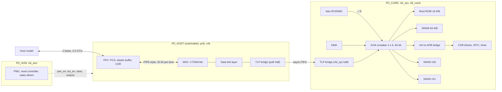

# SoC architecture

This document fixes the decisions that every later step builds on: clocks, resets, power domains, the interconnect, the address and interrupt maps, boot, timing targets and the phase-1 verification plan. A step that changes one of these decisions changes this document in the same commit.

Status: written in step 1-1; numbers are targets until a measurement replaces them with a commit. Sections 2 to 4 (clocks, resets, power domains) are implemented as of step 1-7 (`ca320d4`, [07_clock_reset_power.md](07_clock_reset_power.md)), with two differences listed there: the host FIFOs sit whole in PD_CORE, and the PHY PLL is outside PD_HOST on its own supply. PD_HOST holds a placeholder for its phase-2 logic. Step 2-1 adds the transaction layer (`4a8e515`, [10_transaction_layer.md](10_transaction_layer.md)); sections 1, 5, 6 and 7 below note where it differs from this plan.

## 1. Top level



The host link reaches the CPU's memory through four layers: PHY, MAC, data link layer and transaction bridge. The bridge is split at the clock boundary: its packet half runs on `pclk` inside PD_HOST, and its AXI half runs on `clk_sys` inside PD_CORE, joined by async FIFOs. This lets PD_HOST power off while the AXI side of the bridge stays reachable and idle.

As built in step 2-1 ([10_transaction_layer.md](10_transaction_layer.md)), the `pclk` half is thin: `tl_port` in PD_HOST joins the link side to the FIFOs and holds the link before a power-down. Everything that decodes and builds TLPs, including configuration space and the MSI-X table, is the transaction layer `tl_core` on `clk_sys` in PD_CORE, so the host's configuration survives a PD_HOST power cycle without retention.

## 2. Clock domains

| Clock | Source | Nominal | Domain | Blocks |
| --- | --- | --- | --- | --- |
| `clk_sys` | Input pin (SoC PLL in a real chip) | 50 MHz | PD_CORE | CPU, crossbar, ROM, SRAM, DMA, APB and CSRs, TLP bridge AXI half |
| `pclk` | PHY, from its PLL model | 62.5 MHz | PD_HOST | PIPE MAC side, LTSSM-lite, data link layer, TLP bridge packet half |
| `rclk` | PHY CDR, recovered per lane | 62.5 MHz ± ppm | PD_HOST | PHY receive path up to the elastic buffer |
| `clk_nand` | Input pin | 50 MHz | PD_CORE | NAND channel interface timing |
| `clk_aon` | Slow oscillator model | 1 MHz | PD_AON | PMU, reset controller, wake detect |

- **Link rate.** 2 lanes at 2.5 GT/s with 8b/10b give 500 MB/s of symbols. With a 128-byte maximum payload, header, sequence number, LCRC and framing cost about 24 bytes per packet, so payload bandwidth is about 420 MB/s before DLLPs and SKP sets.
- **Fabric rate.** 64 bits at 50 MHz give 400 MB/s, close to the link. A 128-byte payload is one AXI burst of 16 beats.
- **PIPE width.** 32 bits (4 symbols) per lane at `pclk` 62.5 MHz is the 2.5 GT/s, 32-bit configuration of the public PIPE specification.
- **NAND.** The NAND channels are deliberately much slower than the host (8-bit asynchronous interface, about 25 MB/s per channel). That is the model's scale, not a target. Step 3-1 measures 25 MB/s on the bus: two `clk_nand` clocks per byte at the fastest setting ([15_nand_channel.md](15_nand_channel.md)).
- **`clk_aon`.** 1 MHz instead of a 32.768 kHz RTC keeps power sequences short in simulation. All PMU delays are counted in `clk_aon` cycles and set by CSR.

### Crossings

Every crossing uses one of three structures. A crossing that fits none of them is a design error.

| Structure | Used for | Rule |
| --- | --- | --- |
| Async FIFO, Gray pointers, 2-flop synchronizers | Data streams: TLP bridge (`pclk` ↔ `clk_sys`), NAND data (`clk_sys` ↔ `clk_nand`), elastic buffer (`rclk` → `pclk`) | Both sides reset together; the PMU holds the core-side half in reset while PD_HOST is off |
| Request/acknowledge handshake | CSR access into another domain, commands | The data bus is stable from request to acknowledge; only the request and acknowledge bits are synchronized |
| 2-flop synchronizer | Quasi-static configuration, level status, pulses widened to levels | A pulse that must not be lost is first held in a toggle or sticky flop in the source domain |

CSRs for every block live in `clk_sys`, inside PD_CORE. Configuration crosses into `pclk` or `clk_nand` through synchronizers, and status crosses back. Host link configuration therefore survives a PD_HOST power cycle without retention.

## 3. Resets

| Reset | Domain | Asserted by | Released |
| --- | --- | --- | --- |
| `rst_aon_n` | `clk_aon` | `por_n` pin | 2 `clk_aon` edges after `por_n` rises |
| `rst_sys_n` | `clk_sys` | AON reset, full-chip software reset | PMU, after `clk_sys` has run for `SYS_DELAY` `clk_aon` cycles |
| `rst_nand_n` | `clk_nand` | `rst_sys_n`, NAND soft reset | PMU, after `rst_sys_n` |
| `rst_host_n` | `pclk` | `rst_sys_n`, PD_HOST power-down, host soft reset | PMU, after PD_HOST is on and the PHY reports its PLL locked |
| `rst_phy_n` | `rclk` | Same as `rst_host_n` | Inside the PHY, after CDR lock |

- **Synchronizers.** Every reset is asserted asynchronously and released synchronously through a 2-flop reset synchronizer in its own clock. Release order is AON, then core, then NAND, then host.
- **Soft resets.** DMA, NAND0, NAND1 and the host stack each have a soft reset bit (SYS SOFT_RESET; the NAND bits since step 3-1 reset both clock domains of their channel, each through its own synchronizer). The PMU sequences the host soft reset like a power-down without the switch, so both halves of the TLP bridge FIFOs reset together.
- **Reset-domain crossing.** A domain held in reset drives its outputs idle (`valid` low). A domain that is still running and receives from a domain in reset does not depend on that domain's data until both have left reset.

## 4. Power domains

| Domain | Supply | Contents | States |
| --- | --- | --- | --- |
| PD_AON | Always on | PMU, reset controller, wake detect, power-state registers, retention storage | On |
| PD_CORE | On while the chip is on | Everything in `clk_sys` and `clk_nand` | On; idle blocks are clock-gated |
| PD_HOST | Switched by the PMU | PHY, MAC, data link layer, TLP bridge packet half | On, off with retention |

PD_HOST powers off when the firmware has put the link in L1 and the host path is idle. This is the same idea as the deepest L1 substate in PCIe: the link keeps its logical state while the PHY loses power.

### Isolation

Only PD_HOST outputs need isolation, because a powered-off domain must not drive powered-on logic. Signals from PD_CORE or PD_AON into PD_HOST are not isolated.

| PD_HOST output group | Clamp | Reason |
| --- | --- | --- |
| Valid, request and interrupt signals | 0 | No transaction or event comes from an unpowered block |
| Ready signals toward PD_CORE (FIFO read side, response accept) | 1 | A stray response is consumed instead of stalling the fabric; the bridge logs it as an error |
| Status levels (link state, PLL lock) | 0 | Read as "down" while off |

### Retention

Retention covers what a PCIe-like link needs to resume without full retraining from scratch:

- data link layer sequence numbers (`NEXT_TRANSMIT_SEQ`, `ACKD_SEQ`, `NEXT_RCV_SEQ`)
- flow-control credit limits and consumed counts
- the negotiated link width and lane order from link training

Retention is modeled as save and restore shadow registers on the always-on supply, controlled by `save` and `restore` pulses from the PMU.

### Sequences

The PMU runs both sequences in `clk_aon`. Each wait has a CSR-set timeout, and a timeout ends the sequence with an error status and an interrupt.

| Step | Power-down (firmware request) | Power-up (wake or firmware request) |
| --- | --- | --- |
| 1 | Check that the host path is idle: no outstanding AXI transactions, bridge FIFOs empty; from step 2-1 also the link held by firmware (HOST LINK_CTRL.HOLD). Otherwise refuse with status `REFUSED` | `pwr_en = 1`, wait for `pwr_ack = 1` |
| 2 | `iso_en = 1` | Enable `pclk`, wait for PLL lock |
| 3 | `save` pulse | Release `rst_host_n` |
| 4 | Gate `pclk`, PHY PLL off | `restore` pulse |
| 5 | Assert `rst_host_n` | `iso_en = 0` |
| 6 | `pwr_en = 0`, wait for `pwr_ack = 0` | Interrupt; firmware starts link recovery back to L0 |

Wake sources are a receiver electrical-idle exit seen by the wake detector in PD_AON, and a firmware write.

### UPF and power-aware simulation

`syn/upf/storage_soc.upf` describes the domains, the PD_HOST power switch, isolation with the clamp values above, retention, and a power-state table. The open-source tools here do not read UPF. So the RTL instantiates the isolation and retention cells explicitly in a PD_HOST boundary wrapper, and a script checks that the wrapper's isolated ports and the UPF isolation list match.

The testbench corrupts PD_HOST while it is off:

| Simulator | Off-state value | Check |
| --- | --- | --- |
| xsim | X on every PD_HOST output | No X reaches PD_CORE or PD_AON |
| Verilator (2-state) | A new random value every cycle | No change reaches PD_CORE or PD_AON |

In both, retained state must come back after power-up, and non-retained state must come back at its reset value.

## 5. Interconnect

### Masters and slaves

| Port | Block | Native interface | Fabric side |
| --- | --- | --- | --- |
| M0 | CPU instruction | Ibex OBI-style, 32 bit | AXI4 read-only, upsized to 64 bit |
| M1 | CPU data | Ibex OBI-style, 32 bit | AXI4, upsized to 64 bit |
| M2 | DMA | AXI4, 64 bit | AXI4 |
| M3 | Transaction layer (step 2-1): inbound BAR2 window and the bus master's local reads and writes, which also carry the NVMe controller's command fetches (step 2-2), PRP data, PRP list entries and completion queue entries (step 2-3) | AXI4, 64 bit | AXI4 |
| S0 | Boot ROM | | Read-only, writes get SLVERR |
| S1 | SRAM | | |
| S2 | AXI to APB bridge | APB4, 32 bit | Downsized; one APB transfer per 32-bit word |
| S3 | NAND0 data port | | Page buffer window |
| S4 | NAND1 data port | | Page buffer window |
| S5 | NVMe controller buffer (step 2-3) | | 128 bytes in flops, repeated over a 4 KiB window: PRP list entries and completion queue entries on their way |

The crossbar is sparse: only the paths below exist, and an address that maps to a slave the master cannot reach gets DECERR from the crossbar's default slave.

| Master | ROM | SRAM | APB | NAND0 | NAND1 | NVMe buffer |
| --- | --- | --- | --- | --- | --- | --- |
| M0 CPU I | ● | ● | | | | |
| M1 CPU D | ● | ● | ● | ● | ● | |
| M2 DMA | | ● | | ● | ● | |
| M3 Host | | ● | ● | | | ● |

### AXI4 rules

| Item | Value |
| --- | --- |
| Address, data | 32 bit, 64 bit |
| ID | 2 bits at each master; the crossbar prepends a 2-bit master index, so 4 bits at each slave |
| Bursts | INCR only, up to 16 beats (128 bytes) of 64 bits, or a single 32-bit beat (a narrow access, used by the CPU ports). FIXED and WRAP are not issued; an SVA check enforces both forms |
| 4 KB boundary | No burst crosses one. Masters split; the DMA does it in hardware |
| Outstanding | Up to 4 reads and 4 writes per master |
| Ordering | Responses with the same ID return in order. A new transaction whose ID already has transactions outstanding to a different slave waits until they finish, so responses can never return out of order |
| Write data | Follows AW order per slave; no interleaving. A W beat is accepted only after its AW |
| Read data | Not interleaved at a master: the crossbar keeps R on one slave until RLAST. Slaves must not interleave read bursts |
| Arbitration | Round-robin per slave, separately for reads and writes |
| Exclusive access, QoS, cache attributes | Not supported or passed through unused: `AxLOCK` = 0, `AxQOS` and `AxCACHE` carried but ignored |
| Errors | DECERR from the default slave; SLVERR from ROM writes and APB `PSLVERR` |

The ID-ordering rule is the usual deadlock-free choice for a crossbar without reorder buffers. Its cost (a stall when one ID switches slaves) is measured in [03_axi_crossbar.md](03_axi_crossbar.md): 47 clocks behind a 40-clock read in the directed test, and 10.7 clocks per write and 5.1 per read under random IDs and targets (commit 76fd272).

## 6. Address map

| Range | Size | Target |
| --- | --- | --- |
| `0x0000_0000` – `0x0000_3FFF` | 16 KiB | Boot ROM |
| `0x1000_0000` – `0x1000_FFFF` | 64 KiB | SRAM |
| `0x3000_0000` – `0x3000_1FFF` | 8 KiB | NAND0 page buffer (4 KiB until step 3-1) |
| `0x3001_0000` – `0x3001_1FFF` | 8 KiB | NAND1 page buffer (4 KiB until step 3-1) |
| `0x4000_0000` – `0x4000_FFFF` | 64 KiB | APB, 4 KiB per block (16 slots), below |
| `0x5000_0000` – `0x5000_0FFF` | 4 KiB | NVMe controller buffer (128 bytes, repeated), host port only |
| Everything else | | DECERR |

| APB block | Base | Contents |
| --- | --- | --- |
| SYS | `0x4000_0000` | ID, version, soft resets, clock-gate enables, simulation console and exit registers |
| PMU | `0x4000_1000` | Power state, requests, sequence timeouts, wake sources (AON registers reached by handshake) |
| INTC | `0x4000_2000` | Pending, enable, claim (no side effect; sources are levels), software set |
| TIMER | `0x4000_3000` | `mtime`, `mtimecmp` |
| DMA | `0x4000_4000` | Channel control, descriptor pointer, status |
| HOST | `0x4000_5000` | Link hold and status, BAR window bases, bus master, MSI-X requests, error status, TLP counts |
| NAND0 | `0x4000_6000` | Channel (step 3-1): write protect, interrupt enables, status, bus timing, busy timeout, command queue, completions, clock counts; ECC counters come with step 3-3 |
| NAND1 | `0x4000_7000` | Same as NAND0 |
| NVME | `0x4000_8000` | NVMe controller, firmware side: controller state and events, command FIFO, command-buffer slots, I/O queue setup, queue pointers |

A slot without a peripheral, and an undefined offset inside one, answer SLVERR (PSLVERR on the APB side). As of step 3-1, SYS, PMU, INTC, TIMER, DMA, HOST, NAND0, NAND1 and NVME exist ([06_dma.md](06_dma.md) for the DMA, [15_nand_channel.md](15_nand_channel.md) for NAND0 and NAND1, [07_clock_reset_power.md](07_clock_reset_power.md) for the PMU, [10_transaction_layer.md](10_transaction_layer.md) for HOST, which still holds the PD_HOST placeholder's command registers too, [11_nvme_queues.md](11_nvme_queues.md) for NVME). The PMU is in PD_AON and is reached through an APB clock-domain crossing. Their register files are generated from one SystemRDL source, `rtl/csr/rdl/soc_apb.rdl` ([05_csr.md](05_csr.md)), and every register and field is listed in [regs/soc_apb.md](regs/soc_apb.md). Blocks added later put their registers in the same source.

The host sees two memory BARs (step 2-1; the plan of one 64 KiB window was split for NVMe):
- **BAR0**, 16 KiB, 64-bit: offsets `0x0000`–`0x1FFF` are the NVMe controller's registers (CAP, VS, CC, CSTS, AQA, ASQ, ACQ, doorbells at `0x1000`), reached through the transaction layer's register port without AXI (step 2-2, [11_nvme_queues.md](11_nvme_queues.md)); `0x2000` holds the MSI-X table and `0x3000` its Pending Bit Array, both inside the transaction layer.
- **BAR2**, 32 KiB, 64-bit prefetchable: goes to AXI at HOST BAR2_WIN, the upper half of SRAM (`0x1000_8000`) at reset.

The NVMe controller fetches submission queue entries with the transaction layer's bus master into a command buffer of 16 slots of 64 bytes in SRAM, `0x1000_BC00`–`0x1000_BFFF` at reset (NVME CMDBUF).

SRAM use in the NVMe firmware (`nvme_app`, step 2-4, [13_nvme_firmware.md](13_nvme_firmware.md)):

| Range | Use |
| --- | --- |
| `0x1000_0000`–`0x1000_7FFF` | Firmware data, BSS and stack |
| `0x1000_8000`–`0x1000_AFFF` | Namespace 1: 24 blocks of 512 bytes |
| `0x1000_BC00`–`0x1000_BFFF` | Command buffer (CMDBUF) |
| `0x1000_C000`–`0x1000_FFFF` | Left to the SoC tests' background traffic from the host |

## 7. Interrupts

Ibex has dedicated timer and external interrupt inputs. The timer drives `irq_timer`, and everything else goes through the INTC to `irq_external`. Sources are levels: a source in another clock domain sets a sticky status bit in its CSR block, and the INTC sees status AND enable. As of step 3-1, sources 1 and 2 (the DMA's STATUS.DONE and STATUS.ERR), 3 (NVME: a command waiting, or a controller event), 5 (HOST ERR_STATUS), 6 to 9 (NAND0 and NAND1: a completion waiting, and EVENT.ERR or EVENT.OVF, each with its enable in CTRL), 10 (the PMU's PWR_IRQ) and 12 (HOST BM_STATUS.DONE or ERR) are wired; the others follow with their blocks.

| ID | Source |
| --- | --- |
| 1 | DMA done |
| 2 | DMA error |
| 3 | NVMe: a fetched command waiting (CTRL.IEN_CMD), or a controller event (EVENT and EVENT_EN: enable, reset, shutdown, bad doorbell, failed fetch) |
| 4 | Host link state change |
| 5 | Host error: unsupported request, malformed or poisoned TLP, completion error or timeout, AXI error (LCRC and sequence errors from step 2-6) |
| 6 | NAND0 ready |
| 7 | NAND0 error (status fail, uncorrectable ECC) |
| 8 | NAND1 ready |
| 9 | NAND1 error |
| 10 | PMU sequence done or failed, wake |
| 11 | Bus error captured (address and master of the last DECERR or SLVERR) |
| 12 | Host bus master done or failed (step 2-1) |

## 8. Boot and firmware

- **Reset vector.** Ibex starts at `boot_addr + 0x80`, with the vector table at `boot_addr`. `boot_addr` is `0x0000_0000`, so the ROM holds the vectors at `0x00`–`0x7F` and the reset entry at `0x80`.
- **Build and layout.** Firmware in `fw/` is built with xPack riscv-none-elf-gcc 15.2.0 for `rv32imc_zicsr_zifencei`, `ilp32`. Code and read-only data stay in ROM. Data, BSS and the stack are in the lower 32 KiB of SRAM, and start-up code copies `.data` from ROM. The core is Ibex v2.1.0 ([04_cpu_subsystem.md](04_cpu_subsystem.md)).
- **Simulation console.** The SYS block's console register prints one character per write, and its exit register ends the simulation with a pass or fail code. The testbench watches both. They are ordinary registers and stay in the synthesized design.

## 9. Timing targets

| Clock | Period | Sign-off |
| --- | --- | --- |
| `clk_sys` | 20 ns | Setup at `ss_n40C_1v40`, hold at `ff_100C_1v95`, `tt_025C_1v80` reported |
| `pclk`, `rclk` | 16 ns | Same corners |
| `clk_nand` | 20 ns | Same corners |
| `clk_aon` | 1000 ns | Same corners |

- **Library.** Sky130 HD standard cells. The ROM and SRAM are behavioral in simulation and black boxes in synthesis, so the area tables state that memories are excluded.
- **CDC constraints.** Gray pointers and handshake data get `set_max_delay` from the source clock to the first synchronizer flop, and a false path is set only into the synchronizer input. There are no blanket asynchronous clock groups, because those would override the max-delay constraints.
- **These are targets.** Step 1-9 reports measured slack per corner with the commit it was measured at ([09_timing.md](09_timing.md)). Pre-layout, 50 MHz and 62.5 MHz are met at tt and ff; setup at `ss_n40C_1v40` is not met (`clk_sys` would run at about 14.5 MHz there), and hold at ff misses by tens of picoseconds into the SRAM macros, left to layout. The crossing constraint is applied as a max delay of the destination period between every pair of clocks, and `flow/cdc/check_cdc.py` shows that every crossing path ends at a synchronizer, a handshake register, a FIFO word or a PMU control, where that bound is the right check.

## 10. Phase-1 verification plan

| Block | Checks |
| --- | --- |
| Every AXI port | Bound SVA checker: handshake stability, INCR only, 16-beat limit, 4 KB boundary, WLAST count, same-ID response order |
| Crossbar | Verilator random test: 4 master models, 5 slave memory models, reference scoreboard. Directed tests for decode errors, sparse paths, the same-ID slave-switch stall, outstanding limits and back-pressure. Covergroup over master, slave, burst length and response. UVM AXI master and slave agents on xsim, kept for the SoC environment in phase 4 |
| AXI to APB bridge | Bursts split into APB transfers, `PSLVERR` returned as SLVERR, byte strobes |
| DMA | Descriptor chains, 4 KB splits, unaligned lengths, an error in the middle of a chain |
| CSRs | Generated register model: reset values and access types for every field |
| Power | PD_HOST power cycle under traffic, corruption check while off, retained and non-retained state after power-up, refused power-down when not idle |
| SoC | Firmware tests on the full RTL: boot, memory test, DMA, interrupts, power cycle |
| Lint | Verilator `-Wall` clean on `rtl/`, with every waiver commented |

## 11. Directory layout

```text
rtl/top/      SoC top, PD_HOST boundary wrapper
rtl/axi/      crossbar, register slices, width converters, AXI to APB bridge
rtl/cpu/      Ibex wrapper and OBI-to-AXI adapters
rtl/mem/      ROM and SRAM models
rtl/csr/      SystemRDL source (rdl/) and the register blocks generated from it (gen/)
rtl/periph/   SYS, INTC and timer: logic around the generated register blocks
rtl/dma/      DMA
rtl/nand/     NAND channel controllers (step 3-1)
rtl/pmu/      PMU, reset controller, wake detect, isolation and retention cells
rtl/common/   synchronizers, async FIFO, clock gate
rtl/vendor/   third-party sources, each pinned to a commit
fw/           firmware, linker script, start-up code
dv/           SVA checkers, Verilator testbenches, UVM environments
syn/          SDC, UPF, synthesis and STA scripts
docs/         this document and the ones that follow
```

## 12. Open decisions

| Decision | Settled in |
| --- | --- |
| Ibex commit and configuration (RV32IMC, multiplier, register file) | 1-4 |
| Which AXI_PCIe_Subsystem blocks are reused as they are, and which are rewritten for AXI4 | 1-2, 1-3 |
| PeakRDL version; generated RTL is committed so simulation needs no Python | 1-5: PeakRDL 1.5.0, regblock 1.3.1 (`flow/rdl/requirements.txt`); generated files committed, `make -C dv rdl-check` compares them with the source |
| How the Sky130 libraries are fetched (script, not committed) | 1-9: `flow/syn/fetch_sky130.sh` from lambdapdk v0.2.9, SHA-256 checked, into `build/pdk` |
| CDC check method on the synthesized netlist | 1-9 |
