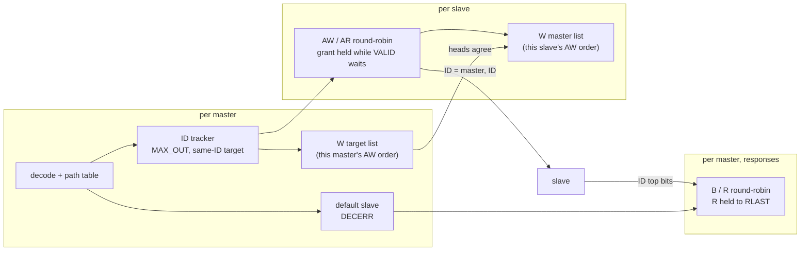

# AXI4 crossbar

Step 1-3. `rtl/axi/axi_xbar.sv` connects the four masters of the SoC to its five slaves under the rules of section 5 of the architecture document. RTL and testbench are at commit `76fd272`, and every result below was measured there.

## Blocks

| Block | File | Role |
| --- | --- | --- |
| `axi_xbar` | `rtl/axi/axi_xbar.sv` | Address decode, AW and AR arbitration per slave, W routing, B and R arbitration per master |
| `axi_id_tracker` | `rtl/axi/axi_id_tracker.sv` | Per master and direction: number outstanding, and the target each ID went to |
| `axi_err_slv` | `rtl/axi/axi_err_slv.sv` | One default slave per master; answers DECERR |
| `rr_arb` | `rtl/common/rr_arb.sv` | Round-robin arbiter that can hold its grant |
| `fifo_sync` | `rtl/common/fifo_sync.sv` | Ordered lists for W routing |

| Parameter | Value |
| --- | --- |
| Masters, slaves | 4 (CPU instruction, CPU data, DMA, host), 5 (ROM, SRAM, APB, NAND0, NAND1) |
| Paths | 12 of 20, from the `CONN` table; the other 8 master and slave pairs answer DECERR |
| Address, data | 32 bit, 64 bit |
| ID | 2 bits at a master; the crossbar prepends the 2-bit master index, so 4 bits at a slave |
| Outstanding | 4 reads and 4 writes per master (`MAX_OUT`) |

## Request and response flow



## Design decisions

**Same-ID target rule instead of a reorder buffer.**
- **Rule.** A request waits while its ID has transactions outstanding at a different target. All responses for one ID then come from one slave, and a slave answers one ID in order, so responses never need reordering.
- **Cost.** The directed test shows it: an ID 0 read to NAND0 waited 47 clocks behind an ID 0 read to SRAM with 40 clocks of latency. A read with ID 1 to NAND0 went in after 1 clock.
- **Random traffic.** The random test draws ID and target independently, which is the worst case for this rule. The per-master stall counters below show how often the rule held a request there.
- **Why it suits this SoC.** The SoC's masters keep one ID per stream (instruction fetch, data, DMA channel, host tag range). That makes a slave switch within one ID rare in real traffic, so a reorder buffer of up to 4 x 16 beats x 64 bits per master is not worth its area here.

**One default slave per master.**
- A request to an unmapped address, or to a slave the master has no path to, never reaches the slave-side arbiters.
- One master's bad address cannot stall another master.
- The cost is four small state machines.

**W follows two ordered lists.**
- Each master records the targets of its accepted AWs in order, and each slave records the masters of the AWs it accepted in order. A W beat moves only when the head of the master's list names that slave and the head of the slave's list names that master.
- **Why it cannot deadlock.** Every AW handshake happens at one point in time: one per slave per clock, and one per master per clock. All lists therefore follow one global order, and no two lists can wait on each other in a cycle.
- **W before AW.** W is not accepted before its AW, which AXI allows. A master must still not wait for WREADY before offering AW, as AXI already requires.

**R held to RLAST.**
- A master never sees two read bursts interleaved, so the CPU adapter, DMA and host bridge can assume whole bursts.
- **Requirement on slaves.** Slaves must not interleave read bursts themselves. Otherwise slave A could block master 1 mid-burst while holding a beat for master 2, with slave B in the mirror state. ROM, SRAM, the APB bridge and the NAND buffers, built in later steps, must each serve one read burst at a time.

**Grant held while VALID waits.**
- AW and AR grants per slave, and B and R grants per master, stay fixed from VALID to the handshake. VALID and payload toward the other side therefore never change early. The SVA checker on each port checks this, and mutant `aw_hold` below shows what happens without it.

**No register slices inside.**
- READY paths run combinationally from decode through the arbiter. Step 1-9 decides from the slow-corner STA where `axi_channel_reg_slice` goes.

## Verification environment

| Part | File | What it checks |
| --- | --- | --- |
| Master model, 4 | `dv/tb/axi_tb_pkg.sv` | Sends bursts with random gaps and READY. Checks every B and R against what it sent: ID, order within an ID, response (OKAY or DECERR), read data against its shadow of what it wrote, RLAST position, and no read interleaving |
| Slave model, 5 | `dv/tb/axi_tb_pkg.sv` | Memory with random READY and latency. Returns B and R in random order across different IDs, never within one ID. Checks that each request is inside its window and comes from a master with a path, that W arrives after its AW in AW order, and that WLAST is on the last beat |
| SVA checker, 9 ports | `dv/sva/axi4_checker.sv` | VALID and payload stable until handshake on all five channels; INCR, 64-bit beats, at most 16 beats, 8-byte aligned, no 4 KB crossing |
| Covergroup | `dv/tb/tb_axi_xbar.sv` | The 16 master and target pairs (12 paths plus DECERR for each master) x direction, and burst length (1, 2-4, 5-8, 9-16 beats) x direction: 62 bins |
| Watchdog | `dv/tb/tb_axi_xbar.sv` | Fails the run when no transaction finishes for 20,000 clocks |

Each master writes only its own quarter of each slave window, so writes from different masters never race on one word, and the shadow memories stay exact.

## Results

### Directed test

| Test | Result |
| --- | --- |
| Decode | 72 bursts to unmapped addresses or to slaves without a path: all 72 answered DECERR with the right beat count, none reached a slave |
| W order | 32 bursts from all four masters to SRAM at once, slave WREADY 50%: all 32 read back intact by their masters |
| Same-ID switch, reads | ID 1 to NAND0 accepted 1 clock after ID 0 to SRAM. ID 0 to NAND0 waited 47 clocks and was accepted 1 clock after the SRAM read's last beat; the stall counter read 47 |
| Same-ID switch, writes | ID 2 to NAND1 accepted 1 clock after the SRAM write's B |
| Outstanding | 8 reads and 8 writes offered at once to a slow SRAM: at most 4 reads and 4 writes from one master outstanding |
| Parallel paths | M1 to APB and M2 to SRAM reads accepted in the same clock; M1 to NAND0 and M2 to NAND1 writes too |
| Round-robin | Four masters reading SRAM at once: 50, 50, 50, 50 of the first 200 AR grants |
| Throughput | One master to SRAM, 64 bursts of 16 beats, no back-pressure: 1.000 write and 1.000 read data beats per clock |

### Random test

Ten seeds of 2,000 bursts per master gave 80,000 bursts: 39,998 writes and 40,002 reads. 6,414 of them (8.0%) went to unmapped addresses or to slaves without a path. Each seed draws its own slave behavior, and master gaps and READY (0 to 40% gaps, 50 to 100% READY); every seed finished with 0 errors.

| Seed | Slave READY | Slave latency | R gaps | Errors |
| --- | --- | --- | --- | --- |
| 1 | 90% | 0-5 clocks | 21% | 0 |
| 2 | 72% | 0-9 clocks | 5% | 0 |
| 3 | 48% | 0-3 clocks | 26% | 0 |
| 4 | 74% | 0-5 clocks | 13% | 0 |
| 5 | 94% | 0-4 clocks | 35% | 0 |
| 6 | 73% | 0-5 clocks | 1% | 0 |
| 7 | 81% | 0-7 clocks | 4% | 0 |
| 8 | 65% | 0-10 clocks | 40% | 0 |
| 9 | 40% | 0 clocks | 26% | 0 |
| 10 | 95% | 0-3 clocks | 9% | 0 |

Slave READY is for W and AR. AW READY is drawn per slave between 40 and 100%. Each slave has reordering across IDs switched on with a probability of 3 in 4 per seed.

**Cost of the same-ID rule here.**
- The rule held writes for 427,936 AW clocks and reads for 202,608 AR clocks in total. That is 10.7 clocks per write and 5.1 per read on average.
- This is the price of drawing ID and target independently, with 4 IDs over 3 to 5 targets per master. Writes pay more because the rule releases at B, after all the W beats.
- A master that keeps one ID per stream pays this only when a stream changes slaves.

### Coverage

Functional coverage: 62 of 62 covergroup bins hit over the directed run and the 10 seeds.

RTL code coverage of the five crossbar files, with points merged across instances (`dv/cov_summary.sh`):

| Type | Hit | Total | % |
| --- | --- | --- | --- |
| Line | 31 | 32 | 96.9 |
| Branch | 72 | 72 | 100.0 |
| Expression | 596 | 668 | 89.2 |
| Toggle | 3,939 | 5,576 | 70.6 |

- **The missed line** is the `default` arm of the default slave's write state machine. Its two-bit state never takes the fourth value.
- **Missed toggles.** 1,574 of the 1,637 missed toggles are bits that cannot change in this configuration:

| Missed toggles | Bits |
| --- | --- |
| 660 | Default-slave read data (always 0) and responses (always DECERR) |
| 488 | Address bits outside the slave windows |
| 258 | AxLEN[7:4], AxSIZE and AxBURST, which are fixed by the burst rules |
| 128 | Request and grant bits of the 8 master and slave pairs without a path |
| 40 | Slave-side response bits, because the slave models answer OKAY only |

  The other 63 are the W-order FIFO full flags (16 entries, never reached), the default slave's length counters above 16 beats, the reset inputs, and a few index bits.

### Mutation check

`dv/mutate_xbar.sh` copies the RTL into the build directory, plants one bug with `sed`, and runs the directed test and one random seed of 500 bursts per master. It also checks that `sed` really changed the file. The repository's RTL is never modified.

| Mutant | Planted bug | Caught by |
| --- | --- | --- |
| `id_rule` | The same-ID target rule removed | Directed: a master read the wrong data |
| `max_out` | One more outstanding than `MAX_OUT` | Directed: 5 reads and 5 writes outstanding at SRAM |
| `r_lock` | R grant not held to RLAST | Random: R for ID 3 inside a burst for ID 0 |
| `aw_hold` | AW grant free to move while AWVALID waits | Random: SVA `a_aw_hold` on the SRAM-side port |
| `w_order` | W accepted without the slave's AW order | Directed: WLAST on beat 8 of a 10-beat write at SRAM |
| `conn` | Path table ignored by the decoder | Directed: an AR from M2 reached ROM |
| `b_route` | B routed to the wrong masters | Directed: B with an ID that had no write outstanding |

7 of 7 caught.

- **The first mutation run found a gap.** `w_order` passed the directed test, because no directed test had two masters writing one slave at once. In the random test, the lost W beats hung the simulation until the script's 600-second limit killed it. Two fixes followed:
  - the W-order directed test above
  - the progress watchdog, so a hang now ends the run with a diagnosis

## Limits

- QoS, cache and protection fields pass through unused. No exclusive access. Only INCR bursts of up to 16 beats, enforced by assertion.
- Throughput was measured with one master. Contention is covered by the round-robin and W-order tests.
- No register slices yet. Area and timing come in step 1-9.

## How to run

```bash
make -C dv xbar                 # directed test + SEEDS random seeds (default 10) of N bursts per master (default 2000)
SEEDS=3 N=1000 make -C dv xbar  # what CI runs
make -C dv xbar-mut             # the seven mutants; each must fail
bash dv/cov_summary.sh build/dv/xbar/merged.dat /rtl/
```
