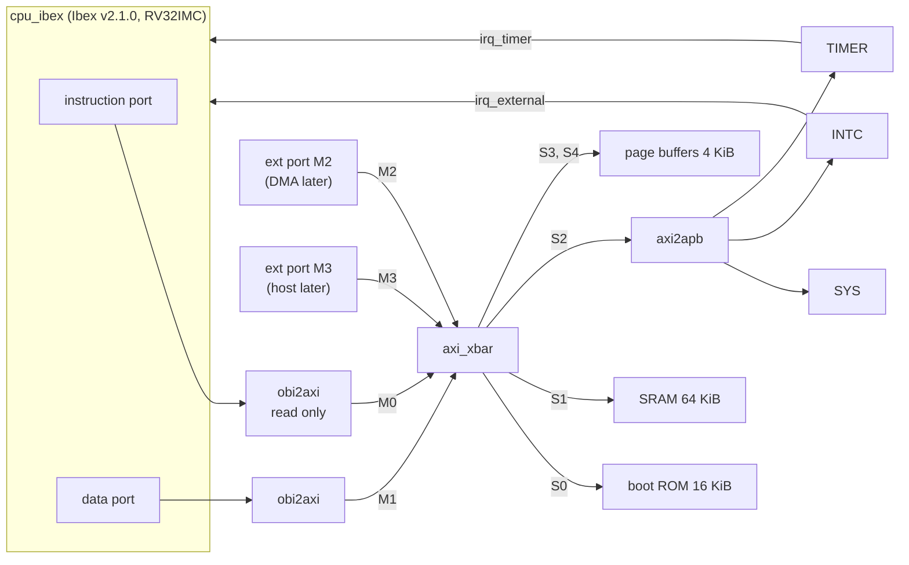

# CPU subsystem and SoC top

Step 1-4 puts a RISC-V core on the crossbar together with the boot ROM, the SRAM, the APB peripherals and firmware, all in `rtl/top/soc_top.sv`. RTL and testbench are at commit `2f1bebc`, the firmware at `3e51bad` (a fix to `memtest`, below), and every result below was measured at `3e51bad`.

## Blocks

| Block | File | Role |
| --- | --- | --- |
| `cpu_ibex` | `rtl/cpu/cpu_ibex.sv` | Ibex core and its register file, wired as Ibex's own top wires them |
| `obi2axi` x 2 | `rtl/cpu/obi2axi.sv` | Ibex instruction port to M0 (read only), data port to M1 |
| `axi_mem` | `rtl/mem/axi_mem.sv` | S0 boot ROM 16 KiB (read only), S1 SRAM 64 KiB, S3 and S4 page-buffer windows of 4 KiB until the NAND channels exist |
| `axi2apb` | `rtl/axi/axi2apb.sv` | S2: AXI4 to APB4, 4 KiB per peripheral slot |
| `apb_sys`, `apb_intc`, `apb_timer` | `rtl/periph/` | SYS (slot 0), interrupt controller (slot 2), machine timer (slot 3) |
| `soc_top` | `rtl/top/soc_top.sv` | All of the above on one clock and reset; M2 and M3 are top-level ports until the DMA (step 1-6, M2) and host interface exist |



## Ibex

| Item | Choice |
| --- | --- |
| Source | github.com/lowRISC/ibex, release tag `v2.1.0`, commit `38c0709` (2024-08-23), Apache 2.0 |
| Files | 43, copied into `rtl/vendor/ibex/`; each has the same git blob hash as in the release (`VENDOR.md` lists them and how the list was made) |
| ISA | RV32IMC with the fast multiplier, Zicsr, Zifencei; no B extension |
| Off | PMP, instruction cache, branch predictor, writeback stage, security features (lockstep, ECC, dummy instructions), debug module |
| Register file | Flip-flop |
| Boot | `boot_addr` = 0: vector table at `0x0000_0000`, first fetch at `0x0000_0080` |

**Why release v2.1.0.** The master branch of 2026-11-20 had just merged CHERIoT. Its `ibex_core` has new ports (`cheriot_enable_i`, tagged data, capability register-file ECC) and changes every week. The release has the plain RV32 core, and in this configuration `ibex_core` needs only a few lowRISC primitives: assertion macros, LFSR, multi-bit enum, one-hot and SECDED helpers.

**Why `ibex_core` and not `ibex_top`.** `ibex_top` adds the clock gate, lockstep, scrambled cache RAMs and their dependencies (PULP common cells among them), and all of those are off here. `cpu_ibex` instantiates the core as `u_ibex_core`, the name Ibex's internal references expect, and the flip-flop register file next to it.

**Lint.** `dv/lint/vendor.vlt` (renamed `waivers.vlt` in step 1-5) keeps the vendor files out of `-Wall`. That includes three UNOPTFLAT signals that Ibex's own waiver file also lists. Everything else in `soc_top` is `-Wall` clean.

## Memory-port adapter

`obi2axi` turns one Ibex port (request, grant, response valid) into one AXI4 master port.

- **Narrow transfers.** Each request is one AXI transfer of 32 bits: AxSIZE 2, AxLEN 0, the address aligned to 4 bytes. Write data and WSTRB go on the byte lanes of the address, and read data is taken from them. The architecture's AXI rules now allow such single narrow beats beside the 64-bit bursts, and the SVA checker enforces both forms.
- **Order.**
  - All transfers use ID 0, so reads come back in order and writes come back in order.
  - AXI keeps no order between the read and write channels, so a read is not issued while a write is outstanding, and the reverse.
  - That gives the core its responses in request order, and a load after a store to the same address sees the store.
- **Store grant.** A store is granted once both its AW and its W are accepted. The crossbar takes W one clock after AW, so a store needs two clocks to be granted.
- **Outstanding.** Up to 2 transfers per port, which matches the two fetches Ibex's prefetch buffer keeps in flight.
- **Errors.** SLVERR and DECERR become error responses, which Ibex raises as instruction, load or store access faults.

## Memories and APB

**`axi_mem`.**
- Reads and writes have separate paths, so a pending B never holds up R.
- One read burst is served at a time and never interleaved, which is the crossbar's requirement on slaves. The next AR is taken in the clock of the previous RLAST.
- Read data is registered, one clock after AR.
- The ROM accepts writes and answers SLVERR.
- In simulation the ROM is loaded from `+rom=<file>`. Synthesis treats the arrays as black boxes.

**`axi2apb`.**
- One AXI transaction at a time, writes first. Each beat becomes 32-bit APB transfers:
  - the addressed word for a narrow beat
  - both words for a 64-bit read
  - each word with a strobe for a 64-bit write
- A slot without a peripheral (1, 4 to 7) answers without an APB transfer. Any PSLVERR or missing slot makes that R beat, or the B, SLVERR.
- Registers with read side effects must be read with 32-bit accesses.

| Block | Registers (byte offset) |
| --- | --- |
| SYS, `0x4000_0000` | ID `0x000` = `0x5353_4F43`, VERSION `0x004`, SCRATCH `0x008`, CONSOLE `0x010` (one character to the simulation console), EXIT `0x014` (ends the simulation, 0 = pass) |
| INTC, `0x4000_2000` | PENDING `0x000`, ENABLE `0x004`, CLAIM `0x008` (lowest pending and enabled ID, no side effect), SWSET `0x00C` (software-set sources) |
| TIMER, `0x4000_3000` | MTIME `0x000`/`0x004`, MTIMECMP `0x008`/`0x00C` (reset all ones), CTRL `0x010` (count enable, prescaler) |

Undefined offsets answer PSLVERR. These register blocks were written by hand for this step. Since step 1-5 (`888d3e5`) their register files are generated from SystemRDL with the same map and timing, and the full field list is in [regs/soc_apb.md](regs/soc_apb.md) ([05_csr.md](05_csr.md)).

## Firmware

| Item | Value |
| --- | --- |
| Toolchain | xPack riscv-none-elf-gcc 15.2.0, `-march=rv32imc_zicsr_zifencei -mabi=ilp32 -O2`, no C library |
| Layout | Code and read-only data in ROM; data, BSS and stack in the lower 32 KiB of SRAM. The upper 32 KiB belong to the other masters in the tests |
| Start-up | `fw/common/crt0.S`: 32 vector entries into one trap handler that saves the caller-saved registers and calls `trap_handler(frame)`, then reset: `gp`, `sp`, `.data` copy, `.bss` clear, `main`, `sys_exit` |
| Images | `make -C fw images` writes `fw/images/<test>.hex` (64-bit words). They are committed, so CI runs the tests without the cross compiler; `dv/run_soc.sh` warns if a fresh build differs |

## Verification

`dv/tb/tb_soc.sv` loads a firmware image into the ROM and runs `soc_top`.
- **Console and exit.** The console is printed line by line, and a write to EXIT ends the run.
- **SVA checkers.** One `axi4_checker` sits on each of the nine crossbar ports.
- **`+bg`.** M2 and M3 send random bursts of 1 to 16 beats with random IDs into their quarters of the upper SRAM half while the firmware runs. The master models check every response. Unwritten SRAM is treated as unknown: the first read of a word sets its expected value. Since step 1-6 (`2c90ba1`) M2 is the DMA and `+bg` drives M3 only; the `+bg` numbers below are from `3e51bad`, and the current ones are in [06_dma.md](06_dma.md).
- **`+apb_check`.** After the firmware ends, M3 tests what the CPU cannot reach with 32-bit accesses: a 64-bit read of ID and VERSION, a write with one word's strobes, SLVERR for a beat that holds a defined and an undefined word, a write to an empty slot, and a two-beat burst over the timer.

### Results

| Test | What it checks | Clocks to exit, alone | Clocks to exit, `+bg` | Background bursts M2 + M3, errors |
| --- | --- | --- | --- | --- |
| `hello` | Boot, console, SYS ID, SCRATCH word and byte writes; then `+apb_check` | 712 | 774 | 63 + 83, 0 |
| `memtest` | 7,664 SRAM words: word, inverse, byte, halfword; then words at byte offsets 1 to 15, of which 12 are misaligned (Ibex splits each into two transfers) and 6 straddle a 64-bit word | 293,459 | 968,821 | 79,396 + 79,470, 0 |
| `irq` | 3 timer interrupts; INTC claims 15, then 9 before 20 | 7,906 | 11,592 | 961 + 1,013, 0 |
| `buserr` | 6 faults, each with the expected `mcause` and `mtval`; code copied to SRAM returns 42 | 4,919 | 10,794 | 858 + 855, 0 |
| `perf` | CRC-32 and loop results equal values computed on the host | 420,009 | 586,765 | 48,794 + 48,824, 0 |

- **APB check.** It passed in both `hello` runs with 0 errors.
- **Faults.** The `buserr` faults are:

| Access | Bus response | Exception (`mcause`) |
| --- | --- | --- |
| Load from `0x2000_0000` (unmapped) | DECERR | Load access fault (5) |
| Store to ROM `0x0000_1000` | SLVERR | Store access fault (7) |
| Load from the empty PMU slot `0x4000_1000` | PSLVERR, SLVERR | Load access fault (5) |
| Load from undefined SYS offset `0x4000_0020` | PSLVERR, SLVERR | Load access fault (5) |
| Call to `0x2000_0000` | DECERR on the instruction port | Instruction access fault (1) |
| Call into the APB window | DECERR: the instruction port has no APB path | Instruction access fault (1) |

### Cycles per instruction

| Loop | Alone | With `+bg` |
| --- | --- | --- |
| Register-only loop, code in ROM | 20,002 clocks, 14,005 instructions, CPI 1.42 | Same, CPI 1.42 |
| Bitwise CRC-32 of 4 KiB in SRAM, code in ROM | 352,259 clocks, 249,862 instructions, CPI 1.40 | 417,838 clocks, CPI 1.67 |

- **Register-only loop.** The background masters only touch SRAM. Instruction fetches from ROM take another crossbar path, so the loop runs at the same CPI with or without them.
- **CRC loop.** It reads SRAM and shares it with two masters issuing bursts of up to 16 beats. It needs 18.6% more clocks.
- **`memtest`.** It does nothing but SRAM accesses and takes 3.3 times as long under the same traffic.

## Bring-up findings

Four problems came up, all in the tools, the testbench and the firmware tests; no RTL bug showed up in this step:

- **The SVA 4 KB check assumed 8-byte beats.** It flagged a correct 4-byte store to `0x1000_7FFC`, the top of the stack. The check now uses `(AxLEN + 1) << AxSIZE`.
- **The master models assumed unwritten memory holds a known pattern.** That is true of the crossbar testbench's slave models but not of the SRAM, so the background traffic reported thousands of false read mismatches. `learn_unknown` makes the first read of an unwritten word set its expected value.
- **GCC 15 rejects `fence.i` without Zifencei in `-march`.** Ibex implements it, so the flag now names it.
- **`memtest`'s misaligned part made no misaligned access.** It computed `base + off * 16`, which is 16-byte aligned for every offset. It passed, and the mistake only showed up while this document was being written. Commit `3e51bad` uses `base + off * 16 + off`; the test now counts the misaligned words itself and fails unless there are 12.

## Limits

- One clock and one reset. Clock domains, the PMU and power switching come in step 1-7.
- INTC sources other than SWSET are not wired yet, and there is no debug module.
- Memories are behavioral.
- CPI was measured with code in ROM only.

## How to run

```bash
make -C fw images                 # needs riscv-none-elf-gcc on PATH
make -C dv soc                    # 5 firmware tests, alone and with +bg
make -C dv lint                   # includes soc_top at -Wall
```
