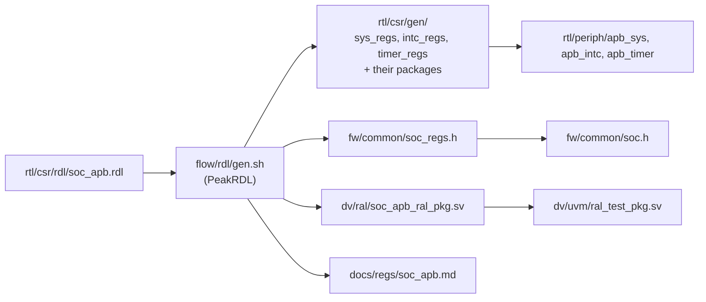

# CSRs from SystemRDL

Step 1-5 replaces the hand-written register files of SYS, INTC and TIMER with ones generated from a single SystemRDL source. The same source also produces the firmware header, the UVM register model and the register document. RTL, firmware and tests are at commit `888d3e5`, the mutation script at `7bbaca7`. Every result below was measured on the RTL and tests of `888d3e5`, the mutation results with the script of `7bbaca7`.

## One source, four outputs



| Output | Generator | Used by |
| --- | --- | --- |
| `rtl/csr/gen/{sys,intc,timer}_regs.sv` and `_pkg.sv` | PeakRDL-regblock 1.3.1 | `apb_sys`, `apb_intc`, `apb_timer`, which add the logic around the registers |
| `fw/common/soc_regs.h` | PeakRDL-cheader 1.2.0 | Register offsets and reset values for the firmware, through `fw/common/soc.h` |
| `dv/ral/soc_apb_ral_pkg.sv` | PeakRDL-uvm 2.4.0 | The UVM register tests |
| `docs/regs/soc_apb.md` | PeakRDL-markdown 1.0.3 | The register reference: every register and field with offset, access and reset |

- **Generated files are committed.** Lint, simulation and CI need no Python. `flow/rdl/requirements.txt` pins the versions they were generated with (PeakRDL 1.5.0, systemrdl-compiler 1.33.0).
- **`make -C dv rdl-check`.** `gen.sh --check` regenerates everything into a temporary directory and fails if any committed file differs. At `888d3e5` it reports `[RDL] generated files match soc_apb.rdl`.
- **Hand-edits.** No generated file is edited by hand. A change to the register map is a change to `soc_apb.rdl` followed by `bash flow/rdl/gen.sh`.

## Register map

The map is the one step 1-4 built by hand, offset for offset; only VERSION changes, to `0x0001_0005`.

| Block | Slot | Registers |
| --- | --- | --- |
| SYS | `0x4000_0000` | ID (read only, `0x5353_4F43`), VERSION (read only), SCRATCH, CONSOLE (write only, event), EXIT (write only, event) |
| INTC | `0x4000_2000` | PENDING (hardware written), ENABLE, CLAIM (hardware written), SWSET |
| TIMER | `0x4000_3000` | MTIME_LO/HI (software and hardware written), MTIMECMP_LO/HI (reset all ones), CTRL (enable, prescale) |

14 registers, 15 fields. Fields and reset values are in [regs/soc_apb.md](regs/soc_apb.md).

## Generator options

`gen.sh` runs regblock once per block with the same options:

| Option | Why |
| --- | --- |
| `--cpuif apb4-flat` | APB4 with PSTRB and PSLVERR, as `axi2apb` drives it; flat ports, so the wrappers keep their port lists |
| `--default-reset arst_n` | Asynchronous active-low reset, the SoC's reset style (docs/01, section 3) |
| `--addr-width 12` | Decode all 12 bits of the 4 KiB slot. By default regblock sizes the address to the block's contents, 5 bits for SYS |
| `--err-if-bad-addr` | PSLVERR for an offset with no register, as before |
| no `--err-if-bad-rw` | A write to a read-only register is ignored, and a read of CONSOLE or EXIT returns 0, without an error, as in step 1-4. With this option either access would become a bus error and an access fault in firmware |

The C header is generated for the top map `soc_apb` with `-i --inst-offset 0x40000000`, so its addresses are the CPU's.

**Timing.** The generated blocks answer every access in its first ACCESS cycle, as the hand-written ones did, so no SoC cycle count moved (below).

## Logic around the registers

The wrappers in `rtl/periph/` keep the ports they had in step 1-4, so `soc_top` did not change. Each one instantiates its generated block and computes what the register file cannot express on its own:

- **`apb_sys`.** CONSOLE and EXIT are `swmod` fields: the block pulses `swmod` on the clock it stores a write. `apb_sys` registers that pulse, so `console_valid` and `exit_valid` are high for one clock, in the same clock that the new value appears on `console_char` and `exit_code`.
- **`apb_intc`.** PENDING and CLAIM are fields written by hardware every clock. PENDING is `(src | SWSET)` with bit 0 cleared; CLAIM is the lowest ID that is pending and enabled, 0 if none. `irq` is high while any enabled source is pending.
- **`apb_timer`.** MTIME_LO and MTIME_HI are software-writable fields with a hardware write enable (`we`). Once every `PRESCALE + 1` clocks with CTRL.ENABLE set, the wrapper loads `mtime + 1` into both words. A software write in the same clock wins, which is SystemRDL's default precedence. `irq` is high while `mtime >= mtimecmp`.

## Firmware header

`fw/common/soc.h` takes every address from the generated header:

```c
#define APB_REG(field) REG32(APB_BASE + offsetof(soc_apb_t, field))
#define SYS_ID         APB_REG(SYS.ID)
#define SOC_ID         SYS_REGS__ID__VALUE_reset
```

- **Why `offsetof` and not the struct.** The header describes the registers as `__attribute__((packed))` structs. GCC may access a member of a packed struct with byte loads and stores, and INTC and TIMER registers must be read and written as whole 32-bit words. The firmware therefore uses the structs only for offsets, and every access is a single `volatile uint32_t` access through `REG32`.
- **Same code.** The firmware images built at `888d3e5` are byte-identical to the committed ones (last changed at `3e51bad`). The register addresses did not change, so the compiler produced the same code.

## Lint

`dv/lint/waivers.vlt` (formerly `vendor.vlt`) keeps generated RTL out of `-Wall`, as it does vendor code. What the waiver covers in the generated blocks:

- members of one unpacked struct driven from separate `always` blocks, which is legal SystemVerilog but reported as MULTIDRIVEN;
- size parameters kept in the package;
- `paddr[1:0]`, unused because the blocks decode 32-bit words.

MULTIDRIVEN, like Ibex's UNOPTFLAT, is reported outside a file-wide waiver and needs its own `-rule` line. Everything else in `soc_top`, the wrappers included, is `-Wall` clean.

## Verification

### UVM register tests

`dv/uvm/` runs on Vivado's simulator with UVM 1.2 (`make -C dv ral`, or `dv/run_ral.ps1` on Windows). The DUT is `apb_sys`, `apb_intc` and `apb_timer` behind a slot decoder (`ral_tb.sv`), so the generated register files are tested together with the logic around them.

| Part | What it checks |
| --- | --- |
| APB agent (`apb_pkg.sv`) | Driver with SETUP and ACCESS phases that waits for PREADY and returns PRDATA and PSLVERR. The adapter passes byte strobes and turns PSLVERR into `UVM_NOT_OK` |
| `uvm_reg_hw_reset_seq` | Reset value of 12 registers |
| `uvm_reg_bit_bash_seq` | Every bit of 10 registers, written 1 and 0 and read back against the field's access type |
| Behavior checks | INTC pending, claim order and external interrupt; timer counting at prescale 0 and 2, counting off, software write over counting, timer interrupt on and off; one console and one exit event per write with the written value; write to ID ignored without error |
| Decode checks | Reads and writes of `0x0018`, `0x0FFC` (SYS), `0x1000`, `0x1FFC` (empty PMU slot), `0x2010` (INTC), `0x3014` (TIMER), `0x4000`, `0xF000` (empty slots) all answer PSLVERR |

The sequences leave some registers out, each for a reason:

- **MTIME_LO and MTIME_HI** count from reset, so neither the reset nor the bit-bash sequence can predict them. The behavior checks cover them.
- **CONSOLE and EXIT** are write-only events that read as 0. They are in the reset test but not in the bit bash; the behavior checks cover them.
- **PENDING, CLAIM and MTIME** are volatile in the generated model, so the bit bash does not compare their read values.

Result at `888d3e5`:

| Item | Value |
| --- | --- |
| Behavior and decode checks | 33, failures 0 |
| APB transfers | 1,191 |
| UVM_ERROR, UVM_FATAL | 0, 0 |
| UVM_WARNING | 3, all `UVM/RSRC/NOREGEX` at time 0 for the names `regmodel.SYS`, `regmodel.INTC`, `regmodel.TIMER` |

The three warnings come from UVM 1.2's resource database, which warns when a resource is created under a name with regular-expression characters, here the dot in a register block's full name. They do not affect a check, and the log keeps them unfiltered.

### Mutation check

`make -C dv ral-mut` (`dv/mutate_ral.ps1`) plants one bug at a time in a copy of a source file, builds the register testbench with the copy and runs it. The repository's files are not modified.

| Mutant | Bug | Caught by | UVM_ERROR |
| --- | --- | --- | --- |
| `reset_value` | MTIMECMP_LO resets to 0 instead of all ones (generated TIMER block) | Reset sequence | 1 |
| `stuck_bit` | SCRATCH bit 8 stuck at 1 after any write (generated SYS block) | Bit bash | 3 |
| `claim_order` | CLAIM returns the highest pending ID instead of the lowest (`apb_intc`) | Behavior check: `CLAIM 20, expected 9` | 1 |
| `no_decode_err` | No PSLVERR for unmapped SYS offsets (generated SYS block) | Decode checks at `0x0018` and `0x0FFC` | 4 |

4 of 4 caught.

### SoC regression

`make -C dv` at `888d3e5` passes: lint, FIFO, register slice, crossbar and the ten firmware runs. Every clock count to exit and every background burst count is the same as at `3e51bad` (docs/04): `hello` 712 and 774, `memtest` 293,459 and 968,821, `irq` 7,906 and 11,592, `buserr` 4,919 and 10,794, `perf` 420,009 and 586,765. The `+apb_check` run, which reaches the registers with 64-bit beats, strobed words and bursts from M3, passes as before.

## Findings

- **The generated blocks decoded only 5 address bits.** regblock sizes the address input to the block's contents by default, so SYS ignored bits 11 to 5 and `0x020`, the undefined offset the `buserr` test loads, would have read ID. This was found by reading the generated RTL before the first simulation, and `--addr-width 12` fixes it. Two tests would catch it if it came back: the `buserr` firmware test, and the decode check at `0x2010`, which INTC's default 4-bit decode would alias to PENDING.
- **The generated register document held an absolute path.** PeakRDL-markdown copies the source path into its output, so `docs/regs/soc_apb.md` named a path on the build machine. `gen.sh` now runs from the repository root with a relative path, which also makes `--check` independent of where the repository is checked out.
- **A UVM test method named `check` clashed with `uvm_component::check`.** The test's helper is now `expect_ok`.

## Limits

- The UVM register tests run only locally: the CI image has Verilator but not Vivado. CI runs everything else, including `soc_top` with the generated blocks.
- At `888d3e5` only SYS, INTC and TIMER were generated. Step 1-6 (`2c90ba1`) added the DMA block and extended the register test ([06_dma.md](06_dma.md)); the PMU (step 1-7) and later blocks follow in `soc_apb.rdl`.
- The SystemRDL source has no CDC or power information. Registers that move to other clock or power domains in step 1-7 get their crossings in the wrappers.

## How to run

```bash
make -C dv rdl-check              # generated files match soc_apb.rdl (needs PeakRDL)
bash flow/rdl/gen.sh              # regenerate after editing soc_apb.rdl
make -C dv ral                    # UVM register tests on xsim (Windows, through WSL interop)
make -C dv ral-mut                # 4 planted bugs, all must be caught
make -C dv                        # lint, block tests, firmware on soc_top with the generated blocks
```

On Windows without WSL: `powershell -ExecutionPolicy Bypass -File dv\run_ral.ps1` and `dv\mutate_ral.ps1`. Both take `-Vivado <install dir>` or `XILINX_VIVADO`.
