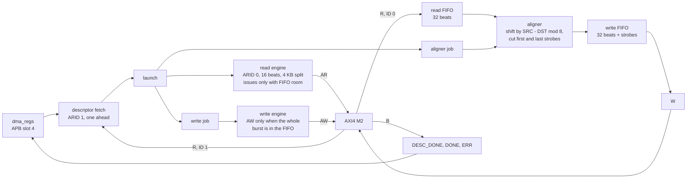

# DMA

Step 1-6 adds a descriptor-based copy engine on crossbar port M2, with its registers in APB slot 4 and its two interrupts on INTC sources 1 and 2. RTL, testbenches, firmware and scripts are at commit `2c90ba1`, and every result below was measured there.

## Blocks

| Block | File | Role |
| --- | --- | --- |
| `dma` | `rtl/dma/dma.sv` | Descriptor fetch, read engine, aligner, write engine, error handling; AXI4 master on M2 |
| `dma_regs` | `rtl/csr/gen/dma_regs.sv` | Its registers, generated from `rtl/csr/rdl/soc_apb.rdl` like the other APB blocks ([05_csr.md](05_csr.md)) |
| `fifo_sync` x 7 | `rtl/common/fifo_sync.sv` | Read data, write data, two job queues, read and write burst tags, W burst lengths |



## Programming model

**Descriptor.** 16 bytes, 16-byte aligned, read with one 2-beat burst:

| Offset | Field | Meaning |
| --- | --- | --- |
| `+0x0` | SRC | Source byte address, any alignment |
| `+0x4` | DST | Destination byte address, any alignment |
| `+0x8` | LEN | `[23:0]` bytes, 1 to 2^24 - 1; `[24]` FENCE: this descriptor's reads start only after every earlier write has its B |
| `+0xC` | NEXT | Next descriptor, 16-byte aligned; 0 ends the chain |

**Registers** (`0x4000_4000`; every field in [regs/soc_apb.md](regs/soc_apb.md)):

| Register | Use |
| --- | --- |
| CTRL | START runs the chain at DESC_PTR; ABORT stops a running chain. Both are pulses and read as 0. START while BUSY is ignored |
| DESC_PTR | First descriptor |
| STATUS | BUSY; DONE and ERR, write 1 to clear, both cleared by START. They are the interrupt outputs, so INTC sees them as levels |
| ERR_INFO, ERR_ADDR | Cause and response of the first error, and its address |
| CUR_DESC | Descriptor whose data is being read, or was read last |
| DESC_DONE | Descriptors whose writes all completed, counted until the first error |
| CYCLES | Clocks from START to the end of the run |

**Error causes.**

| Cause | Event | ERR_ADDR |
| --- | --- | --- |
| 1 | Error response to a descriptor read | Descriptor address |
| 2 | Error response to a data read | Start address of the failed burst |
| 3 | Error response to a write | Start address of the failed burst |
| 4 | LEN 0, NEXT not 16-byte aligned, or DESC_PTR not 16-byte aligned | Descriptor address (DESC_PTR for the last case) |
| 5 | ABORT | CUR_DESC |

After the first error or an abort, nothing new is issued. Every transaction already issued completes, the FIFOs are emptied, and only then is ERR set, so the DMA is idle and can be restarted when the interrupt arrives. A misaligned DESC_PTR sets ERR at once without any bus request.

**Overlap.** A descriptor that reads an earlier descriptor's destination needs FENCE: without it, its reads can start while the earlier writes are still in the write FIFO. A descriptor whose own source and destination overlap is not supported.

## Design decisions

- **Two read IDs.** Data reads use ID 0 and descriptor reads ID 1, and R beats are routed by RID. The next descriptor is fetched as soon as the current one starts, and its read does not queue behind the data reads. With a single ID, a descriptor in SRAM and data in a NAND page buffer would also pay the crossbar's same-ID slave-switch stall on every descriptor (docs/03).
- **RREADY always high.** A data read is issued only when the read FIFO has room for all of its beats (`rd_space` counts entries neither filled nor reserved). The crossbar keeps R on one slave until RLAST, so a master that stalled R would hold that slave's read channel for everyone.
- **AW only with the whole burst buffered.** The write engine issues an AW only when all of its beats are in the write FIFO (`wr_avail`). W then streams without a gap from the first beat to WLAST. The crossbar sends W to each slave in AW order, so a write waiting for read data would hold the slave's W channel. The block testbench checks that WVALID never drops inside a burst.
- **Aligner.** Output beat *j* is bytes *s* to *s*+7 of the previous and the current read beat, with *s* = (SRC - DST) mod 8. When the source offset is below the destination offset, the first output needs no primed beat (a virtual zero beat leads). Beats past the end of the source read as zero. Only the first and last output beats have partial strobes. Every byte-offset pair runs at one beat per clock.
- **Bursts.** 64-bit INCR bursts of up to 16 beats, never across a 4 KB boundary, for reads and writes independently.
- **Outstanding.** Up to 4 data reads plus 1 descriptor read, and 4 writes. The crossbar's limit of 4 per master (docs/01) stalls a fifth read until one completes.
- **FIFO depths.** 32 beats each for read and write data, two maximal bursts. That is enough for full rate on a memory with no stalls (below).

## Verification

### Block testbench

`dv/tb/tb_dma.sv` (`make -C dv dma`) drives the registers over APB and puts the DMA in front of a memory model (`dv/tb/dma_tb_pkg.sv`):
- random READY on AW, W and AR;
- random B and R latency and R gaps;
- W accepted only after its AW, as the crossbar does;
- B and R in order within an ID, reordered between the two read IDs;
- configurable address ranges that answer SLVERR or DECERR.

An `axi4_checker` watches the port.

The reference is a byte array updated by running the descriptors in order. After each run, every byte the memory holds is compared with it. Destinations have 16 guard bytes on each side, so a wrong strobe or a stray write fails as well as wrong data. A run that stops on an error compares the descriptors DESC_DONE reports complete, and must then make no request for 50 clocks.

**Directed test** (all pass):

| Test | What it checks |
| --- | --- |
| Offsets | 64 chains of 17 descriptors: every source and destination byte offset 0 to 7, lengths 1 to 200 |
| 4 KB splits | 8 chains starting 24 and 40 bytes before a page end, lengths 13, 4096, 4097 and 9000: 28 read and 24 write bursts cut at a page end |
| FENCE | 4 chains whose second descriptor reads the last 64 bytes the first one writes |
| Data read error | Cause 2, SLVERR, ERR_ADDR the failed burst `0x1000_1498`, DESC_DONE 1 |
| Write error | Cause 3, SLVERR, ERR_ADDR `0x2000_0950`, DESC_DONE 1 |
| Descriptor read error | NEXT into a DECERR range: cause 1, response 3, ERR_ADDR `0x0F00_0000` |
| Bad descriptors | LEN 0 (cause 4, its address); NEXT misaligned (cause 4, no write issued); DESC_PTR misaligned (cause 4, no read issued) |
| Abort | ABORT 400 clocks into a 32 KiB copy: cause 5, idle 456 clocks after START |
| Restart | Two short descriptors after each error and the abort complete cleanly |
| START while busy | Ignored; a later START clears DONE |

**Throughput** with a memory that never stalls (directed test):

| Copy | Clocks | Bytes per clock |
| --- | --- | --- |
| 4096 B, offsets 0/0 | 540 | 7.59 |
| 4096 B, offsets 3/5 | 540 | 7.59 |
| 65,536 B, offsets 0/0 | 8,220 | 7.97 (99.6% of the 8-byte bus) |
| 64 descriptors of 64 B | 726 | 5.64, or 11.3 clocks per descriptor for 8 data beats |

An unaligned copy runs as fast as an aligned one. Each descriptor costs about 3.3 clocks beyond its data beats.

**Random test** (`make -C dv dma`: 10 seeds of 200 chains):
- Each chain has 1 to 8 descriptors of 1 to 20,000 bytes at random offsets, and the memory's READY, latency and R gaps are random per chain.
- 15% of the descriptors after the first read part of the previous destination and carry FENCE.
- 8% of the chains get a read or write error, and 4% an abort at a random time.

In all, 2,000 chains completed 7,859 descriptors and 17,156,727 bytes, 777 of them with FENCE, plus 163 error runs and 84 aborts, with 0 errors.

| Coverage (directed and random runs merged) | Result |
| --- | --- |
| Covergroups (offset pairs, length classes, FENCE, burst lengths per direction, bursts ending at a page boundary, end causes, chain lengths) | 155 of 155 bins |
| Line, branch, expression (`rtl/dma/`) | 21 of 22 (the unreachable `default` of the state machine), 82 of 82, 218 of 224 |
| Toggle (`rtl/dma/`) | 74.0%. The constant outputs (AXI IDs, PROT, CACHE, QOS) and PSLVERR never toggle; the other misses were not broken down |
| Outstanding seen | 5 reads (4 data and 1 descriptor), 4 writes |

### Mutation check

`make -C dv dma-mut` (`dv/mutate_dma.sh`) plants one bug at a time in a copy of `dma.sv` and runs the directed test and one random seed. All 10 are caught, each by the directed test:

| Mutant | Bug | Caught by |
| --- | --- | --- |
| `page_split` | Bursts not split at 4 KB | `axi4_checker` AR burst assertion |
| `last_strb` | Last beat written with all strobes | Guard byte overwritten |
| `shift_dir` | Aligner shifts the wrong way | Data mismatch |
| `prime` | First beat not primed when the offsets are equal | Data mismatch |
| `fence` | FENCE ignored | FENCE test reads stale data |
| `credit` | Reads issued without room for their data | Hang: no DONE or ERR |
| `drain` | ERR raised before outstanding transactions finish | `axi4_checker` W hold assertion |
| `desc_done` | DESC_DONE counts bursts | DESC_DONE 19, expected 17 |
| `err_addr` | Wrong ERR_ADDR for a data read error | ERR_ADDR check |
| `aw_early` | AW issued before its data is buffered | WVALID low inside a write burst |

### Register tests

The UVM register test (`make -C dv ral`, [05_csr.md](05_csr.md)) now includes the DMA's registers, with the DMA's AXI port on a bus that never answers:
- the reset sequence covers 20 registers and the bit bash 17;
- the bit bash leaves out CTRL, because a 1 there starts or aborts the DMA;
- new behavior checks: a misaligned START ends in ERR with cause 4, ERR_ADDR and no bus request; ERR shows in INTC PENDING as source 2; writing 1 clears it; ABORT while idle changes nothing.

Result:
- 42 behavior and decode checks with 0 failures, over 1,628 APB transfers.
- UVM_ERROR 0.
- 4 UVM/RSRC/NOREGEX warnings, one more than in step 1-5 for the block name `regmodel.DMA`.

The decode checks moved from `0x4000` to `0x4020` and the empty slot `0x5000`. `make -C dv ral-mut` still catches 4 of 4.

### SoC

`soc_top` now has the DMA on M2. The testbench's M2 master is gone, so `+bg` drives M3 only, in its quarter of SRAM. The `dma` firmware test (`fw/tests/dma.c`) keeps its buffers in M2's quarter, `0x1000_8000` to `0x1000_BFFF`:

| Part | Result alone | Result with `+bg` |
| --- | --- | --- |
| 4096 B SRAM to SRAM, CYCLES | 571 clocks (7.17 B per clock) | 934 clocks |
| SRAM, NAND0, NAND1, SRAM: 3 x 4096 B with FENCE on steps 2 and 3 | 1,709 clocks | 2,415 clocks |
| Scatter of 4 unaligned pieces, finished by the DONE interrupt | Interrupt ID 1, DESC_DONE 4, all 4096 bytes of the buffer as expected | Same |
| Write to the ROM (no M2 path) | Interrupt ID 2, ERR_INFO `0x33` (write error, DECERR), ERR_ADDR `0x0000_1000` | Same |
| Read of the APB window (no M2 path) | Interrupt ID 2, ERR_INFO `0x32`, ERR_ADDR `0x4000_0000` | Same |
| Whole test | Exit after 385,735 clocks | 639,716 clocks, 99,916 background bursts, 0 errors |

- **Copy rate.** The same 4096-byte copy takes 571 clocks in the SoC and 540 in the block testbench. The difference is the path through the crossbar and the SRAM model; it was not broken down further.
- **Other tests.** Run alone, every earlier firmware test exits after the same number of clocks as at `3e51bad`. With `+bg` the counts changed, because only M3 now adds traffic:

| Test | `+bg` clocks | M3 bursts |
| --- | --- | --- |
| `hello` | 792 | 141 |
| `memtest` | 783,437 | 120,472 |
| `irq` | 9,965 | 1,556 |
| `buserr` | 8,491 | 1,386 |
| `perf` | 540,487 (CRC loop CPI 1.59) | 84,949 |

## Findings

- **A software clear would have dropped an interrupt.** SystemRDL gives software precedence by default. A write-1-to-clear of STATUS in the same clock as a hardware set would therefore lose the new DONE or ERR. The generated code showed it before any simulation. DONE and ERR now have `precedence = hw`.
- **A read tag could be lost.** The first draft pushed a data read's tag when its AR was accepted, but checked the tag FIFO's room when the AR was loaded. A fifth read could then be loaded while four tags and one accepted AR were in flight. It was found in review before the first simulation. The tag is now pushed at load, as the write side already did.
- **The testbench passed on its first run, so the mutation check came next.** It caught all ten planted bugs. Two of them needed a check that did not exist yet:
  - `aw_early` produces correct data, so the WVALID-gap check was added for it;
  - `credit` overflows the read FIFO and hangs, so the per-run timeout ends such a run.

## Limits

- One channel. Descriptors are not written back, and completion is visible only through DESC_DONE and STATUS.
- All data reads share ID 0. A chain that alternates source slaves pays the crossbar's same-ID stall between them.
- A descriptor's own source and destination must not overlap.
- The DMA's soft reset (docs/01, section 3) comes with the reset controller in step 1-7.

## How to run

```bash
make -C dv dma                    # directed test and SEEDS random seeds (SEEDS, DMA_N)
make -C dv dma-mut                # 10 planted bugs, all must be caught
make -C dv soc                    # includes the dma firmware test, alone and with +bg
make -C dv ral                    # register tests with the DMA block (Vivado)
```
