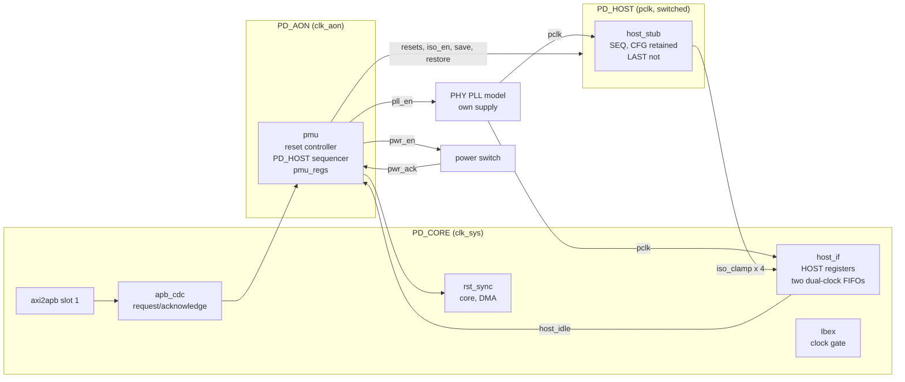

# Clocks, resets and power

Step 1-7 builds the clock, reset and power structure of docs/01, sections 2 to 4:
- four clock inputs and a power-on reset;
- a PMU in the always-on domain that releases the resets in order and switches PD_HOST;
- isolation and retention for PD_HOST, described in UPF;
- a clock gate on the CPU.

PD_HOST's real contents (PHY, link layer) come in phase 2. Until then, a placeholder in PD_HOST carries the kinds of state they will have. RTL, testbenches, firmware and scripts are at commit `ca320d4`, and every result below was measured there.

## Structure



| Block | File | Role |
| --- | --- | --- |
| `soc_pwr` | `rtl/top/soc_pwr.sv` | Everything below, as soc_top uses it; the power testbench drives the same module |
| `pmu` | `rtl/pmu/pmu.sv` | Reset controller and PD_HOST sequencer in `clk_aon`, with the generated `pmu_regs` (APB slot 1) |
| `apb_cdc` | `rtl/pmu/apb_cdc.sv` | APB from `clk_sys` into `clk_aon` with a four-phase request/acknowledge handshake |
| `rst_sync` | `rtl/common/rst_sync.sv` | Asynchronous assert, release after two edges of the domain's own clock |
| `clk_gate` | `rtl/common/clk_gate.sv` | Latch-based clock gate (CPU, PLL model) |
| `iso_clamp` | `rtl/pmu/iso_clamp.sv` | Isolation cell on the always-on side of PD_HOST's outputs |
| `ret_reg` | `rtl/pmu/ret_reg.sv` | Flop plus shadow latch on the always-on supply; save and restore from the PMU |
| `pd_host` | `rtl/host/pd_host.sv` | PD_HOST boundary: reset and restore synchronizers, the placeholder, the four isolation cells, the off-state model |
| `host_stub` | `rtl/host/host_stub.sv` | Placeholder logic: commands in, responses out; retained SEQ and CFG, non-retained LAST |
| `host_if` | `rtl/host/host_if.sv` | Core side: HOST registers (APB slot 5), command and response FIFOs, the idle count the PMU checks |
| `phy_pll_model` | `rtl/host/phy_pll_model.sv` | Behavioral PLL: gated `pclk` and lock, on its own supply outside PD_HOST |
| UPF | `syn/upf/storage_soc.upf` | Domains, switch, isolation, retention, power states |

## Clocks and crossings

| Clock | Frequency in the testbenches | Used by |
| --- | --- | --- |
| `clk_sys` | 50 MHz | Everything in PD_CORE |
| `clk_aon` | 1 MHz | PMU and its registers |
| `clk_nand` | 50 MHz, other phase | Only its reset so far (NAND channels in phase 3) |
| `pclk_in` | 62.5 MHz | The PLL model's output frequency; `pclk` is it gated by the PLL enable |

Every crossing uses one of the three structures docs/01 allows:

| Crossing | Structure |
| --- | --- |
| APB `clk_sys` to `clk_aon` (PMU) | Request/acknowledge: only `req` and `ack` are synchronized; address, data and response registers are stable while their bit is high |
| HOST commands and responses, `clk_sys` and `pclk` | `cdc_async_fifo` x 2 |
| `pwr_ack`, PLL lock, host idle, wake pin into `clk_aon`; PMU interrupt and PD_HOST on into `clk_sys`; restore into `pclk`; PLL enable into `pclk_in` | 2-flop synchronizers on levels |
| Every reset | `rst_sync` in the receiving clock |

The PMU's outputs (resets, isolation, save, restore, PLL enable, switch) are all flops. No decode glitch can reach an asynchronous reset, a latch enable or the switch.

## Resets

| Reset | Released |
| --- | --- |
| PD_AON | 2 `clk_aon` edges after `por_n` |
| Core (`rst_sys_n`) | `SYS_DELAY` (4) `clk_aon` cycles later |
| NAND | 1 `clk_aon` cycle after the core |
| PD_HOST logic | During PD_HOST's power-up, after power and PLL lock; at least 1 `clk_aon` cycle after NAND |
| DMA | With the core, or held by SYS `SOFT_RESET.DMA` |

- **Automatic power-up.** After power-on, PD_HOST powers up by itself. This is part of the reset sequence and raises no interrupt; a failure would raise ERR.
- **Chip reset.** Writing `0x5AFE_0001` to PMU `CHIP_RESET` asserts the core, NAND and PD_HOST logic resets and runs the release order again. PD_AON's registers (`AON_SCRATCH`, `PWR_CYCLES`, `RST_CAUSE`) and PD_HOST's power state are kept. `RST_CAUSE` tells power-on from chip reset.
- **DMA soft reset.** Only for an idle DMA: a reset with transactions outstanding would leave them unanswered at the crossbar.

## PD_HOST power sequence

| State | Power-up | | State | Power-down |
| --- | --- | --- | --- | --- |
| 1 UP_PWR | `pwr_en` 1, wait for `pwr_ack` | | 6 DN_ISO | Refused (result 2, ERR) unless the host path is idle; isolation on |
| 2 UP_PLL | PLL on, wait for lock | | 7 DN_SAVE | Save pulse |
| 3 UP_RST | Release the PD_HOST logic reset | | 8 DN_CLK | PLL off, wait for lock to drop |
| 4 UP_RESTORE | Restore pulse if a save happened since the last reset, then one quiet cycle | | 9 DN_RST | Assert the PD_HOST logic reset |
| 5 ON | Isolation off, core-side FIFO halves out of reset, DONE | | 10 DN_PWR | `pwr_en` 0, wait for `pwr_ack` to drop, then 0 OFF, DONE |

- **Timeouts.** Every wait has the `TIMEOUT` limit (64 `clk_aon` cycles by default). A timeout goes to 11 FAIL: switch off, isolated, in reset, result 3, ERR. UP restarts from FAIL.
- **Wake pin.** A rising edge powers PD_HOST up from OFF when `WAKE_EN` is set, and `PWR_STATUS.WOKE` records it.
- **Idle.** `host_if` counts commands sent minus responses read; the placeholder answers each command once, so the count is exact.
- **Restore.** It happens only after a save, so the first power-up after reset never restores uninitialized shadows (X in xsim).

## Isolation, retention and UPF

- **Isolation.** All four PD_HOST outputs clamp to 0: the command FIFO pop, the response FIFO push and data, and the reset of the FIFOs' `pclk` halves. The reset clamps "in reset", and it then passes another `rst_sync` in PD_CORE, so releasing isolation never releases a reset asynchronously.
- **Retention.** SEQ and CFG of the placeholder stand for the link's sequence numbers and credits.
- **UPF.** `syn/upf/storage_soc.upf` describes PD_CORE, PD_AON and PD_HOST, the switch with its control and acknowledge, the isolation strategy, the retention strategy and a power-state table. No tool in this flow reads UPF, so `make -C dv iso-check` (`flow/power/check_iso.py`) compares it with the RTL. It requires that:
  - every `pd_host` output has an `iso_clamp`;
  - the UPF isolates exactly those ports with the same clamp values;
  - the UPF retains exactly the placeholder's `ret_reg` instances.

  At `ca320d4` it reports 4 isolated outputs and 2 retention registers in agreement, and it fails when one port is removed from the UPF.

**Differences from docs/01.**
- **FIFO placement.** The two FIFOs sit whole in PD_CORE, with their `pclk` halves held in reset while PD_HOST is off. docs/01 splits the transaction bridge across the boundary; phase 2 may move the FIFO halves.
- **PLL placement.** The PLL model is outside PD_HOST, on its own supply. Its clock stops cleanly before the domain loses power, so `pclk` needs no clamp.

## CPU clock gate

`cpu_ibex` gates the Ibex core and its register file the way `ibex_top` does. The clock runs while:
- the core reports busy (registered on the free-running clock),
- or an enabled interrupt is pending,
- or SYS `CLK_GATE.CPU` is 0.

Unlike `ibex_top`, the busy flag resets to busy, so the first cycle after reset is not gated. `SLEEP_CYCLES` counts the clocks the gate removes. The gate is on by default.

## Verification

### Power testbench

`dv/tb/tb_power.sv` drives `soc_pwr` through APB in `clk_sys`, with a power switch model that acknowledges 3 `clk_aon` cycles after `pwr_en` changes. It runs on Verilator (`make -C dv power`) and on xsim (`make -C dv power-x`).

**Off-state model.** While `pwr_ack` is low, PD_HOST's outputs before the clamps are a new random value every `pclk_in` clock on Verilator, and X on xsim.

**Checked all the time.**
- **Every `clk_aon` cycle**, the sequencing rules:
  - isolation and the PD_HOST logic reset are on whenever power is not good;
  - save only with isolation, power and clock;
  - restore only with isolation, power, lock and reset release;
  - isolation off only with power and lock.
- **Every `pclk_in` clock**, isolated outputs are 0.
- **Every `clk_sys` clock**, no X on the core side.
- **The model itself:** it must have produced garbage while PD_HOST was off.

**Directed test** (Verilator and xsim, both pass):

| Part | Result |
| --- | --- |
| Power-on release (`por_n` at 2 µs) | AON 3.5 µs, core 8.5 µs, NAND 9.5 µs, PD_HOST logic 18.5 µs |
| Commands | CFG, three ECHO, STATE answered as specified |
| Refused power-down | With a response unread: result 2, ERR, PD_HOST stays on |
| Power cycle | CFG and SEQ restored, LAST back at 0; a command sent while off dropped with TX_DROP; 1,839 clocks of garbage on the reset output while off (Verilator), none past the clamps |
| Wake pin | Powers up with `WAKE_EN` and sets `WOKE`; ignored without `WAKE_EN` |
| Switch stuck on | Power-down times out after 8 cycles into FAIL; the next power-up restores CFG |
| Chip reset | Core held 5.0 µs; release order core, NAND, host; `AON_SCRATCH` and `PWR_CYCLES` kept; PD_HOST stays on with its logic reset (SEQ 0, no restore) |
| APB crossing | 200 random accesses to PMU and HOST registers read back correctly |
| PLL never locks (`+pll_stuck`) | The power-up after reset ends in FAIL with result 3 and the switch off |

In all, 2,158 sequencing samples, 19,500 isolation samples and 636 APB accesses.

**Mutation check.** `make -C dv power-mut` (`dv/mutate_power.sh`) plants one bug at a time in copies of the RTL. All 11 are caught:

| Mutant | Caught by |
| --- | --- |
| Isolation cells pass their input | Output not clamped while isolated |
| No save pulse; no restore pulse | CFG after power-up is 0 |
| Isolation released before the PLL locks | Sequencing rule |
| Power-down while the host path is busy | Refusal test |
| Host reset released with the NAND reset | Chip-reset release order |
| Waits never time out | Stuck-switch test hangs |
| APB crossing starts before `ack` drops | Wrong read data |
| TX accepted while PD_HOST is off | TX_DROP not set |
| Power-up does not wait for the PLL | Sequencing rule in the PLL-stuck test |
| Off-state model removed | The testbench's own check that the model produced garbage |

### Register tests

The UVM register test (`make -C dv ral`) now takes its reset from `soc_pwr`. PMU and HOST are reached as in the SoC, the PMU through the APB crossing.
- **Coverage.** The reset sequence covers 33 registers and the bit bash 26.
- **Left out, with reasons:** PMU `PWR_CTRL` and `CHIP_RESET` (side effects), `RST_CAUSE` (set by hardware at power-on), HOST `TX` and `RX` (FIFO side effects).
- **New behavior checks:**
  - power-on `RST_CAUSE`, and clearing it;
  - a PD_HOST power-up ending in ON, with DONE on INTC source 10;
  - one command through PD_HOST and back;
  - a power-down counted in `PWR_CYCLES`.
- **Result.** 53 behavior and decode checks with 0 failures over 2,565 APB transfers. UVM_ERROR 0, and 6 UVM/RSRC/NOREGEX warnings, one per register block name.
- **Mutation check.** `make -C dv ral-mut` still catches 4 of 4.

### SoC

| Test | Result |
| --- | --- |
| Earlier tests, alone | Same clock counts as before, with the CPU clock gate on: `hello` 712, `memtest` 293,459, `irq` 7,906, `buserr` 4,919, `perf` 420,009, `dma` 385,735 |
| `power` | Commands, refused power-down, then a power-down in 1,760 `clk_sys` clocks and a power-up in 1,858, each ended by the PMU interrupt in WFI, with the CPU clock gated for 691 of them. After power-up: STATE `0xABCD_0000`, SEQ 4, `PWR_CYCLES` 1. Exit after 10,915 clocks (12,330 with `+bg`) |
| `reset` | DMA soft reset returns DESC_PTR to 0. A 2000-tick WFI has the clock gated for 1,967 clocks, and for 0 with `CLK_GATE.CPU` 0. A chip reset, then a second boot with `RST_CAUSE` 2, the marker in `AON_SCRATCH`, PD_HOST still on and SEQ 0. Exit after 9,770 clocks |

**Why the counts are unchanged.** The gate removes clocks only while the core waits in WFI, and it wakes in the same cycle an interrupt arrives. So an unchanged count shows the gate does not change timing.

**`+bg` counts.** With `+bg` the clock counts differ slightly from `2c90ba1` because the background traffic now starts at a different time after the longer reset sequence, for example `memtest` 786,420 instead of 783,437.

## Findings

- **The automatic power-up left an interrupt pending.** Its DONE stayed in INTC PENDING, and the `irq` test, which ends by checking PENDING is 0, failed. The automatic power-up now raises no DONE; a failure still raises ERR. The first version of this fix never cleared its flag and suppressed every later DONE. The `power` firmware test and the power testbench both caught that.
- **Host reset order.** After a chip reset with PD_HOST on, the host reset was released in the same `clk_aon` cycle as the NAND reset. Found in review; it now follows one cycle later, and the `host_order` mutant shows the order check catches it.
- **Crossing registers without reset.** A source-side reset in the middle of an access would have changed the address and data the destination was still using. The request registers now have no reset.
- **The testbench's own rules.**
  - The first sequencing rule required the PD_HOST logic to be out of reset whenever isolation was off. But during a chip reset PD_HOST stays powered with isolation off and its logic in reset, which docs/01 allows (a domain in reset drives idle outputs), so the rule was relaxed.
  - The first self-check of the off-state model counted nonzero data outputs. Without the model, stale FIFO data showed there anyway, so the `no_pa_model` mutant went uncaught. It now counts the reset output, which is 0 when unpowered unless the model is active.
- **Tool details.**
  - `sw` (SystemRDL) and `soft` (SystemVerilog) are keywords and cannot be field names.
  - xsim rejects a bit-select on a function call.
  - `xsim.bat` splits command-line arguments at `=`.
  - PowerShell reserves `$args`.

## Limits

- PD_HOST holds a placeholder; there is no PHY or link layer yet.
- No tool reads the UPF. Isolation and retention are explicit cells, and the script only checks that the UPF and the RTL agree.
- Only the CPU's clock is gated. The NAND reset has no users yet, and the host soft reset of docs/01 is not built.
- No structural CDC check runs yet; it comes with step 1-9.

## How to run

```bash
make -C dv power                  # Verilator: directed and PLL-stuck tests
make -C dv power-mut              # 11 planted bugs, all must be caught
make -C dv power-x                # xsim with X off-state values (Vivado)
make -C dv iso-check              # UPF and RTL agree on isolation and retention
make -C dv soc                    # includes the power and reset firmware tests
```
