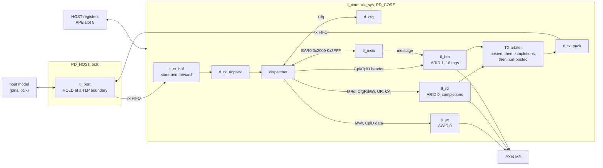

# Transaction layer

Step 2-1 builds the host interface's transaction layer, in both directions: the host reads and writes SoC memory through two BARs, and the SoC moves data to and from host memory as a bus master. Configuration space with an MSI-X capability, completions, error handling and the link hold for PD_HOST's power-down come with it. It runs against a TLP-level host model (a root complex with host memory); the data link layer and the PHY follow in steps 2-6 to 2-9. RTL, testbenches, firmware and scripts are at commit `4a8e515`, and every result below was measured there.

The structure follows the PCI Express Base Specification's transaction layer as far as this document says. Compliance is not claimed.

> **Changed in step 2-2** ([11_nvme_queues.md](11_nvme_queues.md)): BAR0 `0x0000`–`0x1FFF` no longer goes to AXI. It is a register port inside the transaction layer that the NVMe controller's registers sit on, with writes and reads of up to 2 DWs like the MSI-X table, and HOST BAR0_WIN is gone. The bus master takes requests from the NVMe controller too, alternating with HOST-register transfers when both wait; a START that finds the bus master on an NVMe fetch waits for it, with BM_STATUS.BUSY set and BM_CYCLES counting. The rest of this document describes step 2-1 as measured at `4a8e515`, with one correction: its power mutation result below (11 of 11) did not count, because every mutant failed to build and the script took that as a catch ([11_nvme_queues.md](11_nvme_queues.md), Findings; fixed and rerun there).

## Blocks

| Block | File | Role |
| --- | --- | --- |
| `tl_port` | `rtl/host/tl/tl_port.sv` | In PD_HOST, on `pclk`: the link side. Pins (packed TLPs, step 2-1) to the receive FIFO and from the transmit FIFO; HOLD |
| TLP FIFOs | `rtl/host/host_if.sv` | Two `cdc_async_fifo`, 16 beats of 67 bits, between `pclk` and `clk_sys` |
| `tl_core` | `rtl/host/tl/tl_core.sv` | On `clk_sys`, in PD_CORE: receive path, dispatcher, transmit arbiter, AXI port M3 |
| `tl_rx_buf` | `rtl/host/tl/tl_rx_buf.sv` | Store-and-forward receive buffer, 64 beats; malformed TLPs removed whole |
| `tl_rx_unpack`, `tl_tx_pack` | `rtl/host/tl/` | Packed TLPs to header + address-aligned payload, and back |
| `tl_dw_align` | `rtl/host/tl/tl_dw_align.sv` | Moves a DW packet to a new starting lane; used in four places |
| `tl_cfg` | `rtl/host/tl/tl_cfg.sv` | Type 0 configuration space: header, PCI Express capability, MSI-X capability |
| `tl_msix` | `rtl/host/tl/tl_msix.sv` | MSI-X table (8 vectors) and Pending Bit Array |
| `tl_wr` | `rtl/host/tl/tl_wr.sv` | AXI write engine: inbound writes and the bus master's completion data |
| `tl_rd` | `rtl/host/tl/tl_rd.sv` | Inbound reads on AXI and every completion the endpoint sends |
| `tl_bm` | `rtl/host/tl/tl_bm.sv` | Bus master: memory reads with tags and reassembly, memory writes, MSI-X messages |
| `host_regs` | `rtl/csr/gen/host_regs.sv` | HOST registers (APB slot 5), generated from `rtl/csr/rdl/soc_apb.rdl` |



## What the host sees

**Configuration space** (type 0, single function; DW *n* at byte 4*n*):

| Offset | Contents |
| --- | --- |
| `0x00` | Vendor and Device ID: parameters, placeholders `0x0000`/`0x0001`, not IDs assigned to anyone |
| `0x04` | Command: Memory Space Enable, Bus Master Enable, parity error response, SERR# enable, INTx disable. Status: capabilities list, and the error bits below (write 1 to clear) |
| `0x08` | Class code `01:08:02` (NVM Express), revision 1 |
| `0x10`, `0x14` | BAR0/1: 64-bit memory, not prefetchable, 16 KiB |
| `0x18`, `0x1C` | BAR2/3: 64-bit memory, prefetchable, 32 KiB |
| `0x34` | Capabilities pointer `0x40` |
| `0x40` | PCI Express capability v2, endpoint: Max_Payload_Size Supported 256 bytes; Device Control (MPS, MRRS, error reporting enables, relaxed ordering, no snoop) and Device Status (error detected bits, Transactions Pending); link capability x2 at 2.5 GT/s, ASPM L1; Device Control 2 completion timeout disable |
| `0x80` | MSI-X capability: 8 vectors, table at BAR0 + `0x2000`, PBA at BAR0 + `0x3000`; Enable and Function Mask |
| `0x100` and up | 0: no extended capabilities |

The ID used in completions and requests is captured from every configuration write (bus and device; function 0).

**BARs:**

| Range | Goes to |
| --- | --- |
| BAR0 `0x0000`–`0x1FFF` | AXI at HOST BAR0_WIN, `0x4000_8000` at reset: the APB slots the NVMe registers take in step 2-2. Until then they are empty, so a read there gets a CA completion and a write is dropped and counted as an AXI error |
| BAR0 `0x2000`–`0x2FFF` | MSI-X table, inside the transaction layer: per vector address low, address high, data, vector control (mask set at reset) |
| BAR0 `0x3000`–`0x3FFF` | MSI-X Pending Bit Array |
| BAR2 | AXI at HOST BAR2_WIN, the upper half of SRAM (`0x1000_8000`) at reset |

**Requests the endpoint handles:**

| Request | Outcome |
| --- | --- |
| MWr into a window | AXI writes. Bursts of 64-bit beats split at 128 bytes; a 1-DW write is one 32-bit beat, so a register behind the APB bridge sees one word |
| MRd from a window | AXI reads; completions of at most 128 bytes, split at 128-byte address boundaries (also 64-byte RCB boundaries). Byte Count counts the bytes left; Lower Address is the first byte's address. A read of 1 DW is one 32-bit AXI beat |
| MRd or MWr of the MSI-X table or PBA, 1 or 2 DWs | Served from the transaction layer |
| CfgRd0, CfgWr0 to function 0 | Configuration space; Cpl or CplD with Byte Count 4 |
| Message | Dropped without an error |
| Completion | To the bus master (below) |
| I/O, type 1 configuration, locked read, atomics, configuration to function 1 to 7 | UR completion |
| Memory request outside the BARs or with Memory Space Enable clear | UR: a completion for a read, a dropped write |
| Poisoned MWr | Dropped, Detected Parity Error. A poisoned configuration write gets UR |
| MSI-X access longer than 2 DWs | Read: CA completion; write: dropped as UR |
| A read whose AXI burst answers SLVERR or DECERR | The data up to that burst, then one CA completion with the remaining Byte Count; the rest of the request is dropped as it arrives |
| Malformed: Length against the TLP's DW count, a sop inside a TLP or a beat without one, a payload over 64 DWs, an MWr over Max_Payload_Size, byte enables against the rules, a request across 4 KiB, a configuration request of more than 1 DW, a TLP prefix, TD = 1 (ECRC not supported), an unknown type | Dropped whole, Fatal Error Detected |

**Transmit order.** At each TLP boundary a posted request goes first, then a completion, then a non-posted request. So no completion or read passes a posted write, and a posted write may pass both, as the ordering rules allow.

## What the SoC sees

HOST registers (`0x4000_5000`, every field in [regs/soc_apb.md](regs/soc_apb.md)):

| Register | Use |
| --- | --- |
| LINK_CTRL.HOLD, LINK_STATUS | Hold the link before a PD_HOST power-down; LINK_STATUS shows HOLD_ACK, IDLE, and what the host set in configuration space (MSE, BME, MSI-X enable and mask, MPS, MRRS, the captured ID) |
| BAR0_WIN, BAR2_WIN | AXI bases of the two windows |
| BM_HADDR_LO/HI, BM_LADDR, BM_LEN, BM_CTRL, BM_STATUS, BM_CYCLES | One bus-master transfer: host address, local address, length in bytes (DW-granular), direction, START; DONE or ERR with a cause (INTC source 12); clocks it took |
| MSIX_REQ, MSIX_PEND | Request a vector; the Pending Bit Array |
| CPL_TIMEOUT | Completion timeout in units of 64 clocks (4,096 clocks at reset) |
| ERR_STATUS | UR, malformed, poisoned, unexpected completion, completion timeout, completion error, AXI error, link-layer discard, MSI-X drop; bits 0 to 6 are INTC source 5 |
| RX_TLPS, TX_TLPS | TLP counts |
| TX, RX, STATUS | The PD_HOST placeholder's command FIFOs (step 1-7), kept for the power tests |

**Power-down.** The PMU now refuses a PD_HOST power-down unless the host path is held and drained: firmware sets HOLD, `tl_port` stops taking TLPs at the next TLP boundary and acknowledges, and the receive FIFO, transmit FIFO and transaction layer must all be idle for 16 clocks in a row. The 16 clocks cover the synchronizers in the acknowledge and the FIFO status. The PMU driver (`fw/drv/pmu.c`) holds before a power-down and releases after a power-up. Since the transaction layer is in PD_CORE on the core reset, the host's configuration (BARs, enables, MSI-X table) survives the power cycle without retention.

## Design decisions

- **Almost everything on `clk_sys`.** The link side in PD_HOST is only `tl_port`. Decoding, completions, configuration space and the bus master run on `clk_sys` behind the FIFOs. That keeps the host's configuration through a PD_HOST power cycle and leaves one clock domain for the transaction layer's logic. `clk_sys` moves 8 bytes per clock at 50 MHz (400 MB/s), below the link's 500 MB/s at 62.5 MHz.
- **Store and forward on receive.** `tl_rx_buf` makes a TLP visible only when its last beat has arrived and its DW count matches its header; a failed TLP is removed by moving the write pointer back. The transaction layer never acts on part of a TLP, and the data link layer of step 2-6 can drop a TLP it finds corrupt the same way (`in_bad`, counted as a discard).
- **Address-aligned payload.** Inside the transaction layer a payload DW sits in the 64-bit lane of its address (address bit 2; Lower Address bit 2 for a completion). Payload beats then map onto AXI beats directly. One DW aligner moves a packet between lanes wherever the two sides differ: packed TLP to aligned payload, back, TLP lane to AXI lane, and the bus master's local lane to the host lane.
- **One AXI port.** Writes come from one engine with one ID, so B responses return in order; reads use ID 0 (inbound) and ID 1 (bus master), routed back by RID. Every read is issued only when its buffer has room for all its beats, so RREADY is always high and no burst holds a crossbar slave's R channel. AW, W and AR leave through register slices.
- **A read never passes an earlier write.** AXI does not order reads after writes, but a PCIe read must see earlier posted writes. Each inbound read waits until every write accepted before it has its B response (a job counter).
- **Completions in arrival order.** All non-posted requests (memory, configuration, UR and CA) queue one completion job each, so completions leave in request order. Reordering across requests would be allowed, but in-order is simpler and the host model accepts it.
- **Bus master.** One request at a time, up to 1 MiB. Reads are cut at Max_Read_Request_Size and at 4 KiB on both the host and the local side, with 16 tags; a completion is checked against its tag and written to its offset, so completions of different tags may come in any order. Writes are cut at Max_Payload_Size and 4 KiB on both sides, and a chunk is sent only once all of its data is buffered, so its TLP has no gap. A tag that times out stays out of use for one more timeout period, and a completion that arrives for it then is dropped as unexpected.
- **MSI-X in the transaction layer.** The table is inside the transaction layer, not behind the APB bridge, so a message is built without a bus access. A message goes in the same stream as the bus master's data writes, between TLPs, so it never passes data written before it.
- **Why not the old bridge.** AXI_PCIe_Subsystem `b64e36a`'s `pcie_to_axi_bridge` handles one transaction at a time, on a 32-bit AXI master, with a 32-bit DW stream and no bus master or configuration space. The transaction layer here is new; only its byte-count and Lower Address rules (`low_off`, `high_drop`) were kept, and one of them needed a fix (Findings).

## Verification

### Block testbench

`dv/tb/tb_tl.sv` (`make -C dv tl`) drives `tl_core` with the host model `dv/tb/tlp_tb_pkg.sv` on the packed streams and the DMA testbench's memory model on M3 (now also taking single 32-bit beats). The testbench drives the HOST register signals as firmware would; `axi4_checker` watches M3. The host model checks every completion it gets (IDs, tag, status, Byte Count and Lower Address against what is still expected, the 128-byte split rule) and every request the device makes (requester ID, length against MPS or MRRS, 4 KiB, byte enables). It answers the device's reads from host memory after a random latency, in completions split at random 64-byte boundaries, in random order across tags; faults can be injected per read.

**Directed tests** (`+test=`; all pass):

| Test | What it checks |
| --- | --- |
| `enum` | IDs, class code, BAR sizing (all-ones write and read back) and placement above and below 4 GiB, read-only registers, capability list, MPS and MRRS, Memory Space and Bus Master Enable, MSI-X table and enable |
| `target` | Writes and reads of 18 sizes from 1 to 252 bytes at all 8 byte offsets; reads up to 4 KiB; 12 reads outstanding; a read right behind a write to the same bytes; a zero-length read; the BAR0 window |
| `errors` | UR for a read and a write outside the BARs and with Memory Space Enable clear; I/O, type 1 configuration, function 1 and locked reads; a message; eight malformed TLPs; a poisoned write and a poisoned configuration write; a link-layer discard; an AXI read error inside a long read (CA after the good data); an AXI write error; an MSI-X read of 16 bytes; the Status and Device Status bits and their clearing |
| `msix` | All 8 vectors; a masked vector in the PBA and its delivery on unmask; Function Mask; a QW access to the table; a request while MSI-X is disabled |
| `bm` | Both directions for 14 lengths from 1 to 2,048 DWs, each with host and local addresses in the same and different lanes and across 4 KiB on both sides |
| `bm_err` | Bus Master Enable clear; UR, CA, poisoned and wrong-Byte-Count completions; a completion timeout, the late completions dropped as unexpected, and the tags back after the quarantine; unexpected completions beside a good transfer; local AXI write and read errors (no MWr for a chunk that failed) |

**Random test** (`+test=random`): enumeration with random MPS and MRRS, then at once: inbound writes and reads into BAR2 (up to 16 reads outstanding, writes never to bytes a read in flight covers), checked against a byte shadow of the window; bus-master transfers of random direction, length and addresses, checked byte by byte; MSI-X requests, counted. READY, gaps and latencies are random on both sides.

Over 10 seeds of 3,000 inbound operations (`make -C dv tl`), in all 0 errors:
- 30,000 inbound writes and reads;
- 1,040 bus-master transfers: 2,776 MRd for 799,700 bytes of host memory, and 5,797 MWr;
- 237 MSI-X messages;
- the host model sent 40,637 TLPs, among them 10,177 completions (7,401 of them split before the request's end), and received 96,600.

| Coverage (directed, throughput and random runs merged) | Result |
| --- | --- |
| Covergroups (bus master: direction by length class, lane difference and 4 KiB crossings on each side; inbound writes and reads: size class by byte offset; completions per host read) | 172 of 172 bins |
| Line, branch, expression (`rtl/host/tl/`) | 218 of 230, 362 of 396, 989 of 1,066; the misses were not broken down |
| Toggle (`rtl/host/tl/`) | 71.3% |
| Host reads outstanding at once | 16 |

CI runs 3 seeds of 1,000 operations; they also hit all 172 bins.

**Throughput and latency** (`+test=perf`: no idle clocks, no backpressure, 2-clock host latency, completions up to 256 bytes, a memory that never stalls):

| Transfer | Clocks | Bytes per clock |
| --- | --- | --- |
| 128 inbound MWr of 256 bytes (32 KiB) | 4,646 | 7.05 |
| 8 inbound MRd of 4 KiB, all outstanding | 4,889 | 6.70 |
| Bus master, host to SoC, 64 KiB, MRRS 512 | 9,266 | 7.07 |
| Bus master, SoC to host, 64 KiB, MPS 256 | 8,997 | 7.28 |

- **Header overhead.** A 256-byte MWr with a 3DW header is 268 bytes on the 8-byte stream, so 7.64 bytes per clock is its limit; 7.05 is 92% of that. Inbound reads come back in 128-byte completions with 12-byte headers, a limit of 7.31; 6.70 is 92% of it.
- **Latency.** A 1-DW read takes 13 clocks from the request's first beat to the completion's last. A 4 KiB read takes 633 clocks, in 32 completions.

### Mutation check

`make -C dv tl-mut` (`dv/mutate_tl.sh`) plants one bug at a time in a copy of `rtl/host/tl` and runs the directed tests and one random seed until one fails. All 13 are caught: 7 by `target`, 3 by `errors`, 2 by `bm_err` and 1 by `msix`.

| Mutant | Bug | Caught by |
| --- | --- | --- |
| `fence` | A read does not wait for earlier writes | `target`: read after write returns old data |
| `credit` | Reads issued without room in the completion buffer | `target`: hang |
| `split` | Read bursts not split at 128 bytes | `target`: `axi4_checker` AR burst assertion |
| `bc` | Byte Count not reduced after a completion | `target`: host model Byte Count check |
| `la` | Lower Address of later completions wrong | `target`: host model Lower Address check |
| `last_be` | Last BE ignored on writes | `target`: a byte past the write changed |
| `mse` | Memory Space Enable ignored for BAR2 | `errors`: no UR |
| `be_rule` | Byte-enable rules not checked | `errors`: a malformed TLP not counted |
| `timeout` | Completion timeout not reported | `bm_err`: cause 0 instead of 5 |
| `cpl_bc` | Byte Count of completions not checked | `bm_err`: cause 0 instead of 6 |
| `msix_mask` | MSI-X vector mask ignored | `msix`: message sent while masked |
| `rx_len` | TLPs not checked against their Length | `errors`: no return to idle |
| `align_tail` | Aligner drops the DW left over at a packet's end | `target`: hang |

### Power and register tests

- **Power testbench** (`make -C dv power`, Verilator with random off-state values; `make -C dv power-x`, xsim with X). PASS on both, directed and PLL-stuck tests.
  - The isolation check covers all 14 PD_HOST outputs (pins, FIFO controls, HOLD_ACK), and the X check the new core-side signals. M3 must stay idle while the link is quiet.
  - Every power-down holds the link first. New case: a power-down without HOLD is refused (result 2, PD_HOST stays on).
  - 2,207 sequencing and 19,500 isolation samples; a power cycle takes 47.9 µs down and 37.1 µs up, APB polling included.
  - `make -C dv power-mut`: 11 of 11 still caught (the off-state mutant now targets the new model).
- **UPF.** PD_HOST now includes `tl_port`, and 14 outputs are isolated, all clamped to 0. `make -C dv iso-check` passes, with the same 2 retention registers.
- **Register tests** (`make -C dv ral`, xsim).
  - The reset sequence covers 50 registers and the bit bash 41. BM_CTRL and MSIX_REQ are left out of the bit bash: a write starts a transfer or requests a vector.
  - The HOST check now holds the link before it expects STATUS.IDLE and powers down; the decode check moved to HOST + `0x058`.
  - 53 behavior and decode checks, 0 failures, 3,930 APB transfers, UVM_ERROR 0, 6 NOREGEX warnings as before. `make -C dv ral-mut`: 4 of 4.

### SoC

`soc_top`'s M3 is now the transaction layer, and its `ext_*` AXI port is gone. In `tb_soc` the host model sits on the host pins and enumerates the device once PD_HOST is up, in every test. `+bg` is now host traffic: random writes and reads through BAR2 into the host's quarter of SRAM (`0x1000_C000`), checked against every byte the host wrote. `+apb_check` runs through the BAR0 window, pointed by the testbench at the APB slots it needs. A new firmware test, `fw/tests/host.c`, waits for enumeration and then uses the bus master with its interrupt:

| Part of `host` | Alone | With `+bg` |
| --- | --- | --- |
| Enumeration | ID `0x0100` captured, Bus Master and MSI-X enabled | Same |
| Host to SoC, 8192 B from a 64-bit host address | 1,444 clocks (5.67 B per clock), every byte checked | 1,666 clocks |
| SoC to host, 8192 B | 1,188 clocks (6.90 B per clock), checked by the testbench | 1,646 clocks |
| Host to SoC, 1000 B, host and local lanes differ | 230 clocks | 341 clocks |
| SoC to host, 1000 B, lanes differ | 177 clocks | 238 clocks |
| MSI-X vector 2 | 1 message, address and data checked | Same |
| Whole test | Exit after 156,082 clocks, 0 errors | 195,778 clocks, 9,010 host requests (1.7 MB), 0 errors |

- **Rate.** The host-to-SoC rate is below the block test's 7.07 bytes per clock: in the SoC the host model answers after 10 to 40 `pclk` clocks, in completions of up to 128 bytes, and the transfer is 8 KiB.
- **Other tests, alone.** hello 712, memtest 293,459, irq 7,906, buserr 4,919, perf 420,009, dma 385,735 and reset 9,770 clocks, the same as at `fbe4b8a` ([08_firmware.md](08_firmware.md)). Two programs changed, both because of HOLD:
  - power: 10,920 clocks, from 10,915; its power-down and power-up take 1,763 and 1,859 clocks;
  - soc_app: 462,896, from 458,790, with PD_HOST down in 1,756 clocks and up in 1,888.
- **With `+bg`.** The host traffic is now TLPs through the transaction layer. memtest ran 24,301 host requests (4.66 MB) and soc_app 37,980 (7.30 MB), with 0 errors. During the power test the host waits through the hold, so that run has only 56 requests.
- **APB check through BAR0.** A QW read of ID and VERSION, a DW write and read of SCRATCH, CA for a QW read beside an undefined word, a PMU register through the APB crossing, and a 2-beat burst over the timer: 0 errors.

### Synthesis, timing and CDC

`make -C flow` at `4a8e515`, pre-layout as in [09_timing.md](09_timing.md).

**Area.** 97,796 cells and 1,319,995 µm² of standard cells, SRAM macros not counted: 2.8 times step 1-9's 472,680 µm². By block (`flow/syn/area_by_block.py`, whose total of 1,324,980 µm² also counts the fanout buffers):

| Block | Area (µm²) | Share |
| --- | --- | --- |
| Transaction layer, in all | 810,532 | 61.2% |
| of it: bus master (tags, 64-beat write buffer) | 235,458 | 17.8% |
| of it: completer (64-beat completion buffer, job queues) | 183,904 | 13.9% |
| of it: dispatcher, transmit arbiter, AXI and receive register slices | 134,016 | 10.1% |
| of it: receive buffer (64 beats) | 129,759 | 9.8% |
| of it: unpack, pack, MSI-X table, write engine, configuration space | 127,395 | 9.6% |
| DMA | 199,013 | 15.0% |
| CPU | 122,962 | 9.3% |
| PMU, crossing, PD_HOST, HOST registers, the four dual-clock FIFOs | 61,567 | 4.6% |
| Everything else | 130,906 | 9.9% |

The transaction layer's area is mostly its three 64-beat buffers, which are flops with 64:1 read muxes (Limits).

**Timing at `4a8e515`:**

| Corner | Setup WNS | Hold WNS | Worst setup |
| --- | --- | --- | --- |
| `tt_025C_1v80` | +1.859 ns | +0.106 ns | `clk_sys` +1.86 (a CPU path), `pclk` +7.53; from the transaction layer +6.68 |
| `ff_100C_1v95` | +8.580 ns | −0.022 ns (TNS −0.355, SRAM input pins) | `clk_sys` +8.58, `pclk` +8.77 |
| `ss_n40C_1v40` | −54.803 ns | +1.040 ns | `clk_sys` −54.8 (a CPU path), from the transaction layer −37.7, `pclk` −4.33 |

- **tt.** Every clock meets its frequency. The +0.290 ns of step 1-9 is gone because its worst path ended at the M3 chip port, which is internal now.
- **ss.** Not met, as at step 1-9 (docs/09 has the plan, P5 5-1). The transaction layer adds its own failing paths at ss, and the host pins' 4.8 ns budget makes `pclk` miss by 4.3 ns.

**CDC check.** 30,319 flops, 32 latches and 4 SRAM macros checked; every crossing is a synchronizer (49 bits), a handshake register (80), a FIFO word (8,927) or a PMU control (2,725). PASS, after the HOLD_ACK fix (Findings).

## Findings

- **Zero-length read.** A read with First BE `0000` must complete with Lower Address bits 1:0 at 0. The byte-offset rule taken from the old bridge returned 3 for an empty byte enable. The first directed run found it.
- **The AR arbiter changed its choice under VALID.** The AR channel takes requests from the completer and the bus master. The first random run tripped the register slice's own assertion: the round-robin choice could flip while an AR waited for READY, changing the payload. The choice now holds until the handshake. The bus master's first AR of a chunk could also drop VALID if an error arrived while it waited; it now stays up.
- **MSI-X was idle with a message ready.** Between an unmask and the message being taken, `tl_msix` reported idle for a clock. The MSI-X test found it; the PMU would have accepted a power-down then. A vector that can be sent now counts as busy.
- **The first TLP after a power-up was lost.** When isolation ends, `tl_port`'s READY rose at once, but the receive FIFO's `pclk` side leaves reset two clocks later, behind its synchronizer. In the SoC the host's first configuration read went into a FIFO still in reset, and enumeration never finished. READY now waits for the FIFO (`fifo_ok`).
- **Logic before a synchronizer.** The CDC check (`flow/cdc/check_cdc.py`) found HOLD_ACK passing its isolation clamp straight into the `clk_sys` synchronizer. It is registered again on `pclk` in PD_CORE first.
- **The reset net became data.** Synthesis gave −131 ns of setup slack at tt, from the core reset synchronizer through 6,765 unbuffered pins into flop enables. The register slice imported in step 1-2 assigned its data registers inside its asynchronous-reset process without reset values, and synthesis held them during reset by gating their enables with the reset. The slice was used only in its own testbench before; the transaction layer instantiates five. Its data registers are now in a process of their own; the slice testbench still passes.
- **Two flow bugs.** OpenSTA rejected the netlist: `buffer_fanout.py` treated an escaped name with brackets in it (from an unpacked array) as an escaped vector bit and left out its terminating space. And the CDC check took the host pins for `clk_sys` ports; they are timed against `pclk` (`PORT_DOMAIN`).
- **Testbench issues on the way:** the host model reported idle while its driver held a TLP in a random gap; its completions waited behind unbounded inbound traffic and timed out; and `small` and `inside` are SystemVerilog keywords, so they cannot name coverage bins.

## Limits

- **No flow control credits** until the data link layer (step 2-6); the host model takes every TLP the device sends.
- **One receive queue.** A non-posted request that cannot proceed (its completion buffer is full) holds the TLPs behind it. That is safe because completions always drain to the host; with credits in step 2-6, separate posted, non-posted and completion queues may be needed.
- **No ECRC** (a TLP with TD = 1 is dropped as malformed), no error messages to the host, no INTx or MSI (only MSI-X), no extended capabilities (no AER), one function, no function-level reset.
- **Max_Payload_Size up to 256 bytes**, 16 tags without Extended Tag, and completions in request order.
- **Bus master:** one transfer at a time, DW-granular addresses and lengths.
- **BAR0's register window points at empty APB slots** until the NVMe registers of step 2-2.
- **Area.** The three 64-beat buffers (receive, completion, bus-master write) are flops with 64:1 read muxes; a 2-port register file per buffer would remove most of the transaction layer's area (an area item for P5).

## How to run

```bash
make -C dv tl                     # six directed tests and SEEDS random seeds (SEEDS, TL_N)
make -C dv tl-mut                 # 13 planted bugs, all must be caught
make -C dv soc                    # firmware tests with the host model, including fw/tests/host.c
make -C dv power power-mut        # power testbench with HOLD; planted bugs
make -C dv ral                    # register tests with the HOST block (Vivado)
make -C flow                      # synthesis, CDC check, STA, area
```
