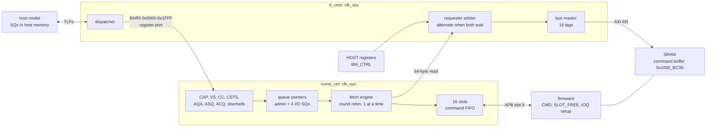

# NVMe registers and queues

Step 2-2 builds the NVMe-style controller's register interface and its submission side. The host enables the controller, rings doorbells, and the controller fetches its commands from host memory into SRAM, round robin across the admin queue and four I/O queues. Firmware takes the fetched commands from a FIFO, handles the admin commands that create I/O queues, and returns each command buffer slot. Completion queue entries, PRP data transfers and per-queue MSI-X come in step 2-3. The step's RTL, firmware and scripts are in commit `883242d`, and `d3a786e` makes the block testbench's directed tests cover every bin (Findings). Every result below was measured at `d3a786e`, whose RTL is that of `883242d`.

The registers and queues follow the NVM Express Base Specification's layout as far as this document says. Compliance is not claimed.

## Blocks

| Block | File | Role |
| --- | --- | --- |
| `nvme_ctrl` | `rtl/host/nvme/nvme_ctrl.sv` | On `clk_sys`, in PD_CORE: host registers and doorbells, controller state, queue pointers, round-robin fetch engine, command buffer slots, command FIFO |
| `nvme_regs` | `rtl/csr/gen/nvme_regs.sv` | NVME registers for firmware (APB slot 8), generated from `rtl/csr/rdl/soc_apb.rdl` |
| `tl_core` register port | `rtl/host/tl/tl_core.sv` | BAR0 `0x0000`–`0x1FFF`: one DW per clock out, two DWs read back, no AXI |
| `tl_core` NVMe port | `rtl/host/tl/tl_core.sv` | Bus-master requests from `nvme_ctrl`, alternating with HOST-register transfers when both wait |
| `host_if` | `rtl/host/host_if.sv` | Instantiates `nvme_ctrl` next to the transaction layer; its idle joins the PD_HOST power-down condition |



## What the host sees

BAR0 `0x0000`–`0x1FFF` (offsets in bytes; a TLP may carry 1 or 2 DWs, as for the MSI-X table):

| Offset | Register | Contents |
| --- | --- | --- |
| `0x00` | CAP (64-bit) | MQES 1023 (1,024 entries), CQR 1 (contiguous queues), TO 1 (500 ms), DSTRD 0, CSS NVM command set, MPSMIN and MPSMAX 4 KiB |
| `0x08` | VS | 1.4.0 |
| `0x0C`, `0x10` | INTMS, INTMC | Read 0, writes ignored: MSI-X only |
| `0x14` | CC | EN, CSS, MPS, AMS, SHN, IOSQES, IOCQES stored; EN and SHN act |
| `0x1C` | CSTS | RDY, CFS, SHST; read-only |
| `0x20` | NSSR | Reads 0, writes ignored |
| `0x24` | AQA | ASQS and ACQS, 12 bits each |
| `0x28`, `0x30` | ASQ, ACQ (64-bit) | Admin queue bases, 4 KiB aligned |
| `0x1000 + 8y` | SQyTDBL | Submission queue y tail, y = 0 to 4 |
| `0x1004 + 8y` | CQyHDBL | Completion queue y head, y = 0 to 4 |
| everything else | | Reads 0, writes ignored |

**Enable and reset.** CC.EN is a level. With EN set and the controller off, the admin queue pair is taken from AQA, ASQ and ACQ, its pointers start at 0 (completion phase 1), and CSTS.RDY rises two clocks after the CC write. With EN clear and the controller on, fetching stops; once no fetch is in flight, every queue pointer goes back to 0, the I/O queues' enables are cleared, waiting commands are dropped, all 16 slots are freed, CFS and SHST are cleared, and RDY falls. A host that writes EN = 0 and polls RDY therefore sees the reset finish after the fetch in flight, if any.

**Shutdown.** CC.SHN written non-zero while the controller is on sets SHST to "processing" and stops new fetches; SHST reads "complete" once no fetch is in flight. A later controller reset clears it.

**Doorbells.** A tail or head value must be below the queue's size, and the queue must exist (queue 0 while the controller is on; queues 1 to 4 once firmware has enabled them). Otherwise the write is ignored and reported to firmware (EVENT.DB_ERR, DB_ERR with queue, SQ or CQ, and value). Writes above `0x1027` are ignored without a report.

**Fetch.** A submission queue has work while its head and tail differ. The queues with work are served round robin, one command per turn, whenever a slot is free and no other fetch is in flight: a 64-byte memory read at SQ base + 64 × head, through the transaction layer's bus master, into SRAM at CMDBUF + 64 × slot. When the read completes, {queue, slot} enters the command FIFO and the head moves on, wrapping at the queue size. A failed read (an error completion, poisoned data, a completion timeout, a local AXI error) sets CSTS.CFS and stops fetching until the next controller reset.

## What the firmware sees

NVME registers (`0x4000_8000`, every field in [regs/soc_apb.md](regs/soc_apb.md)):

| Register | Use |
| --- | --- |
| CTRL.IEN_CMD | Interrupt (INTC source 3) while a command waits in the FIFO |
| STATUS | RDY, CFS, CC.EN, SHST; commands waiting (0 to 16) and free slots (0 to 16) |
| EVENT, EVENT_EN | ENABLE, RESET, SHUTDOWN, DB_ERR, FETCH_ERR, sticky, write 1 to clear; any enabled one interrupts on source 3 |
| CC, AQA, ASQ_LO/HI, ACQ_LO/HI | Read-only copies of the host's registers |
| CMDBUF | Base of the command buffer, 1 KiB aligned; `0x1000_BC00` at reset |
| CMD | The oldest fetched command: VALID, SQID, SLOT. Reading it with VALID set pops it |
| SLOT_FREE | Write a slot number to return the slot once its command is no longer needed |
| DB_ERR, FETCHES | The last bad doorbell; commands fetched since reset |
| IOQ[1..4] | Per I/O queue pair: SQ base, SQ size, its CQ and SQ enable; CQ base, size, interrupt vector, interrupt enable and CQ enable. Enabling a queue sets its pointers to 0 |
| SQ_PTR[0..4], CQ_PTR[0..4] | Head and tail of every queue; the completion queue's phase |

The firmware's part of a command's life, as `fw/tests/nvme.c` does it: on the interrupt, read CMD until VALID is clear; read the 64-byte entry from CMDBUF + 64 × SLOT; act on it; write the slot to SLOT_FREE. For a Create I/O Completion Queue or Create I/O Submission Queue admin command, acting on it means writing the queue's IOQ registers from the command's PRP1, queue size, queue ID and flags. After EVENT.RESET the firmware forgets the commands it holds: their slots were freed by the reset.

## Design decisions

- **Registers on the transaction layer, not behind AXI.** The roadmap placed the NVMe registers behind a new crossbar slave port. Instead, BAR0's lower 8 KiB is a register port inside the transaction layer, like the MSI-X table: a doorbell write reaches the controller a few clocks after its TLP, with no AXI or APB bus on the way, and the registers can be tested on the transaction layer alone. HOST BAR0_WIN, which pointed that range at AXI, is gone.
- **Fetches through the existing bus master.** The roadmap also had a new crossbar master port for the controller. A command fetch is a host memory read whose data goes to SRAM, which is exactly a bus-master transfer, so the controller requests one on a second port of the transaction layer's bus master. When a HOST-register transfer and an NVMe fetch both wait, they take turns. The crossbar keeps its 4 × 5 shape.
- **Commands in SRAM, slot numbers in a FIFO.** The controller does not hold commands. Firmware reads a 64-byte entry from SRAM like any other data, and the controller keeps only a 16-entry FIFO of {queue, slot}. Each slot is in use from the fetch to SLOT_FREE, so the FIFO can never overflow and a slow firmware simply stops the fetches.
- **Admin commands in firmware.** Creating, and later deleting, I/O queues is a firmware decision that checks the command first (queue ID, size, contiguity, an existing completion queue). The hardware only provides the per-queue registers. The I/O commands will be handled the same way in step 2-4.
- **CC.EN as a level, reset after the fetch in flight.** A reset never cuts a bus-master transfer in the middle. The transfer finishes and its command is dropped. That keeps the transaction layer's tags and completion bookkeeping consistent through a controller reset.
- **One fetch at a time.** The bus master serves one transfer at a time. Several outstanding fetches would need several bus-master requests in flight, or one read of several entries into adjacent slots. A fetch takes 40 clocks with a fast host (Limits); step 2-3 shares the bus master with data transfers anyway.

## Verification

### Block testbench

`dv/tb/tb_nvme.sv` (`make -C dv nvme`) puts `tl_core` and `nvme_ctrl` together. The host model from step 2-1 (`dv/tb/tlp_tb_pkg.sv`) enumerates the device and acts as an NVMe host: it writes commands into submission queues in its host memory and rings the doorbells through BAR0. The testbench plays the firmware over APB: it creates I/O queues, pops commands from CMD and frees their slots. The DMA testbench's memory model stands for SRAM. Every command is checked when firmware pops it: it comes from the queue it was submitted to, in submission order, exactly once, and its 64 bytes are the submitted ones.

**Directed tests** (`+test=`; all pass):

| Test | What it checks |
| --- | --- |
| `regs` | CAP fields, VS, write masks of CC and AQA, ASQ and ACQ low bits, CSTS read-only, INTMS, NSSR, doorbells and reserved space read 0; firmware mirrors; STATUS and CMDBUF at reset; PSLVERR for unmapped firmware addresses |
| `enable` | CC.EN to RDY and back, EVENT.ENABLE and RESET, an event interrupt through EVENT_EN, a second enable from a clean state |
| `fetch` | 30 admin commands through a 4-entry queue, then 32 commands through four 3-entry I/O queues, so every head wraps many times; firmware pace random; the command interrupt |
| `rr` | All 16 slots taken, then six commands in each of the five queues: the fetch order cycles through the queues; the command interrupt follows CTRL.IEN_CMD |
| `doorbell` | Tail equal to the size, a queue not created, a head beyond the queue (SQ and CQ): ignored, reported in DB_ERR and EVENT.DB_ERR; a good CQ head doorbell taken |
| `ferr` | A fetch answered with UR: CSTS.CFS, EVENT.FETCH_ERR, the slot back, no command; cleared by a reset |
| `shutdown` | SHN right behind a doorbell, with the host answering after 300 clocks so a fetch is in flight: SHST reads "complete" only after it, and nothing is fetched afterwards |
| `reset` | A controller reset with commands waiting and a fetch in flight (the host answers after 300 clocks); firmware takes a command and returns its slot while the reset waits. Then no command, 16 free slots, all pointers 0, I/O queues disabled; after the next enable only new commands arrive |

**Random test** (`+test=random`): queues of 2 to 40 entries, commands into random queues in random batches, firmware taking commands at a random pace, and now and then a controller reset (half of them after a shutdown, with firmware still popping while the reset runs) followed by new queue sizes. Commands that firmware has not taken before a reset are dropped, as a host that resets its controller expects.

Over 10 seeds of 2,000 commands (`make -C dv nvme`), in all 0 errors:
- 20,008 commands submitted and 15,395 fetched and checked; the other 4,613 were dropped by 50 controller resets, 25 of them after a shutdown;
- 399,968 firmware APB accesses.

| Coverage (directed, throughput and random runs merged) | Result |
| --- | --- |
| Covergroups (fetches: queue by head wrap, slot; controller events and corner states: enable, reset idle and with a fetch in flight, shutdown idle and with a fetch in flight, four doorbell error kinds, fetch error, a queue waiting for a slot, SLOT_FREE during a reset; commands waiting at each fetch) | 49 of 49 bins |
| Line, branch, expression (`rtl/host/nvme/`) | 40 of 51, 54 of 54, 93 of 98 |
| Toggle (`rtl/host/nvme/`) | 49.2% |

The 11 lines not hit are the cases of the host-register read function, which Verilator does not count when a continuous assignment calls it; `regs` checks every value it returns. CI runs 3 seeds of 1,000 commands. The directed tests alone hit all 49 bins.

**Throughput and latency** (`+test=perf`: the host answers after 2 clocks and takes every beat, the memory never stalls):

| Case | Clocks |
| --- | --- |
| Doorbell write at the controller to the command in the FIFO | 40 |
| 63 commands behind one doorbell (a full 64-entry queue) | 2,524 (40.1 per command) |

A fetch is a round trip through the whole transaction layer: request, MRd out, the host's 2 clocks, the 76-byte completion stored and checked whole in the receive buffer, written to SRAM, and the write response. At 50 MHz, 40 clocks per command is 1.25 million commands per second.

### Mutation check

`make -C dv nvme-mut` (`dv/mutate_nvme.sh`) plants one bug at a time in a copy of `nvme_ctrl.sv` and runs the directed tests and one random seed until one fails. All 14 are caught.

| Mutant | Bug | Caught by |
| --- | --- | --- |
| `rr_fixed` | Fixed priority instead of round robin | `rr`: order |
| `rr_hold` | Round-robin pointer never moves | `rr`: order |
| `wrap` | Submission queue head does not wrap | `fetch`: wrong command |
| `stride` | Entries fetched 32 bytes apart | `fetch`: wrong command |
| `slot_used` | A fetched command's slot stays free | `fetch`: command overwritten before firmware read it |
| `cmd_slot` | Command FIFO reports the wrong slot | `fetch`: wrong command |
| `db_range` | Submission doorbell beyond the queue size taken | `doorbell`: SQ0 tail moved |
| `db_event` | Bad doorbell not reported | `doorbell`: EVENT.DB_ERR |
| `cfs` | Failed fetch does not set CFS | `ferr` |
| `flush` | Controller reset leaves commands in the FIFO | `reset`: STATUS shows 12 commands |
| `ioq_clr` | Controller reset leaves I/O queues enabled | `reset`: SQ1 still enabled |
| `shut_wait` | SHST complete with a fetch in flight | `shutdown`: a fetch counted after it |
| `shut_stop` | Fetching goes on after a shutdown | `shutdown`: one more fetch |
| `irq_en` | Command interrupt ignores CTRL.IEN_CMD | `rr`: interrupt with IEN_CMD clear |

### Transaction layer

`tl_core` gained the register port and the NVMe bus-master port, so `tb_tl` changed with it:
- A register model on the register port replaces the BAR0 window check in `target`: 1- and 2-DW writes with byte enables, a 3-DW write dropped as UR, reads of 2 bytes, 1 DW and 2 DWs, a 3-DW read answered with CA.
- The random test drives the NVMe port with its own transfers (random direction and length, own address ranges, checked byte by byte) while HOST-register transfers run, and the testbench checks the arbiter's rule on every grant: with both waiting, the one not served last goes first.
- In the random runs the two requesters never waited at the same clock (each re-requests only after a check). So `bm` now also starts both at once eight times; every round must show both waiting and the alternation.

Over 10 seeds of 3,000 inbound operations (`make -C dv tl`), in all 0 errors: 30,000 inbound operations, 1,040 HOST-register and 1,051 NVMe-port bus-master transfers, and 268 MSI-X messages. Covergroups 172 of 172; line, branch and expression coverage of `rtl/host/tl/` 221 of 232, 373 of 406 and 1,029 of 1,101; toggle 72.1%. Throughput is that of step 2-1 to within a clock.

`make -C dv tl-mut`: 16 of 16 caught, 8 by `target`, 3 by `errors`, 2 by `bm_err`, 2 by `bm` and 1 by `msix`. Two of the three new mutants got through the first version of the checks. `arb_prio` (the NVMe port always wins) went unnoticed because in every both-at-once round the HOST-register request had been served last, so the right order and the bug's order were the same. `nv_done` (a HOST-register done also reaches the NVMe port) went unnoticed because the testbench looked for the NVMe port's done only after its own grant. Odd rounds now run an NVMe transfer alone first, and a done on the NVMe port with no NVMe transfer in flight is an error. Both are caught by `bm`, and `rp_be` (register-port byte enables ignored) by `target`.

### Power and register tests

- **Power testbench** (`make -C dv power`, Verilator; `make -C dv power-x`, xsim with X): PASS. The NVMe controller's idle is part of the PD_HOST power-down condition and of the X check. 2,207 sequencing and 19,500 isolation samples, as before.
- **Power mutation check.** `make -C dv power-mut`: 11 of 11, each caught by one of the testbench's own checks (10 by `directed`, 1 by `pll_stuck`). The step 2-1 result did not count (Findings).
- **UPF.** Unchanged: `nvme_ctrl` is in PD_CORE. `make -C dv iso-check` passes with 14 isolated outputs and 2 retention registers.
- **Register tests** (`make -C dv ral`, xsim). NVME is on slot 8 of the testbench's APB bus and its interrupt on INTC source 3.
  - The reset sequence covers 97 registers and the bit bash 112. SLOT_FREE is left out of the bit bash: it is write-only and returns a slot.
  - New checks: STATUS (16 free slots) and CMD (empty) with no host, and no interrupt with every NVME source enabled. The decode check adds slot 7, two unmapped NVME offsets and slot 9.
  - 64 behavior and decode checks, 0 failures, 10,949 APB transfers, UVM_ERROR 0. The 11 UVM warnings are the resource-name notices for the register blocks, 5 more than before for NVME and its 4 IOQ entries. `make -C dv ral-mut`: 4 of 4.

### SoC

`soc_top`'s APB bridge now has 16 slots, with NVME on slot 8, and the NVMe interrupt is INTC source 3. The `+apb_check` run goes through BAR2 now, with the testbench pointing BAR2_WIN at the APB slots. It adds a read of an empty slot on each side of NVME and two NVME registers through slot 8, all with 0 errors.

A new firmware test, `fw/tests/nvme.c`, receives NVMe commands from the host model in `tb_soc` (`+test=nvme`). The host enables the controller with an 8-entry admin queue pair and submits Create I/O Completion Queue and Create I/O Submission Queue for queue pair 1 (16 entries). Firmware checks both and sets up the queue pair from them. The host then rings 12 Read commands on queue 1 in two batches, and finally shuts the controller down. Firmware takes every command in its interrupt handler, checks each I/O command's fields, and at the shutdown event checks the totals. Without completion queue entries (step 2-3), the host follows the controller's state inside the design: SQ1 enabled, SQ1 head at 12.

| Part of `nvme` | Alone | With `+bg` |
| --- | --- | --- |
| Admin queue mirrors in firmware (AQA, ASQ, ACQ) | As written by the host | Same |
| 2 admin commands, from their doorbell to SQ1 enabled by firmware | 313 clocks | 814 clocks |
| 12 I/O commands, from the first doorbell to the SQ1 head at 12 | 769 clocks | 2,378 clocks |
| At the shutdown | 2 admin and 12 I/O commands, 14 fetches, 0 bad, STATUS 16 free slots, SHST complete | Same |
| Whole test | Exit after 4,891 clocks, 0 errors | 7,524 clocks, 297 host requests (59 KB), 0 errors |

- **Other tests.** hello 712, memtest 293,459, irq 7,906, buserr 4,919, perf 420,009, dma 385,735, power 10,920, reset 9,770 and soc_app 462,896 clocks alone, all as at `4a8e515`. With `+bg`, memtest ran 24,301 host requests and soc_app 37,980, as before.
- **host test.** The four bus-master transfers take 1,437, 1,190, 227 and 179 clocks, against 1,444, 1,188, 230 and 177 at `4a8e515`. A HOST-register START now goes through the requester arbiter, which shifts the timing, so the host model's random latencies fall differently. The whole test exits after 156,072 clocks (156,082 before).

### Synthesis, timing and CDC

`make -C flow` at `d3a786e`, pre-layout as in [09_timing.md](09_timing.md).

**Area.** 104,160 cells and 1,387,894 µm² of standard cells, SRAM macros not counted: 67,899 µm² (5.1%) more than at `4a8e515`. By block (`flow/syn/area_by_block.py`, total 1,392,863 µm² with the fanout buffers):

| Block | Area (µm²) | Share |
| --- | --- | --- |
| NVMe controller (registers, queues, fetch engine) | 50,311 | 3.6% |
| Transaction layer's dispatcher, arbiter and slices (with the register port and requester arbiter) | 137,132 | 9.8% (134,016 at `4a8e515`) |
| Rest of the transaction layer | 678,317 | 48.7% |
| DMA | 199,046 | 14.3% |
| CPU | 119,193 | 8.6% |

**Timing:**

| Corner | Setup WNS | Hold WNS | Worst setup by origin |
| --- | --- | --- | --- |
| `tt_025C_1v80` | +6.414 ns | +0.082 ns | CPU +6.41; transaction layer +7.05; NVMe controller +7.92; `pclk` +7.53 |
| `ff_100C_1v95` | +8.772 ns | −0.041 ns (TNS −0.394, SRAM input pins) | NVMe controller +12.48 |
| `ss_n40C_1v40` | −35.475 ns | +0.972 ns | CPU −35.5; transaction layer −31.1; NVMe controller −29.7; `pclk` −4.33 |

- **tt** meets every clock. The worst path is still a CPU path, now with +6.41 ns instead of +1.86. The CPU did not change. Yosys and ABC map the flattened design as a whole, so a change elsewhere moves the CPU's paths too. Slacks are therefore comparable only within one run.
- **The NVMe controller's worst path** runs from the controller's state through the round-robin choice, then a 62-bit add of the queue base and the head offset into the fetch address. The area-oriented mapping makes the add a ripple chain. At ss it misses by 29.7 ns, inside the ss envelope that P5 5-1 deals with.
- **ss** is not met, as before (docs/09).

**CDC check.** 31,622 flops, 32 latches and 4 SRAM macros; the crossings are the same 49 synchronizer bits, 80 handshake registers, 8,927 FIFO words and 2,725 PMU controls as at `4a8e515`, since the controller is all on `clk_sys`. PASS.

## Findings

- **A 16-slot APB bridge would have selected nothing.** `axi2apb` checked a slot number against `4'(NSLOT)`. At NSLOT 16 that is 0, so every APB access would have failed. Lint caught it as a constant comparison when NVME moved the bridge to 16 slots; the range check is now left out at 16 slots.
- **The power mutation check had been counting build failures as catches.** At `4a8e515`, `run_power.sh` started taking the transaction layer and the register slice from the mutant's RTL copy, but `dv/mutate_power.sh` did not copy those directories. Every mutant then failed to build, and the script counted that as caught, so the "11 of 11" in [10_transaction_layer.md](10_transaction_layer.md) was not a real result. The script now copies every directory the power testbench builds from, and stops when a mutant does not build. After the fix, all 11 mutants are caught by the testbench's own checks.
- **A shutdown notification with the controller off started a shutdown.** Found while writing `regs`, which writes every CC bit with EN clear. SHN now acts only while the controller is on, and a controller reset clears SHST.
- **Testbench issues on the way:** the firmware model gave up after 30 empty polls, less than one fetch at the host model's latency; a CQ_CFG field was packed one bit off; and the random test's resets were too rare in short runs to catch reset bugs, so the `reset` test was added. CI's first run at `883242d` failed on coverage: with its 3 seeds of 1,000 commands, no random reset met a SLOT_FREE, so one bin stayed empty. The `reset` and `shutdown` tests now hold the fetch in flight with a slow host, and `fetch` wraps the I/O queues, so the directed tests hit every bin on their own.

## Limits

- **No completion queue entries, PRP data or per-queue MSI-X** until step 2-3. CQ head doorbells are checked and stored but not yet used, and the completion queue registers are only stored.
- **One fetch at a time**, 40 clocks each with a fast host (1.25 million commands per second at 50 MHz). Fetching several adjacent entries in one read would cut that.
- **Fixed entry sizes:** 64-byte submission and 16-byte completion entries. IOSQES and IOCQES are stored but not checked.
- **Not implemented:** weighted round robin and urgent priority, NVM Subsystem Reset, INTx and MSI (MSI-X only, INTMS and INTMC read 0), controller memory buffer, doorbell stride other than 4 bytes, more than 4 I/O queue pairs, queues that are not physically contiguous, SGLs.
- **A slot written to SLOT_FREE after a controller reset** frees whatever the slot holds then. Firmware must forget its commands at EVENT.RESET.
- **ss timing.** The fetch address is a long path at ss (above). Pipelining the add, or keeping a running fetch address per queue, would shorten it.

## How to run

```bash
make -C dv nvme                   # eight directed tests, throughput, SEEDS random seeds (SEEDS, NVME_N)
make -C dv nvme-mut               # 14 planted bugs, all must be caught
make -C dv tl tl-mut              # transaction layer with the register port and the NVMe port; 16 planted bugs
make -C dv soc                    # firmware tests, including fw/tests/nvme.c
make -C dv power power-mut        # power testbench; planted bugs
make -C dv ral                    # register tests with the NVME block (Vivado)
make -C flow                      # synthesis, CDC check, STA, area
```
