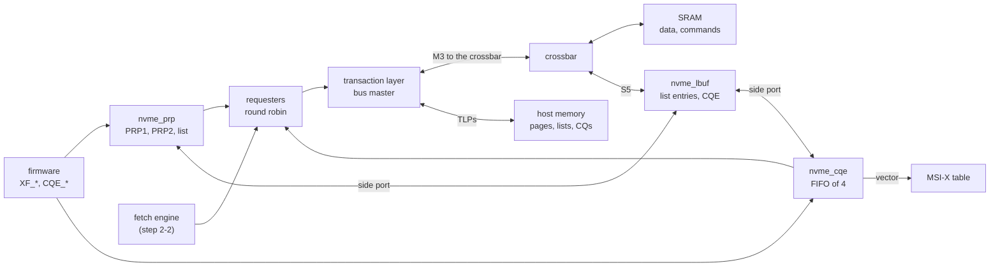

# NVMe data transfers and completions

Step 2-3 completes the NVMe-style controller's I/O path. Firmware moves a command's data between host memory and SRAM with a PRP engine, and posts its completion queue entry, which the hardware fills with the SQ head and the phase tag and follows with the queue's MSI-X vector. PRP list entries and completion entries pass through a small controller buffer on a new crossbar slave port. The firmware's command set (Identify, queue management, Read and Write on a namespace) and its cost per command are step 2-4. RTL, testbenches, firmware and scripts are at commit `569ad05`, and every result below was measured there.

The PRP and completion queue formats follow the NVM Express Base Specification as far as this document says. Compliance is not claimed.

> **Changed in step 2-5** ([14_nvme_host_verification.md](14_nvme_host_verification.md)): XF_CTRL and CQE_CTRL take the command's epoch. A start with another epoch, or with the controller not on, ends at once with cause 11 and moves nothing; such a post is discarded and counted (CQE_STATUS.STALE, STALE), not dropped as an error.

## Blocks

| Block | File | Role |
| --- | --- | --- |
| `nvme_prp` | `rtl/host/nvme/nvme_prp.sv` | PRP engine: PRP1, PRP2 or a PRP list (fetched in batches of up to 8, chained across list pages), one bus-master transfer per page |
| `nvme_cqe` | `rtl/host/nvme/nvme_cqe.sv` | Completion poster: a FIFO of 4 entries from firmware; waits while the queue is full; builds the 16-byte entry with SQ head and phase; writes it; requests the queue's MSI-X vector |
| `nvme_lbuf` | `rtl/host/nvme/nvme_lbuf.sv` | Controller buffer, 16 words of 64 bits in flops: an AXI4 slave on crossbar S5 (`0x5000_0000`) for the bus master, a side port for the two engines |
| `nvme_ctrl` | `rtl/host/nvme/nvme_ctrl.sv` | Step 2-2's controller, now with three bus-master requesters (fetch, PRP engine, poster) served round robin, and the completion queue tail and phase |
| `host_if` | `rtl/host/host_if.sv` | MSI-X requests: a HOST-register request first, the controller's one a clock later when both come at once |
| `soc_top` | `rtl/top/soc_top.sv` | The crossbar gets a sixth slave, S5, reachable from the host's port M3 only |



## What the firmware sees

NVME registers added at `0x4000_8000` (every field in [regs/soc_apb.md](regs/soc_apb.md)):

| Register | Use |
| --- | --- |
| XF_PRP1_LO/HI, XF_PRP2_LO/HI | The command's PRP entries, taken at START |
| XF_LADDR, XF_LEN | SRAM address (DW aligned, contiguous there) and length in bytes (a multiple of 4, 4 bytes to 128 KiB) |
| XF_CTRL | START, and D2H for SRAM to host (a Read); START while busy is ignored |
| XF_STATUS, XF_CYCLES | BUSY, DONE, ERR with a cause; clocks from START to the end. CTRL.IEN_XFER puts DONE and ERR on INTC source 3 |
| CQE_DW0, CQE_INFO, CQE_CTRL | An entry: DW0, CID and SQID, then the completion queue and the status field (SC, SCT, CRD, M, DNR). Writing CQE_CTRL queues it |
| CQE_STATUS, CQES | Entries waiting (0 to 4), FIFO full, the oldest waiting for room; DROP and WERR (write 1 to clear); entries written |
| EVENT.CQE_ERR | An entry dropped or its write failed |

A command, as `fw/tests/nvme.c` handles it: take it from CMD and copy its 64 bytes; return the slot; for a Read or a Write, give the engine PRP1, PRP2, the namespace address in SRAM and the length, start, and wait for DONE or ERR; map the cause to a status; post the entry with CQE_DW0, CQE_INFO and CQE_CTRL. Transfer causes: 1 to 7 the bus master's (an error completion, poisoned data, a completion timeout, Bus Master Enable clear, a local AXI error), 8 a length out of range, 9 a PRP entry with a bad offset, 10 aborted by a controller reset.

## PRP transfers

The memory page is 4 KiB (CC.MPS 0, the only size CAP offers).

- **PRP1** is the first page with the offset in it (DW aligned); it holds the first 4096 − offset bytes.
- **PRP2**, when the rest fits in one page, is that page and must be page aligned. When it does not fit, PRP2 points to a PRP list (8-byte aligned, any offset in its page).
- **List entries** must be page aligned. The engine reads them into the controller buffer in batches of up to 8 (one bus-master read of up to 64 bytes each). When more entries are needed than are left in a list page, the page's last entry points to the next list page, and the engine follows it.
- **One bus-master transfer per page**, in data order, each to the next SRAM address. The bus master splits each further at Max_Read_Request_Size or Max_Payload_Size, as in step 2-1.
- **Errors** end the transfer before its first byte moves (a length or PRP1 or PRP2 that breaks the rules) or between pages (a bad list entry or chain pointer, a bus-master error). A controller reset ends it after the page in flight.

## Completion queue entries

| DW | Contents |
| --- | --- |
| 0 | CQE_DW0 |
| 1 | 0 |
| 2 | SQID (31:16) and SQ head (15:0): the controller's fetch head of that submission queue when the entry is built |
| 3 | Status (31:17) from CQE_CTRL, phase tag (16), CID (15:0) |

- **Room.** The entry waits while its queue is full: the tail plus one equals the head the host last wrote to the queue's head doorbell. CQE_STATUS shows it waiting.
- **Order.** The entry is built in the controller buffer, written by the bus master to CQ base + 16 × tail, and the tail moves on in the clock the write ends; at the wrap the phase toggles. Only then is the queue's vector requested (admin queue: vector 0, always on; I/O queues: CQ_CFG.IV and IEN), and the next entry waits until the request is taken. The MSI-X message therefore follows its entry in the same TLP stream, and a masked vector stays pending in the PBA until the host unmasks it.
- **Drops.** An entry posted while 4 wait, or to a completion queue that is not enabled, is dropped (CQE_STATUS.DROP, EVENT.CQE_ERR). A failed write (only possible with Bus Master Enable clear) drops the entry and sets CSTS.CFS.
- **Reset.** A controller reset empties the FIFO once no write is in flight; posts during the reset are dropped.

## Design decisions

- **A controller buffer on the crossbar.** The bus master moves data only between host memory and AXI addresses. PRP list entries must reach the PRP engine, and a completion entry must be a source for the bus master. A 128-byte buffer on a new crossbar slave port does both with standard AXI, and the transaction layer stays as verified in steps 2-1 and 2-2. This is the NVMe slave port the roadmap planned; the registers and the fetches of step 2-2 had gone elsewhere.
- **List entries in batches of 8.** A whole list page (512 entries, 4 KiB) would cost 32 times the flops. With batches of 8, one 64-byte read covers 32 KiB of data, and the engine follows chained list pages the same way.
- **Hardware builds the entry, firmware decides it.** Firmware gives the CID, the SQID, the status and DW0. The SQ head and the phase tag come from the controller's own pointers at the moment of posting, so firmware never tracks them and two posts can never carry the same phase slot.
- **The tail moves in the clock the write ends.** A registered tail update would let the next entry check for room against the old tail and overwrite an entry the host has not read. It was found when the poster was written, before its first simulation.
- **MSI-X after the entry, acknowledged.** Requesting the vector only after the write, and holding the next entry until the request is taken, keeps the host from seeing the interrupt before the entry.
- **One transfer at a time, one bus-master transfer per page.** The PRP engine is simple and its errors fall between pages. The cost is the gap between pages (Limits).

## Verification

### Block testbench

`tb_nvme` (`make -C dv nvme`) now has the crossbar between the transaction layer's M3 and two slaves, as in `soc_top`: the memory model for SRAM and `nvme_lbuf`. The host model sets up the MSI-X table and enables MSI-X during enumeration. As an NVMe host it now:
- lays out data in host pages that are never adjacent, with PRP lists placed so that some run over the end of their list page;
- builds real submission entries (block count, starting LBA);
- takes completion entries by phase from every queue and checks CID, SQID, status, DW0 and the SQ head, and the data of every Read;
- learns the SQ head from the entries, as a host does.

The testbench as firmware moves every command's data by PRP, checks a Write's data in SRAM against the host's pages, and posts the entry. A new monitor checks that an SQ head only ever moves by one, or to 0 at an enable or a reset.

**New directed tests** (`+test=`; all pass):

| Test | What it checks |
| --- | --- |
| `data` | Write and Read, each through 10 layouts: one page, to the end of a page, over a page end (PRP2 a page), two pages, lists of 3, 15 (batches of 8 and 7) and 31 entries (128 KiB), 128 KiB − 512 from an offset, a list over two list pages, a full batch ending in the chain pointer; an Identify on the admin queue; Flush; an unknown opcode; PRP2 and a list pointer with bad offsets (PRP Offset Invalid). Every command gets exactly one MSI-X message on its queue's vector |
| `cqe` | Six entries on each of the five completion queues, so every phase wraps; a full queue holding an entry until the host frees a slot; the message arriving only after its entry; a masked vector pending until the unmask; drops to a queue that does not exist and with 4 waiting; a failed write with Bus Master Enable clear setting CSTS.CFS |
| `xerr` | Lengths 0 and 128 KiB + 4; PRP1 not DW aligned; a second-page PRP2 with an offset; a list entry with an offset; a chain pointer not 8-byte aligned; UR on the data read; a controller reset during a 128 KiB transfer (cause 10, the reset waits); a reset while a transfer and an entry wait for the bus master behind a fetch |

**Random I/O test** (`+test=io`): queues of 2 to 16 entries on four I/O queues and the admin queue; Reads and Writes of 512 bytes to 128 KiB with random offsets and list positions, Flushes, unknown opcodes and bad PRP entries; the host takes entries as they come and rings head doorbells late at times, so queues fill; a controller reset every 97 commands, with new queue sizes.

Over 10 seeds (`make -C dv nvme`), in all 0 errors:
- random I/O, 300 commands a seed: 2,281 completion entries taken and checked (2,177 good, 104 with the error status the command called for), 2,171 PRP transfers moving 13.5 MB to the host and 11.7 MB from it, 2,313 MSI-X messages, 30 controller resets;
- the random queue test of step 2-2, 2,000 commands a seed: 20,002 submitted, 16,341 fetched and checked, 39 controller resets (25 after a shutdown).

| Coverage (directed, throughput and random runs merged) | Result |
| --- | --- |
| Covergroups: step 2-2's, plus PRP layout (one page, two pages, list, chained list) by direction and length class; transfer causes (length, offset, bus master, abort); a queue waiting for room, the phase wrap, both kinds of drop, a failed entry write, a masked vector, a chain pointer taken, a full batch of 8; entries on every queue with both phases | 95 of 95 bins, all of them hit by the directed tests alone |
| Line, branch, expression (`rtl/host/nvme/`) | 96 of 107, 160 of 166, 269 of 288 |
| Toggle (`rtl/host/nvme/`) | 54.1% |

The 11 lines not hit are again the host-register read function, which Verilator does not count when a continuous assignment calls it. CI runs 3 seeds of 1,000 random queue commands and 150 random I/O commands.

**Throughput and latency** (`+test=perf`: the host answers after 2 clocks and takes every beat, the memory never stalls):

| Case | Clocks | Bytes per clock |
| --- | --- | --- |
| PRP transfer, 4 KiB, host to SRAM | 714 | 5.74 |
| PRP transfer, 4 KiB, SRAM to host | 615 | 6.66 |
| PRP transfer, 128 KiB (list of 31), host to SRAM | 23,291 | 5.63 |
| PRP transfer, 128 KiB, SRAM to host | 19,836 | 6.61 |
| Completion entry: CQE_CTRL write to the entry in host memory | 17 | |
| Completion entry: CQE_CTRL write to its MSI-X message at the host | 24 | |
| Doorbell to command in the FIFO (step 2-2's measure, now through the crossbar) | 36 | |

At 50 MHz, 6.6 bytes per clock is 330 MB/s out of SRAM and 5.6 is 282 MB/s into it.

### Mutation check

`make -C dv nvme-mut` (`dv/mutate_nvme.sh`) now plants bugs in any of the four NVMe files and also runs the new directed tests and a random I/O seed. All 27 are caught: step 2-2's 14 (the head-wrap mutant now by the new pointer monitor) and 13 new ones.

| Mutant | Bug | Caught by |
| --- | --- | --- |
| `first_room` | PRP1's offset ignored: the first page's data runs past its end | `data`: read data |
| `chain` | A list page's last entry never taken as the pointer | `data`: PRP Offset Invalid on a chained list |
| `lp_adv` | The next batch of list entries read from the same place | `data`: write data in SRAM |
| `prp2_chk` | A second-page PRP2 with an offset not refused | `data`: write data in SRAM |
| `laddr` | Every page to the same SRAM address | `data`: read data |
| `maxlen` | A length over 128 KiB not refused | `xerr`: wrong cause |
| `phase` | Phase tag always 1 | `cqe`: entry never seen after the wrap |
| `cq_full` | Entries written into a full completion queue | `cqe`: nothing waiting with the queue full |
| `sqhd` | SQ head 0 in every entry | `data`: SQ head check |
| `msix_vec` | Every queue signals vector 0 | `data`: no message on the queue's vector |
| `tail_wrap` | Completion queue tail does not wrap | `cqe`: entry never seen after the wrap |
| `f_done` | The fetch engine takes another requester's done as its own | `io`: a completion for a command never fetched |
| `werr_cfs` | A failed entry write does not set CSTS.CFS | `cqe` |

All 27 are caught: `data` 7, `cqe` 4, `fetch` 4, `rr` 3, `doorbell`, `reset` and `shutdown` 2 each, `ferr`, `xerr` and `io` 1 each.

The first version of the list had a 27th mutant that routed every done to the PRP engine. It survived because it changes nothing: the PRP engine and the poster wait for done only after their own request is taken, and the bus master runs one transfer at a time. The fetch engine is different, since it is busy before its request is taken, and its mutant (`f_done`) is caught.

### Transaction layer, power and register tests

- **Transaction layer.** `tl_core` did not change; `tb_tl` and `tl-mut` are as at `d3a786e` ([11_nvme_queues.md](11_nvme_queues.md)).
- **Power** (`make -C dv power`, `power-x`): PASS; `make -C dv power-mut`: 11 of 11.
- **Register tests** (`make -C dv ral`, xsim): the reset sequence covers 97 registers and the bit bash 124. XF_CTRL and CQE_CTRL are left out of the bit bash: a write starts a transfer or queues an entry. 64 behavior and decode checks, 0 failures, 12,170 APB transfers, UVM_ERROR 0, 11 UVM resource-name warnings as before. `make -C dv ral-mut`: 4 of 4.

### SoC

`fw/tests/nvme.c` now completes every command, so the host in `tb_soc` waits for completion entries instead of looking inside the design. The firmware keeps a namespace of 16 blocks of 512 bytes in SRAM (`0x1000_8000`). The host:
- creates I/O queue pair 1 with two admin commands, completed on the admin queue (vector 0);
- runs 7 I/O commands on it: a Write of 8 KiB from an offset whose PRP list sits in the last slot of a list page (so it chains), Reads of 4 KiB over two pages and of one block, a Write of 1 KiB over a page end, a Flush, an unknown opcode (Invalid Command Opcode) and a Write past the end (LBA Out of Range);
- checks every entry and the data it read back, and shuts the controller down.

| Part of `nvme` | Alone | With `+bg` |
| --- | --- | --- |
| 2 admin commands, doorbell to both entries on the admin queue | 796 clocks | 1,434 clocks |
| Write 8 KiB, chained list (XF_CYCLES) | 1,651 clocks | 2,609 clocks |
| Read 4 KiB over two pages | 653 clocks | 881 clocks |
| Read 512 bytes | 111 clocks | 139 clocks |
| Write 1 KiB over a page end | 290 clocks | 346 clocks |
| 7 I/O commands, first doorbell to the last entry | 136,410 clocks | 200,132 clocks |
| Read-back, statuses, MSI-X | All bytes as written; Invalid Command Opcode and LBA Out of Range where due; vector 0 twice, vector 1 seven times | Same |
| Whole test | Exit after 140,244 clocks, 0 errors | 205,188 clocks, 9,124 host requests (1.76 MB), 0 errors |

- **Where the clocks go.** The four transfers take 2,705 of the 136,410 clocks. Nearly all the rest is the test firmware comparing the 9 KiB it was sent with the host's pattern, byte by byte on the CPU. Step 2-4 measures the cost of firmware per command.
- **Other tests.** hello 712, memtest 293,459, irq 7,906, buserr 4,919, perf 420,009, dma 385,735, power 10,920, reset 9,770, host 156,072 and soc_app 462,896 clocks alone, all as at `d3a786e`. With `+bg`, memtest ran 24,301 host requests and soc_app 37,980, as before.
- **APB check** (`+apb_check`): unchanged and 0 errors; it reads the new VERSION, `0x0002_0003`.

### Synthesis, timing and CDC

`make -C flow` at `569ad05`, pre-layout as in [09_timing.md](09_timing.md).

**Area.** 115,766 cells and 1,504,900 µm² of standard cells, SRAM macros not counted: 117,006 µm² (8.4%) more than at `d3a786e`. By block (`flow/syn/area_by_block.py`, total 1,510,170 µm² with the fanout buffers; the NVMe split is by instance name and approximate):

| Block | Area (µm²) | Share |
| --- | --- | --- |
| NVMe controller, in all | 152,870 | 10.1% (50,311 at `d3a786e`) |
| of it: buffer (16 words of flops) | 36,107 | 2.4% |
| of it: PRP engine | 23,120 | 1.5% |
| of it: completion poster | 9,138 | 0.6% |
| of it: registers, queues, fetch, requesters | 84,506 | 5.6% |
| AXI4 crossbar (now 4 × 6) | 39,579 | 2.6% (31,808) |
| Transaction layer | 815,455 | 54.0% |
| DMA | 199,428 | 13.2% |
| CPU | 123,000 | 8.1% |

**Timing:**

| Corner | Setup WNS | Hold WNS | Worst setup by origin |
| --- | --- | --- | --- |
| `tt_025C_1v80` | +3.729 ns | +0.082 ns | CPU +3.73; transaction layer +6.43; NVMe controller +6.86; `pclk` +7.78 |
| `ff_100C_1v95` | +8.936 ns | −0.041 ns (TNS −0.340, SRAM input pins) | NVMe controller +12.27 |
| `ss_n40C_1v40` | −47.150 ns | +0.972 ns | CPU −47.2; NVMe controller −42.4; transaction layer −34.5; `pclk` −3.03 |

- **tt** meets every clock. The worst path is again a CPU path; its slack moved from +6.41 to +3.73 ns with no change in the CPU, as Yosys and ABC map the flattened design as a whole.
- **The NVMe controller's worst path** now runs from the poster's FIFO read pointer to the oldest entry's queue number, through that queue's base and tail, into the 62-bit add of the entry's host address: the same kind of path as step 2-2's fetch address. It meets tt with 6.9 ns to spare and misses ss by 42.4 ns. Keeping a running entry address per queue would cut it (P5 5-1).

**CDC check.** 33,864 flops, 32 latches and 4 SRAM macros; the same 49 synchronizer bits, 80 handshake registers, 8,927 FIFO words and 2,725 PMU controls as before, since everything new is on `clk_sys`. PASS.

## Findings

- **The tail update was a clock late** in the first version of the poster: the next entry checked for room against the old tail and could have overwritten an entry the host had not read. Found when the poster was written, before its first simulation; the tail now moves in the clock the write ends.
- **The testbench's SQ head check was wrong once a tail wraps past the command.** It compared positions modulo the queue size, so a late entry for an earlier lap looked out of range. The controller was right: a new monitor of the SQ head pointers saw it never jump. The check now counts all entries submitted.
- **The testbench host flooded the link.** It rang every doorbell on every loop, and the device's reads waited behind the posted writes until they timed out (bus-master cause 5). It now rings a doorbell only when its value moved, and not while its own send queue is long, the same lesson as the host model's in step 2-1.
- **Verilator copies module tasks with timing controls into every caller.** With step 2-3's tests the testbench's initial block became one coroutine of 241,000 lines of C++, a 15-minute build. The APB master is now a class (compiled once), every test is called from one place, and `data` runs a table: 62,000 lines and a 4-minute build with coverage.
- **A Verilator internal fault** came from hierarchical references to enum constants (`u_nv.C_ON`) once `nvme_ctrl` was a parameterized instance; the testbench uses the values.
- **Dead code in the PRP engine** (a branch the state machine never takes, and abort checks in two one-clock states) showed up as unhit lines and was removed.

## Limits

- **Throughput.** PRP transfers run at 5.6 to 5.7 bytes per clock host to SRAM and 6.6 SRAM to host, against 7.07 and 7.28 for one contiguous bus-master transfer (step 2-1): every page is its own bus-master transfer and the next starts only when it ends. Merging physically contiguous pages, or overlapping pages, would close most of the gap.
- **One data transfer at a time**, and the poster writes one entry at a time.
- **PRP only:** no SGLs; MPS 4 KiB only; at most 128 KiB per transfer.
- **No interrupt coalescing**, MSI-X only.
- **The controller buffer's window repeats** every 128 bytes inside its 4 KiB crossbar window.
- **Firmware posts every entry**: the hardware never completes a command by itself.
- **Shutdown** completes with entries still waiting for room in a full completion queue.

## How to run

```bash
make -C dv nvme                   # directed tests, throughput, SEEDS random queue and random I/O seeds
make -C dv nvme-mut               # 27 planted bugs, all must be caught
make -C dv soc                    # firmware tests, including fw/tests/nvme.c end to end
make -C dv ral                    # register tests with the new NVME registers (Vivado)
make -C flow                      # synthesis, CDC check, STA, area
```
