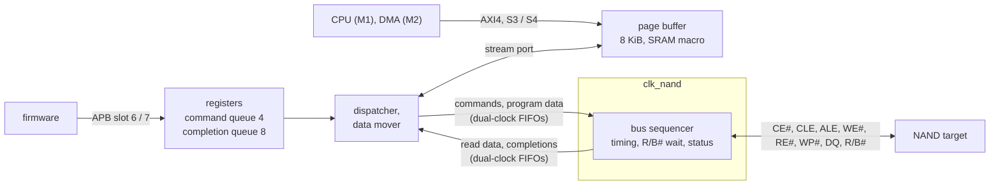

# NAND channel controllers

Step 3-1 builds the two NAND channels of the storage path. Each drives one NAND target over an 8-bit asynchronous interface in the style of ONFI. A bus sequencer in `clk_nand` runs these operations with timing that firmware sets:
- reset and read ID;
- page read and change read column;
- page program and block erase;
- read status.

On the `clk_sys` side, a command queue, a completion queue and a data mover connect the sequencer to an 8 KiB page buffer on the crossbar, where the CPU and the DMA put and take the data. The channels replace the plain memories that stood at S3 and S4 since step 1-4, at the same addresses.

A NAND model in the testbenches answers the commands and checks every interface rule in nanoseconds. RTL, testbenches, firmware and scripts are at commit `f67f5d6`, and every result below was measured there. The interface follows the general structure of the publicly available ONFI specification; compliance is not claimed.

## Blocks

| Block | File | Role |
| --- | --- | --- |
| `nand_ctrl` | `rtl/nand/nand_ctrl.sv` | One channel, `clk_sys` side: registers, a command queue of 4, the dispatcher, the data mover, a completion queue of 8, the clock-domain crossings, interrupts |
| `nand_seq` | `rtl/nand/nand_seq.sv` | Bus sequencer in `clk_nand`: the steps of each operation with the command's timing, the R/B# wait with its timeout, the status byte |
| `nand_pbuf` | `rtl/nand/nand_pbuf.sv` | Page buffer: 1024 words of 64 bits in one SRAM macro, an AXI4 slave on S3 or S4 and a stream port for the data mover |
| `nand_pkg` | `rtl/nand/nand_pkg.sv` | The command and the completion that cross between the two clock domains |
| `nand_regs` | `rtl/csr/gen/nand_regs.sv` | The registers, generated from `rtl/csr/rdl/soc_apb.rdl` (NAND0 and NAND1) |



## What firmware sees

**Page format.** A page is 4,096 bytes of main area and 224 of spare area, 4,320 in all; a block is 64 pages. A row address is block × 64 + page, a column the byte in the page, 0 to 4,319.

**A command.** Firmware puts the data in the page buffer for a program (with the CPU or the DMA) and writes CMD_ROW, CMD_COL, CMD_LEN and CMD_BUF. It then writes CMD_GO with an operation and a tag, which queues the command with those values. The channel runs its commands in order, one at a time, and moves LEN bytes between the bus and the page buffer from byte offset CMD_BUF. Each command ends with a completion in CPL: its tag, a code and the status byte.

| Register | Contents |
| --- | --- |
| CTRL | Write protect (WP# low while set, from reset); interrupt enables for a completion waiting and for an error |
| STATUS | Busy; R/B# as seen; commands waiting (0 to 4); completions waiting (0 to 8) |
| EVENT | A completion with a code other than 0; a command dropped because 4 were waiting (both write 1 to clear) |
| TIMING0, TIMING1 | Bus timing in `clk_nand` clocks (below); a command takes them as they are when it starts |
| TIMEOUT | The longest R/B# busy time, in units of 256 clocks; 0 waits without limit |
| CMD_ROW, CMD_COL, CMD_LEN, CMD_BUF, CMD_GO | The next command |
| CPL | The oldest completion, removed by the read: tag, code (0 done, 1 status fail, 2 busy timeout, 3 write protected), status byte |
| CYCLES, BUSY_TIME, COUNT | `clk_sys` clocks of the last command, `clk_nand` clocks it waited for R/B#, commands done and failed |

**Interrupts.** INTC sources 6 and 8 are raised while a completion waits on NAND0 or NAND1, and 7 and 9 while their EVENT.ERR or EVENT.OVF is set; each has an enable in CTRL. **Soft reset:** SYS SOFT_RESET.NAND0 and NAND1 reset both clock domains of a channel; its page buffer keeps its contents.

## The bus

Every output pin comes from a flop in `clk_nand`, and CE# is low from the first cycle of a command to its last. The operations, as the sequencer runs them:

| Operation | Steps |
| --- | --- |
| RESET | command FFh; wait tWB; wait for R/B# |
| READ_ID | command 90h; address CMD_COL; wait tWHR; LEN data cycles |
| READ | command 00h; 5 address cycles (column, row); command 30h; wait tWB; wait for R/B#; wait tRR; LEN data cycles |
| CHANGE READ COLUMN | command 05h; 2 column cycles; command E0h; wait tWHR; LEN data cycles |
| PROGRAM | command 80h; 5 address cycles; wait tADL; LEN data cycles; command 10h; wait tWB; wait for R/B#; command 70h; wait tWHR; status |
| ERASE | command 60h; 3 row cycles; command D0h; wait tWB; wait for R/B#; command 70h; wait tWHR; status |
| STATUS | command 70h; wait tWHR; status |

After a program or an erase, the status byte sets the code: 3 (write protected) if bit 7 is clear, 1 (failed) if bit 0 is set. A busy time past TIMEOUT ends the command with code 2 and CE# high; firmware then sends RESET.

| Timing | Field | Reset value | Fastest setting tested |
| --- | --- | --- | --- |
| WE# low, high (tWP, tWH) | TIMING0 | 3, 2 clocks (100 ns cycles) | 1, 1 (40 ns) |
| RE# low, high (tRP, tREH); DQ is sampled at the edge that raises RE# | TIMING0 | 3, 2 | 1, 1 |
| Confirm command to the first look at R/B# (tWB, plus the 2-flop synchronizer) | TIMING1 | 12 clocks | 8 |
| Last WE# rising to RE# falling, for status, ID and changed-column reads (tWHR) | TIMING1 | 6 | 5 |
| Last address cycle to the first data cycle (tADL) | TIMING1 | 10 | 4 |
| R/B# seen ready to the first RE# falling (tRR) | TIMING1 | 2 | 1 |

Back-to-back data cycles take tWP + tWH clocks (tRP + tREH), so the fastest setting moves one byte every two `clk_nand` clocks: 25 MB/s at 50 MHz, the rate `docs/01` planned. A command, address, wait or status step takes one clock more to start.

## Design decisions

- **Two halves.** Everything firmware deals with is in `clk_sys`, next to the registers: the queues, the dispatcher, the data mover. Only the sequencer, which has to count bus timing, runs on `clk_nand`. Four dual-clock FIFOs join them:
  - commands, sys to nand;
  - program data, a byte wide;
  - read data, a byte wide;
  - completions, nand to sys.

  R/B# crosses into each domain through a 2-flop synchronizer, and so does the write enable.
- **Timing travels with each command.** TIMING0, TIMING1 and TIMEOUT go into the command FIFO with the command, so no multi-bit setting crosses domains outside a FIFO, and a change applies from the next command on.
- **The page buffer serves the bus first.** The AXI side works exactly like the memory it replaces, and the data mover uses the SRAM port in clocks the bus leaves free. It does not read while an AXI beat waits for its master, since that beat is the memory's output. Every earlier firmware test therefore exits after the same number of clocks as before.
- **No completion can be lost.** A command is dispatched only with room for its completion: at most 8 wait, and a ninth command stays queued until firmware reads one.
- **A read byte enters its FIFO at the clock edge that samples it**, so the FIFO's full flag is exact when the next read cycle is decided, and data cycles can follow each other without a gap.
- **Write protect from reset.** WP# is low until firmware clears CTRL.WP, so nothing can be programmed or erased while firmware starts.

## The NAND model

`dv/tb/nand_model.sv` is a NAND target with the page format above, used by `tb_nand` and by `tb_soc` (one per channel):
- **Commands:** reset; read ID (address 00h or 20h, "ONFI"); page read into its page register; change read column; program, which ANDs the page register into the page, since flash only clears bits; erase of a block; status. Busy times are fixed knobs in this step, and step 3-2 makes them vary.
- **Refusals and failures:** with WP# low a program or erase is refused (status bit 7 clear). Knobs make the next program or erase fail, or hold R/B# busy until a reset.
- **Every interface rule the controller must keep, in nanoseconds** against the requirements the testbench sets:
  - WE# and RE# pulse widths and cycle times;
  - CLE, ALE, DQ and CE# setup to WE# rising, and CLE, ALE and DQ hold after it;
  - tWHR, tADL and tRR;
  - no command but status or reset while busy;
  - WE# and RE# never low together, nor CLE and ALE high together;
  - no cycle with CE# high, and DQ never driven by both sides.

  Read data is valid tREA after RE# falls, and an inverted byte is driven before that, so a read sampled early fails. R/B# falls tWB (100 ns) after the confirm command.

## Testbench and tests

`tb_nand` (`make -C dv nand`) puts `nand_ctrl` on its own with the model on its pins. The testbench plays two roles: the firmware on APB, and a bus master on the page buffer, with random gaps in RREADY in `arb`.
- **Expected data:** the testbench keeps its own copy of the array. Every read is compared with that copy, and so is the model's array itself after every program and erase.
- **Guard bytes:** written before and after every directed read must not change.
- **Clocks:** `clk_sys` is 20 ns; `clk_nand` is 20 ns out of phase, or 17 or 23 ns in the random runs.

| Test | What it covers |
| --- | --- |
| `regs` | Reset values, write masks, write-1-to-clear |
| `reset`, `id` | RESET and its busy time; READ_ID at 00h and 20h |
| `rw` | A whole page with its spare area; reads of the spare area, across main and spare, of one byte and of most of a page; change read column; a partial program, and a second program that only clears bits |
| `erase` | Programmed pages of a block erased |
| `fail`, `wp`, `timeout` | A failed program and erase (code 1, EVENT.ERR, the error interrupt); write protect (code 3, the page unchanged); a device stuck busy (code 2), then RESET |
| `timing` | The fastest setting against fast requirements, a mixed setting, the reset values against slow requirements, and the fastest setting against slow requirements, which the model must catch |
| `queue` | 4 commands behind a running one, a fifth dropped (EVENT.OVF), 8 completions holding back a ninth command, the done interrupt |
| `arb` | A whole page programmed and read back while the bus master writes and reads other bytes of the buffer, with RREADY gaps |
| `softreset` | The channel reset in the middle of a program's data cycles; then RESET and a read |
| `random` | Batches of up to 4 commands (reads, programs, erases, status, change read column) on random pages, columns, lengths, buffer offsets and timing settings |

**Assertions** (`dv/sva/nand_checker.sv`, bound into every `nand_seq` in `tb_nand` and `tb_soc`), in `clk_nand` clocks:
- WE# and RE# never low together, nor CLE and ALE high together;
- every cycle inside CE# low, and the bus idle while the sequencer is;
- DQ driven through every write cycle and never during a read cycle;
- each WE# and RE# low phase exactly the command's tWP and tRP, and each high phase between cycles at least tWH and tREH;
- no read byte pushed into a full FIFO, no program byte taken from an empty one.

`axi4_checker` watches the page buffer's port.

**Coverage:** 32 covergroup bins, all hit by the directed tests:
- operations and completion codes;
- lengths, from one byte to a whole page;
- data in the main area, the spare area or across both;
- buffer offsets aligned or not;
- queue and completion limits, interrupts and soft reset;
- timing settings, a caught violation, and streaming beside bus traffic.

## Results

`make -C dv nand`, `make -C dv nand-mut`, `make -C dv soc`, `make -C dv ral`, `make -C dv ral-mut` and `make -C flow`, all at `f67f5d6`.

### `tb_nand`

- **Directed and random runs.** 12 directed tests and 10 random seeds pass, with the assertions bound and none fired. `clk_nand` ran at 20, 17 and 23 ns in turn. The model found no interface violation except the one `timing` provokes on purpose.
- **Random load:** 10 runs of 300 commands moved 486,922 bytes to the device and 616,328 from it, under 2,244,656 interface checks in the model.
- **Coverage:** 32 of 32 covergroup bins. RTL coverage of `rtl/nand/` is line 99 of 107, branch 93 of 98, expression 173 of 179, toggle 80.2%.
- **Mutation check** (`make -C dv nand-mut`): 18 of 18 planted bugs caught.

  | Where | Mutants |
  | --- | --- |
  | Sequencer | command cycles without CLE; an address byte of the column or of the row always 0; R/B# looked at too early; no busy timeout; write protection reported as a failure; R/B# not waited for; WP# never low; tWH used for tWP; the status byte never read |
  | Channel | program bytes swapped; read data written as whole buffer words; a dropped command not reported; a command dispatched with no room for its completion; a read completed before its data was in the buffer; a failure not setting EVENT.ERR |
  | Page buffer | a stream read in place of an AXI beat that waits; a stream write in the clock of an AXI write |

  Two are caught first by an assertion: `nand_checker`'s WE# width, and `axi4_checker`'s rule that a beat waiting for its master does not change.

### Throughput

- **The bus** moves a byte every two `clk_nand` clocks at the fastest setting: 25 MB/s at 50 MHz.
- **A whole page** of 4,320 bytes, measured by `fw/tests/nand.c` in `tb_soc` from CYCLES and BUSY_TIME (the same in `tb_nand`):
  - a program takes 9,689 `clk_sys` clocks from dispatch to completion, 991 of them waiting for R/B# (the model's tPROG of 20 µs);
  - a read takes 8,924 clocks, 241 of them waiting for R/B# (tR of 5 µs).

  The rest is the 8,640 clocks of data cycles and the command, address and status cycles around them.

### SoC

- **`fw/tests/nand.c`** passes alone and with background traffic, in 390,182 and 390,368 clocks. On both channels it does:
  - RESET and READ_ID;
  - a whole page programmed, read back and compared;
  - the spare area read by CHANGE READ COLUMN;
  - both channels at once, with the done interrupts seen pending until the completions are taken;
  - a program refused under write protect.
- **Every earlier firmware test exits after the same number of clocks as at `c5e2b96`.** That includes `dma`, which copies through both page buffers (385,735 clocks), and `buserr`, which now finds its empty slot at `0x4000_9000`. `nvme_rand` is unchanged, with 81 of 81 bins.

### Register tests (xsim)

- The reset sequence covers 127 registers and the bit bash 151, NAND0 and NAND1 included; CMD_GO and CPL are left out of the bit bash, because a write queues a command and a read takes a completion.
- 74 behavior and decode checks, 0 failures, in 14,722 APB transfers; among them a STATUS command on each channel and its done interrupt.
- `ral-mut`: 4 of 4.

### Synthesis, timing and CDC

`make -C flow`, pre-layout as in [09_timing.md](09_timing.md).

**Area.** 127,053 cells and 1,685,007 µm² of standard cells, SRAM macros not counted: 176,959 µm² (11.7%) more than at `c5e2b96`. Two `sram_1024x64` macros now hold the page buffers, where two `sram_512x64` macros stood.

| Block | Area (µm²) | Share |
| --- | ---: | ---: |
| NAND0: registers, queues, data mover, crossings | 74,585 | 4.4% |
| NAND1: the same | 73,780 | 4.4% |
| NAND0 and NAND1 bus sequencers | 8,967 + 8,691 | 1.0% |
| NAND0 and NAND1 page buffer ports (macros not counted) | 4,257 + 3,870 | 0.5% |
| NAND channels in all, reset synchronizers included | 174,290 | 10.3% |
| Memory controllers (ROM and SRAM; 29,512 at `c5e2b96` with the two old page-buffer memories) | 22,632 | 1.3% |

**Timing:**

| Corner | Setup WNS | Hold WNS | Worst setup by origin |
| --- | --- | --- | --- |
| `tt_025C_1v80` | +3.547 ns | +0.106 ns | CPU +3.55; transaction layer +6.53; NVMe controller +7.87; `pclk` +7.62; `clk_nand` +13.17 |
| `ff_100C_1v95` | +8.834 ns | −0.023 ns (TNS −0.168, SRAM input pins) | `clk_nand` +13.40, hold +0.149 |
| `ss_n40C_1v40` | −52.089 ns | +1.040 ns | CPU −52.1; NVMe controller −35.2; transaction layer −35.1; `pclk` −3.85; `clk_nand` +0.326 |

`clk_nand` meets 50 MHz at every corner, ss included, with the NAND pins budgeted at 30% of the period on each side. The CPU's worst path at ss moved from −49.8 to −52.1 ns with no change in the CPU, as Yosys and ABC map the flattened design as a whole.

**CDC check.** 38,333 flops, 32 latches and 4 SRAM macros. The crossings: 119 synchronizer bits, 80 handshake registers, 10,237 FIFO words and 2,725 PMU controls; PASS.
- **Synchronizer bits:** 49 at `c5e2b96`. Each channel adds 35: R/B# into both domains, the write enable, and the Gray pointers of its four FIFOs.
- **Rule changes:** the check now knows the NAND pins (DQ inputs on `clk_nand`, R/B# asynchronous) and the channels' FIFOs.

## Found on the way

- **Logic in front of a synchronizer.** The write enable reached its synchronizer through an inverter. The CDC check of the netlist caught it, since the project's rule allows no logic there, after step 1-9. It is now a flop of its own that resets to 0, so WP# stays low from reset.
- **Two blind spots of the testbench, found by the mutation check.**
  - A row address byte stuck at 0 passed, because a program and the read after it went to the same wrong page; the testbench now checks the model's array after every program and erase.
  - A program that looked at R/B# too early passed, because the model's R/B# fell 60 ns after the confirm command. It now falls after 100 ns, the usual limit.
- **The testbench's bus master** first looked at READY after the clock edge and so waited for a handshake that had already happened; it now takes a handshake at the edge after a falling edge that sees VALID and READY high.

## Limits

- **One target per channel.** No CE# interleaving, cache or multi-plane operations, synchronous modes, parameter page, or SET FEATURES (the timing comes from TIMING0 and TIMING1).
- **One command at a time per channel and one page buffer:** the bus waits while firmware or the DMA fills the buffer for the next program.
- **Busy is waited for on R/B# only**, not by polling status.
- **No ECC:** step 3-3 adds BCH between the page buffer and the bus. Step 3-4 joins NVMe commands to the channels.
- **Fixed busy times in the model** (step 3-2 varies them and adds bit errors).
- **STA of the NAND pins** uses a plain 30% input and output budget against `clk_nand`; pad and board delays are left to layout.

## How to run

```bash
make -C dv nand                   # tb_nand: 12 directed tests, random seeds, assertions, 32 bins
make -C dv nand-mut               # [MUT] 18 of 18 mutants caught
make -C dv soc                    # every firmware test, the new nand test included
make -C flow                      # synthesis, CDC check, STA, area by block
```
