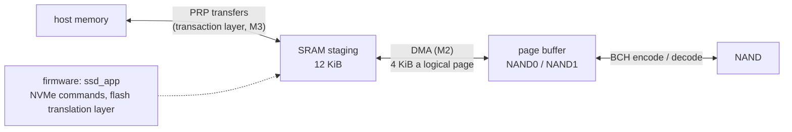

# NVMe on NAND

Step 3-4 puts the NVMe namespace on NAND. `ssd_app`, the NVMe firmware of step 2-4 built with a NAND backend, serves Read and Write through a flash translation layer. The layer keeps logical pages on both NAND channels, through the BCH path of step 3-3. The RTL does not change in this step. The host side is the NVMe host driver model of step 2-5, unchanged in what it checks. Firmware, testbench and scripts are at commit `a4d455b`, and every result below was measured there.

## The data path



The crossbar of step 1-3 gives the transaction layer's master (M3) the SRAM but not the page buffers, and the DMA (M2) both. So every byte crosses SRAM:
- **Read:** for each logical page the command touches, an ECC READ into the channel's page buffer, then a DMA copy to the staging area; then one PRP transfer of the blocks asked for to the host, and the completion.
- **Write:** a logical page the command covers only in part is read into the staging area first, so that its other blocks are kept. The PRP transfer then puts the host's data over the staging area. Each logical page is copied by DMA into a page buffer, gets its metadata, and is programmed with ECC; then the completion.

## What the host sees

| Item | Value |
| --- | --- |
| Namespace 1 | 256 blocks of 512 bytes (128 KiB): 32 logical pages of 8 blocks |
| MDTS | 1: 8 KiB, so that a command's data fits the 12 KiB staging area (8 KiB that do not start on a logical page touch three of them) |
| Write | Completed once its pages are programmed; no volatile write cache, so Flush has nothing to do |
| Statuses | Write Fault (SCT 2, SC 80h) when no page could be programmed; Unrecovered Read Error (SCT 2, SC 81h) when a codeword was past correcting; Invalid Field past MDTS; the rest as in step 2-4 |
| Blocks never written | Read as zeros |

## The flash translation layer

`fw/drv/ftl.c`:
- **The map.** One 16-bit entry for each logical page gives its physical page: the channel, the block and the page. Even logical pages are on NAND0, odd ones on NAND1.
- **Writes go to a new page.** Each channel fills one open block a page at a time, in order, as the NAND model's program rules require. A block is erased when it is opened, and a write never programs a page twice. The page a logical page leaves is not reclaimed: there is no garbage collection. Both channels together have 8,192 pages for the 32 logical pages, and the longest run here writes 359 of them.
- **Bad blocks.** At start-up the firmware reads the marker byte of the first and last page of every block on both channels. A block is bad when either byte has fewer than four 1 bits, so a raw bit error or two does not make a good block bad. A block whose erase or program fails is marked bad too, and a failed program is tried again in the next good block, up to four times.
- **Metadata.** The first metadata word of a page holds "LP" and the logical page number, the second a sequence number. Every read checks the first against the logical page it wanted.

The data moves between SRAM and the page buffers by DMA, 4 KiB at a time; the channel commands are polled.

## Design decisions

- **Logical pages of 4 KiB with 512-byte blocks.** The namespace keeps the format of step 2-4, so the host model needs no change in what it checks, and a page of NAND holds eight blocks, one codeword each. Writes of less than a logical page cost a read of it first.
- **Out-of-place writes, no garbage collection yet.** Programming pages in order into erased blocks is what NAND allows; the map makes a rewrite cheap. With far more pages than the namespace needs, the runs never run out, and reclaiming old pages is left for later.
- **MDTS of 8 KiB.** The PRP engine moves a command's data to one contiguous range of SRAM and cannot start part way into it, so the whole command has to fit the staging area at once.
- **One command at a time.** Each command's NAND operations run one after the other, as they come. The two channels are not used side by side, which keeps the firmware simple and leaves room for a scheduler later.

## Tests

`make -C dv soc` runs the host driver model of step 2-5 (`+test=nvme_rand`) against `ssd_app` with `+ssd`, alone and with background traffic:
- **The host.** The namespace of 256 blocks is written first, then large transfers with PRP lists, then six epochs of random Read, Write and Flush on four queue pairs, with controller resets in planned states. At most 16 blocks a command, and every limit on waiting 50 times longer than on SRAM. Every byte read is compared with the host's own copy of the namespace.
- **The NAND models:** busy times drawn per operation, 200 bit errors per million bits. NAND0 has factory bad block 1, and the first erase it gets fails. The first program NAND1 gets fails.
- **Performance**, after the namespace is written:
  - one command at a time: 16 each of 4 KiB reads and writes of whole logical pages, and 512-byte reads and writes;
  - 32 reads of 4 KiB with four outstanding.

## Results

`make -C dv soc` at `a4d455b`.

- **`nvme_rand` on `ssd_app`** passes alone and with background traffic, in 11,715,604 and 22,372,211 clocks. Alone:
  - the host issued 863 commands: 323 Read, 312 Write, 85 Flush, 78 admin. 779 completed, 65 of them with the error statuses the host meant to provoke, and 84 were abandoned by 5 controller resets;
  - 733,696 bytes were read and compared with the host's copy, and 676,352 written, with 0 errors;
  - the firmware read 695 logical pages and wrote 359, with 8 erases. The BCH path corrected 4,643 bits and found no codeword past correcting, and no metadata mismatched.
  - The 3 bad blocks were the factory one, the block whose erase failed and the one whose program failed; that program was done again in the next block.

  With background traffic, 850 commands and 834,560 bytes compared, 0 errors.
- **Pace**, alone, in `clk_sys` clocks at 50 MHz:

  | Command | Clocks | µs |
  | --- | ---: | ---: |
  | 4 KiB read | 11,637 | 232.7 |
  | 4 KiB write | 12,215 | 244.3 |
  | 512-byte read | 11,174 | 223.5 |
  | 512-byte write (read-modify-write) | 21,669 | 433.4 |
  | 32 reads of 4 KiB, four outstanding | 354,325 | 4,515 IOPS |

  - In the firmware's own count, a logical page takes 10,102 clocks to read and 10,655 to write. Most of it is the bus: 4,233 bytes at 40 ns each, 8,466 clocks.
  - On the SRAM namespace of step 2-4 ([13_nvme_firmware.md](13_nvme_firmware.md)), a 4 KiB read takes 1,400 clocks and 4 KiB reads one at a time reach 35,709 IOPS: NAND is about eight times slower.
  - Four commands outstanding are no faster than one, since the firmware runs one NAND operation at a time.
- **Every earlier firmware run is unchanged.** The 33 runs of `make -C dv soc` before this step exit after the same number of clocks, with the same host traffic, as at `2c9bc8b`. `nvme_rand` on `nvme_app` is among them, still hitting 81 of 81 bins.

## Limits

- **No garbage collection or wear leveling:** pages left behind are not reclaimed, and the device is full after 8,192 page writes.
- **The map is lost at power-off:** the metadata of each page would let firmware rebuild it, but no scan does yet.
- **One command at a time,** so queue depth does not raise IOPS, and the two channels do not work side by side.
- **A small namespace:** 128 KiB with an MDTS of 8 KiB, sized to the 12 KiB staging area in SRAM.

## How to run

```bash
make -C dv soc                    # every firmware test, nvme_rand on ssd_app (+ssd) included
```
